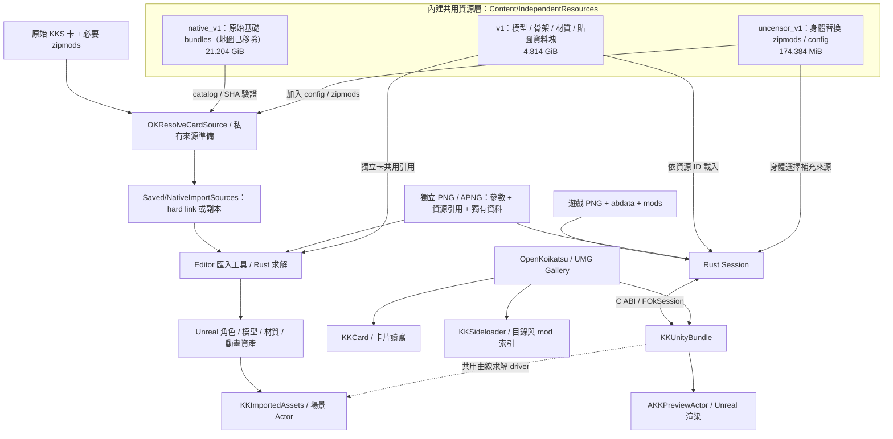

# AGENTS.md

給在這個專案工作的 AI agent 看的說明。使用者看的簡介在 [README.md](README.md)。

## 工作規則

- **回覆語言**：一律用繁體中文；程式碼、識別名稱、路徑、指令保持原文。
- **照使用者的決定做**：使用者做出的決定或指出的錯誤，直接照辦，不質疑、不反問、不二度確認；使用者說錯就是錯。
- **版控只放共用資源**（[Docs/BASE_LIBRARY_SHARED_RESOURCES_PLAN.md](Docs/BASE_LIBRARY_SHARED_RESOURCES_PLAN.md)）：
  - 角色卡（`Content/CharacterCards/`、`UserData/Studio/scene/*_cards/`、含角色的 Studio 樣本場景）與第三方 mod 轉出的模型只留本機，不要 `git add -f`。
  - commit 前的 hook 會擋下角色卡、OK 卡與含角色的 Studio 場景（`Tools/check_no_cards.lua`；新 checkout 先執行 `Tools/lua/lua.exe Tools/install_git_hooks.lua`，`--all` 可檢查全部已追蹤檔）。私有卡與測試卡只留本機。
  - 共用 mod 清單在 `Tools/base_library_shared_mods.txt`。轉換新 mod 後執行 `ok-extract <遊戲> --oklib shared-ignore <base_v1>` 重新產生 `Content/IndependentResources/base_v1/models/.gitignore` 再提交。
  - 改動基礎庫或 `gamefs`／`oklib` 後，在乾淨 clone 跑 `kks-verify` 與 `okcard-check ... live`，並和完整本機基礎庫的結果對照。
- **StreetSocialCity**：`StreetSocialCity/` 是使用者建模中的另一個 UE 專案，不進版控，也不要去動它。
- **遠端**：`origin` 是 `https://github.com/damody2026/OpenKoikatsu.git`；引擎分支 `UE5.8-physX-5.11-ok` 在 `https://github.com/damody2026/UnrealEngineOK.git`（引擎 checkout 的 remote `ok`，推送用 damody2026 帳號）；歷史從 2026-10-20 的單一 commit 開始，之後照一般方式 commit 與推送，不再壓 commit。單次推送超過 2 GB 會被 GitHub 拒絕。
- **雙線開發**：C（`C:\portable\OpenKoikatsu`，`master`，引擎 `D:\PhysX\UE5.8`）做大世界；E（`E:\OpenKoikatsu`，`duo2`，引擎 `E:\PhysX\UE5.8`）做 1 對 1 互動與 OK Studio。規則見 [Docs/DUAL_LINE_DEVELOPMENT.md](Docs/DUAL_LINE_DEVELOPMENT.md)。
- **腳本與工具**：專案腳本用 Lua（`Tools\lua\lua.exe`），不新增 `.py`／`.ps1`；交付的工具用 Rust。
- **錯誤紀錄**：做錯的事與修正寫進 `Docs/ERROR_LOG.md`（街頭相關寫 `Docs/STREET_ERRORS.md`），兩邊合併時兩邊的列都保留。
- **共用工作樹**：其他 session 可能同時改同一批檔案，只提交自己的 hunk。

## 打包街區交流 demo（StreetSocial.cmd 執行的版本）

`StreetSocial.cmd` 執行 `Saved/StreetSocial/Build/` 裡最新的 `*.stage`。從 Content 與 Source 重新打包：

```powershell
.\Tools\lua\lua.exe Tools\rebuild_street_social_runtime.lua --tag <名稱> [--engine <UE5.8>] [--base-dir Saved/StreetSocial/Base]
```

流程：建 Interaction host（`Saved/Interaction/FreeTalk01Host`，`Tools/prepare_interaction_runtime_host.lua`）與 Development 遊戲執行檔 → cook StreetSocial 地圖 → UAT 以 `-pak` staging 到 `--base-dir` → `Tools/stage_interaction_runtime.lua` 產生 `Saved/StreetSocial/Build/<名稱>.stage`。換了引擎建置要用新的 `--base-dir`（舊 stage 仍連到舊 base）。`.stage` 目錄裡有 junction，不要遞迴刪除；要換版本就用新的 tag。日誌在 `Saved/StreetSocial/Rebuild-<名稱>/`。

**完整流程只在整合時跑**：平常開發可以沿用既有的 base、只重編執行檔與 stage（`--skip-cook`／`--skip-base`）。整合 C／E 時一律跑完整流程（重新 cook 與 base，新 tag），兩邊的 `CardReaderDevelopment.cmd`、`StreetSocial.cmd` 都要編過並實際啟動確認，再刪掉舊的 stage、base 與 host。

**街區遊戲 MCP**：AI 操作遊戲一律用 `Tools/ok-game-mcp`（`.mcp.json` 的 `ok-game`；說明見 [Docs/STREET_SOCIAL_GAME_MCP.md](Docs/STREET_SOCIAL_GAME_MCP.md)）。它以 `-Control` 啟動遊戲，透過本機控制通道（`OKStreetSocialControl.inl`）走路、按鍵、按按鈕、對話、等時間、截圖、存讀檔，並能下主控台指令與錄 Unreal Insights trace（`game_exec`、`game_trace_start/stop`）；MCP 沒載入的 session 用 `Tools/ok-game-mcp/target/release/ok-game-mcp.exe call <工具> '<JSON>'`。以前的 `Tools/street_play.lua` 已移除。效能分析：啟動器 `-Trace <頻道>` 錄 `trace.utrace`，`-Exec "t.HitchFrameTimeThreshold 60,stat dumphitches"` 把每個卡頓幀的耗時寫進 game.log。

女角清單用 `-SelectionFile <json>`（`{"cards": [OK 卡路徑...]}`）。同一個 checkout 已有遊戲在跑（例如別的 session）時，加 `-Sandbox <名稱> [-PortBase N]` 另開一個：自己的連接埠（預設 48060 起，控制埠 N+10，ok-game-mcp 用 `OK_CONTROL_PORT` 指定）、存檔在 `Saved/StreetSocial/Sandbox/<名稱>/`，不停掉別人的語音伺服器。

## 倉庫內容與匯入角色（2026-10-20）

倉庫：`https://github.com/damody2026/OpenKoikatsu`（`master`）。歷史從 2026-10-20 的單一 commit 重新開始。

**版控只放共用資源**，角色卡與第三方 mod 轉出的模型不在倉庫內：

| 內容 | 在倉庫內 | 說明 |
|---|---|---|
| 原作轉出的 OK 模型、paired 動作、Studio 動畫與道具清單 | ✅ | `Content/IndependentResources/base_v1/`（Git LFS） |
| UncensorSelector 身體、全域 mod | ✅ | `KKS_UncensorSelector`、`KK_UncensorSelector`、`BetterPenetration`、`KKS_Fixes`、覆蓋原版路徑的 bundle、陰影 ramp、Material Editor 的 shader 包；清單在 [`Tools/base_library_shared_mods.txt`](Tools/base_library_shared_mods.txt) |
| 角色卡（原作卡、OK 卡、Studio 場景拆出的角色） | ❌ | 例如 `Content/CharacterCards/`、`UserData/Studio/scene/*_cards/` 只留在本機 |
| 其他第三方 mod（Sideloader Modpack、卡片包附帶的 mod）轉出的模型 | ❌ | `sources.okidx` 仍記著它們；開卡時改讀真正的 zipmod |

需要角色時，用自己的原作卡＋zipmod 匯入：

| 情境 | 讀到的資源 | 結果 |
|---|---|---|
| 指定遊戲路徑（`Config/DefaultGame.ini` 的 `Root`，或 CLI 的遊戲目錄參數） | 基礎庫＋遊戲 `mods/` 的實體 zipmod；遊戲的 `UserData/config/system.xml` 與 UncensorSelector 設定 | 與遊戲模式一致 |
| 只有卡片＋zipmod（zipmod 放在卡片旁邊） | 基礎庫＋卡片資料夾的 zipmod；UncensorSelector 設定依序找卡片旁的 `UncensorSelector.cfg`、專案 [`Config/UncensorSelector.cfg`](Config/UncensorSelector.cfg) | 能開；缺的 zipmod 會列出（轉 OK 卡時印在 `absent=`） |
| 只有原作卡（沒有 zipmod、沒有遊戲） | 只有基礎庫 | 卡片只用原作與共用資源時可完整還原；用到其他 mod 的部件會缺，並列出缺哪些 zipmod |
| OK 卡（`--oklib card`／`cards` 轉出的 APNG） | 基礎庫＋卡內資源包 `okLc` | 不需要遊戲與 zipmod；轉卡時用到的遊戲設定也錄在卡內 |

轉成 OK 卡：

```powershell
# 只有 zipmod 資料夾（名稱為 mods）：不讀遊戲任何東西，陰影 ramp、UncensorSelector 設定用共用資源（基礎庫、專案 Config/）
.\Tools\ok-extract\target\release\ok-extract.exe D:/KoikatuSunshine/mods --oklib card .\Content\IndependentResources\base_v1 <原作卡.png> <輸出.png>
# 有遊戲：卡片指名的 zipmod 由遊戲 mods/ 提供，設定用遊戲的
.\Tools\ok-extract\target\release\ok-extract.exe D:/KoikatuSunshine --oklib card .\Content\IndependentResources\base_v1 <原作卡.png> <輸出.png>
# 沒有遊戲：zipmod 放在卡片旁邊，遊戲目錄給一個不存在的路徑
.\Tools\ok-extract\target\release\ok-extract.exe X:/NoGame --oklib card .\Content\IndependentResources\base_v1 <卡片資料夾\原作卡.png> <輸出.png>
```

新增或轉換 mod 後，以 `ok-extract <遊戲> --oklib shared-ignore <基礎庫>` 重新產生 `base_v1/models/.gitignore`，再提交。驗收方式與結果見 [基礎庫共用資源與版控計畫](Docs/BASE_LIBRARY_SHARED_RESOURCES_PLAN.md)；基礎庫格式見 [OK 基礎模型庫](Docs/OK_BASE_LIBRARY_PLAN.md)。下方「共用資源、快取與打包」一節的 `v1`／`native_v1` 盤點是 2026-10-11 的歷史紀錄。

## 目前可用的功能

已轉換的獨立 PNG／APNG 可使用程式共用資源包預覽或匯入為 Unreal 資產；Editor 的原始 KKS 卡匯入另外使用 `native_v1` 基礎資源包與 zipmod 解析，不要求 KKS 遊戲本體。這兩種資源包用途不同，也不能視為涵蓋所有卡片。九套服裝的早期資產及 Cook 驗證見 [獨立卡匯入](Docs/INDEPENDENT_ASSET_IMPORT358.md)、[來源 mip 保存](Docs/INDEPENDENT_ASSET_MIPS359.md)、[骨架資源](Docs/INDEPENDENT_ASSET_SKIN360.md)、[morph 保存](Docs/INDEPENDENT_ASSET_MORPH361.md)；後續原始卡匯入及完整部件動畫見 [匯入介面](Docs/CARD_IMPORTER_NATIVE365.md)、[原生資源包](Docs/NATIVE_RESOURCE_COPY368.md)、[完整部件動畫](Docs/COMPLETE_CHARACTER_ANIMATION372.md)。

| 項目 | 當前狀態 |
|---|---|
| PNG 人物卡 | 讀取資料、PNG／APNG 預覽；Gallery 可另存暱稱與已支援身形數值，輸出目錄由使用者指定，獨立卡可另存四視圖 APNG。 |
| 卡片牆 | 支援遊戲人物卡目錄及獨立卡資料夾，選卡、背景載入 3D、切換服裝及動畫。 |
| 角色組裝 | 依卡片載入身體、頭部、頭髮、衣服與飾品；解析 zipmod GUID、資源覆寫、UncensorSelector、ABM／ABMX 等已接入的來源資料。頭髮可選 PBR 或原作髮材質，另有 Tripo 頭髮接入流程（見 [Tripo 頭髮 APNG](Docs/TRIPO_HAIR_APNG.md)）。 |
| 身形調整 | Gallery 提供身體 44 項、臉部 52 項，共 96 個即時滑桿；尚不代表所有編輯結果已能完整寫回人物卡。 |
| 3D 顯示 | Rust Session 經 C ABI 傳入 UE；具備 SkeletalMesh／GPU 蒙皮、共用骨架、私有附件骨架、材質、外框及 OBJ 備援載入。 |
| 表情與視線 | 嘴型及開合、眉眼 BlendShape、眨眼與表情時鐘、手型、眼睛視線與來源 EyeLook 已有專項比對。 |
| 動態骨骼 | 已接入身體 DynamicBone_Ver02、普通髮／衣物動態及部分來源碰撞政策；遊戲動畫與外部 UE 動畫共用後處理。 |
| 動畫目錄 | UE 內已有總覽 DataAsset 及八張 DataTable，保存來源識別、原始欄位與雜湊；包含 29,956 列動畫 metadata，並非同數量的烘焙 UAnimSequence。 |
| Animator 取樣 | 明確選取 state、1D／巢狀 1D、Cartesian 2D、來源速度與 motion 時間倍率、遮罩、Additive、多個選定層及各層獨立時鐘。 |
| Studio 初始化 | LoadAnime、來源 override 身分、部分同步 motion set、Yure enable／形狀政策及 PV 手腳複製與 FK 開關語義。 |
| 動畫過渡 | 有 trigger self re-entry、base／layer CrossFade 與多層過渡實作及測試；完整支援邊界需按來源 controller 與專項驗證確認。 |
| Unreal 資產播放 | 保存角色、完整 renderer 的 skeletal 資產、烘焙動畫及共用原作曲線；角色與動畫可在沒有原遊戲安裝的環境播放。 |
| 配對與語音 | 雙角色共用時鐘／接觸求解、一般語音與配對呼吸、PCM 音量嘴型。 |
| 百人房間 | `/Game/Scenes/CrowdRoom/CrowdRoom`：前 100 張女角依固定順序匯入、每張第 0 套服裝，以 60 Hz 烘焙行走片段與 GPU 群組動畫顯示；完整服裝 APNG 位於 `Content/CharacterCards/CrowdAPNG/`（目錄內 101 個 PNG）。見 [百人房間](Docs/CROWD_ROOM.md)、[完整服裝 APNG](Docs/CROWD_APNG.md)。 |
| 街區交流 demo | `/Game/Scenes/StreetSocial/StreetSocial`：獨立製作的一男五女街區，含對話、語音、邀約、電話、觸碰與數個互動動作。以 `StreetSocial.cmd` 啟動，操作見 [街區交流操作](Docs/STREET_SOCIAL_PLAY_GUIDE.md)。這是 demo，不是完整遊戲。 |
| 人物編輯 MCP | 啟動人物編輯器時加入 `-CharacterMCP`，外部 AI 可透過 Rust stdio server（31 個工具）查詢與調整參數，並拍攝正／側／背三視圖。見 [使用說明](Docs/CHARACTER_EDITOR_MCP_USAGE.md)。 |
| 油漆水槍示範 | `/Game/PaintDemo/PaintDemo`：以 1024×1024 雙 Render Target 遮罩將白色油漆噴在示範人物上，見 [Stage396](Docs/PAINT_SPRAY396.md)。 |

以上支援限於已實作並驗證的來源路徑，不表示所有卡片、mod、controller 或 Studio 動作均可播放。

## 詳細程式架構

### 整體分層與兩條資料流程

主線採 **Unreal C++ 顯示／操作 + Rust 來源資料與求解**。C++ 管理 UObject、UMG、Actor、渲染及音訊；Rust 處理人物卡、Unity 資源、骨架／身形、來源動畫及動態骨。兩者以靜態連結的 C ABI 溝通，正常 Gallery 載入不會啟動外部 Rust CLI 程序。

**內建共用資源是獨立的一層**，安裝於 `Content/IndependentResources/`，由多張卡片及匯入工作共用。它包含原始基礎 bundle 庫 `native_v1`、獨立卡拆分資源 `v1`、身體替換來源 `uncensor_v1`；卡片保存參數／引用，載入器再將所需共用內容組裝成 Session 或 Unreal 資產。圖中容量是目前本機檔案長度，細分內容見「大量共用資源的內容與檔案大小」。



兩條流程分別是：**即時預覽**將來源卡或獨立卡與所需共用資源載入 Session，再交給 PreviewActor 顯示；**Unreal 資產匯入**將原始卡與 `native_v1`／補充 mod 建成私有來源，或從獨立卡與 `v1` 重建，最後保存可播放的 `.uasset`。已保存的 Unreal 資產不必在播放時重新讀取整個 `native_v1`。

| 使用方式 | 輸入及依賴 | 執行時負責的模組 |
|---|---|---|
| 遊戲目錄即時預覽 | 原始卡、GameRoot 下的 `abdata`／`mods`；已安裝的 `uncensor_v1` 提供身體替換補充來源 | Gallery → `FOkSession` → Rust → `AKKPreviewActor` |
| 獨立卡即時預覽 | 含 `okPv` 的 PNG／APNG，或舊 `.okpreview`；共用引用卡另需 `IndependentResources/v1` | 相同預覽架構，使用 portable 載入分支 |
| Editor 匯入原始卡 | 原始 KKS PNG、`native_v1` 基礎包、已安裝的 `uncensor_v1` 與必要 zipmod | `KKCardImporterEditor` → 私有來源準備 → `KKUnityBundle` 匯入器 |
| 保存資產後播放 | 已匯入角色與動畫 `.uasset` | `KKImportedAssets`；共用原作曲線求解另外需要 `KKUnityBundle` driver |

### Unreal 模組與依賴邊界

專案入口在 `OpenKoikatsu.uproject`。`KKUnityBundle.uplugin` 同時宣告 Runtime 模組 `KKUnityBundle`、Editor 模組 `KKCardImporterEditor`，並啟用 `KKImportedAssets`。Editor 工具不編入一般 Runtime 模組的 UI 啟動流程。

| 模組 | 核心職責與主要程式 | 專案內主要依賴 |
|---|---|---|
| `OpenKoikatsu` | `OpenKoikatsuGameMode`、`OKHUD`、`OKGalleryWidget`、PlayerController；串接卡片、預覽、相機及操作 | `KKCard`、`KKSideloader`、`KKUnityBundle`，以及 UMG／Slate |
| `KKCard` | `KKCardReader`、`KKCardWriter`、`KKPng`、`KKMsgpack`、`KKAnimatedPng`、`KKCardWorkspace`；卡片結構、讀寫、預覽與工作目錄 | UE Core／CoreUObject／Engine；不依賴 Rust 求解器 |
| `KKSideloader` | `KKGameRoot`、`KKModIndex`、`KKLocalMods`；遊戲目錄、manifest／GUID 索引、缺失與衝突診斷 | `KKCard`、JSON／XML／zlib |
| `KKUnityBundle` | `KKRustExtract`、`KKPreviewActor`、`KKSkeletalBuilder`、材質／貼圖、語音、配對播放及匯入器 | `KKImportedAssets`、Rust 靜態庫、渲染／音訊模組；Editor 建置另依賴卡片、sideloader 與資產建置模組 |
| `KKCardImporterEditor` | Editor 的 Tools／Content Browser 選單、輸入驗證與匯入服務 | `KKUnityBundle`、`KKImportedAssets`、UnrealEd／ToolMenus／ContentBrowser |
| `KKImportedAssets` | `UKKImportedCharacter`、動畫資產、`AKKImportedCharacterActor`、`UKKImportedPoseComponent`；保存資產的組裝及播放 | Core／CoreUObject／Engine；Editor 額外動態載入 AnimationDataController |
| `KKRuntimePose` | 即時 Runtime 姿態：`KKRuntimePoseBank`、姿態快取與排程、render mesh／rig、shadow 提交、語音及 GPU 磁碟快取；內含共用 shader（`SharedShaders/`） | `KKUnityBundle`／渲染模組；於 `OpenKoikatsu.uproject` 啟用 |
| `KKCrowdGpuPacking` | 人群房間的 GPU 動畫打包：動畫 bundle／manifest、clip 視窗、常駐形變、skin palette、材質與 coating 的 GPU 播放；內含 `.spec.cpp` 測試 | 由 `OpenKoikatsu.Build.cs` 引入；於 `.uproject` 啟用 |

應用層的人群與街區程式位於 `Source/OpenKoikatsu/`：`OKCrowd*`（百人房間、GPU 姿態、LOD、房間環境）、`OKStreetSocial*`（街區場景、對話、邀約、電話、觸碰與互動）、`OKPaint*`（油漆水槍）、`OKCharacterMCP*`（人物編輯 MCP 登錄與幾何）、`OKInteraction*`（雙人互動）。百人房間由 `AOKCrowdGameMode`（`OKCrowdScene.h`）指定，油漆示範為 `AOKPaintDemoGameMode`；街區場景以 `OKStreetSocialScene` 組成。專案預設 GameMode 仍是 `AOpenKoikatsuGameMode`。

依賴方向的重點是：`KKImportedAssets` 不反向依賴人物卡 parser 或 Rust。它以 `IKKSharedAnimationDriver` 介面取得可選求解能力；`KKUnityBundle::StartupModule` 註冊原生 driver，Shutdown 時清除 factory。已烘焙的 `UAnimSequence` 播放可只使用 `KKImportedAssets`，共用曲線播放則透過註冊 driver 建立每個角色自己的 Session。

### 啟動、UI 與相機

`Config/DefaultEngine.ini` 指定預設 GameMode 為 `AOpenKoikatsuGameMode`，預設地圖是引擎 Template_Default。GameMode 設定 `AOKHUD`、`AOpenKoikatsuPlayerController` 與 SpectatorPawn；HUD 在 `BeginPlay` 建立 `UOKGalleryWidget` 並加入 viewport。

`UOKGalleryWidget::RebuildWidget` 以 C++ 的 `WidgetTree` 建立 UMG。主要區域是卡片列表／資料檢視、身體與臉部參數、3D 預覽空間、動作與表情；`SetModelLayout` 切換列表及模型操作版面。UI 事件呼叫 Actor／Session API，沒有另一套獨立的前端服務或網路後端。

| 程式 | 用途 |
|---|---|
| `OKGalleryWidget.cpp/.h` | 掃描、分頁、選卡、服裝、非同步載入、動畫目錄與控制項、配對角色、另存 |
| `OKShapeSlider` | 身體／臉部及來源動畫參數的滑桿回呼與數值標籤 |
| `OKCardRowButton` | 卡片列的選取事件 |
| `OKMotionComboBox` | 動作區選單共用樣式；深色背景、明確白字、hover／selected 狀態與字級 |
| `OKGallerySpeech.cpp` | Gallery 語音資料載入、聲線與播放 UI |
| `OKCardPreviewCapture.cpp` | 獨立卡四視圖擷取，供 APNG 預覽保存 |
| `OpenKoikatsuPlayerController.cpp`、`OKCameraDrag.h` | 滑鼠 gesture、UI 命中／focus、相機 owner 與拖曳狀態 |

3D 相機與構圖由 `AKKPreviewActor` 的 StudioCam／orbit API 管理。Controller 將輸入送給目前相機 owner：左鍵旋轉、中鍵平移、右鍵升降／拉近拉遠、左右同按平移、滾輪縮放。UI 使用 NoCapture 保留按鈕／滑桿點擊；滑鼠按鍵在 Slate 可用時從 `FSlateApplication` 讀取，避免只查 PlayerInput 而漏掉 viewport 未捕捉的按鍵。gesture 從 UI 開始或失焦時不接管相機，詳見 [相機輸入](Docs/CAMERA_INPUT390.md)。

### 卡片格式、來源解析與保存

Unreal 的 `FKKCharacterFile` 保存卡片中繼資料、身形／臉部、Coordinate、mod resolve 資訊及原始 bytes。`KKCardReader` 處理 PNG 後的來源卡資料與 MessagePack；Rust 的 `card.rs` 則提供提取／求解流程所需的解析。兩者服務不同邊界，修改格式時需同時確認顯示、轉換與保存契約。

`KKCardWorkspace` 管理獨立卡及輸出目錄，並判斷可攜資源來源；`FKKAnimatedPng` 解析／建立 APNG，Gallery `NativeTick` 按各 frame duration 更新 2D 預覽。APNG 的預覽影格與 3D 模型動畫是不同資料，不能將 APNG 播放視為來源骨骼動畫。

原始卡 Editor 匯入使用 `OKResolveCardSource`：驗證 PNG chunk、辨識 `okPv`，對原始卡讀取 `native_v1/catalog.json`，排除 `abdata/map/` 與 `abdata/studio/map/` 場景來源後，核對保留 bundle 的大小與 SHA-256，在 `Saved/NativeImportSources/<GUID>/` 建立私有 `abdata`／`mods` 視圖。被排除的場景 payload 不必安裝，索引中繼資料仍會驗證；其他類別尚未依單一卡片裁剪。Windows 優先使用 hard link，跨磁碟時使用複製；資源索引及 zipmod 衝突失敗會回報錯誤。`KKLocalMods` 處理匯入用 zipmod 發現與 GUID；找到 manifest 不代表該 mod 的全部 3D 功能已支援。

Gallery 的 `OnSave` 使用 `KKCardWriter::SaveWithEdits` 另存，保留原預覽並寫入已支援的編輯；必要時複製舊 sidecar 或已找到的 zipmod。`OnSaveApng` 要求目前載入的是同卡、同服裝的 portable Session，以更新後模型擷取四視圖，再組成 APNG 保存。這些 API 不代表完整捏人、所有 KKEx／MaterialEditor 設定都能來回還原。

### 即時載入、非同步工作與生命週期

```text
SelectIndex / Outfit 選擇
  → OnLoad3D：擷取 CardPath、GameRoot、Outfit、LoadGeneration
  → worker thread：FOkSession::Open → Rust 解碼／組裝
  → game thread：FinishLoad3D → Spawn AKKPreviewActor
  → 移交 Session → LoadSession 建立 Unreal 顯示資源
  → 同步身形、表情／手型、動畫目錄、語音及相機
  → 切換模型版面，後續由 Actor Tick 更新
```

背景工作以 weak widget reference 與 generation 防止舊結果寫回新狀態；載入中的選取／服裝操作受 busy 狀態保護。換角色時先保留 `StalePreview`，待新 Actor 準備好才替換，失敗時可恢復既有顯示。普通遊戲來源在 Session／顯示載入失敗時仍有 `OKExtractCard` → OBJ 目錄載入備援；獨立卡不回退讀遊戲資料。

來源動畫切換另有 `AnimationPrepareGeneration`、pending job、Actor identity 與 `LoadGeneration` 檢查；配對動作有自己的 `PairPrepareGeneration`。來源／clip 預備在 worker 執行，返回 game thread 後才提交現用 Actor；取消或舊結果不應覆蓋最新選擇。這不是所有 UObject 工作都搬到背景：Actor、UMG 與 Unreal 渲染資源建立仍由 game thread 完成。

`FOkSession` 是可移動、不可複製的 C++ RAII handle；析構時 Close，移交給 Actor 後由該 Actor 的 Session 管理 Rust 狀態。不可把相同可變 Session 當成多角色共用求解器；共用資源與每角色可變狀態分開保存。

### Rust 核心與 C ABI

`Tools/ok-extract/Cargo.toml` 產生 `ok_extract` 的 `staticlib`／`rlib` 與 `ok-extract` CLI。`include/ok_extract.h` 定義 C 結構及呼叫契約，`ffi.rs`／`lib.rs` 提供匯出入口；Unreal 的 `KKRustExtract.cpp` 透過 `ok_register_bindings` 註冊 log callback 及取得函式表，再封裝為 `FOkSession`。

| Rust 程式／群組 | 主要責任 |
|---|---|
| `card.rs`、`list.rs`、`mods.rs` | 人物／服裝資料、ChaList、GUID 與 bundle override 解析 |
| `unity.rs`、`unity/references.rs` | Unity bundle 與 `ParsedBundle`（記錄查詢）、物件參照 |
| `unity/mesh_channels.rs`、`unity/mesh_decode.rs`、`unity/textures.rs`、`unity/tints.rs`、`unity/prefabs.rs`、`unity/clothes_states.rs` | 頂點欄位；UV／顏色／權重／索引／skin／blend shape；Texture2D 轉 PNG 與貼圖查找；頭髮與身體配色、overtex；基礎 bundle、prefab 圖與 maindata 網格查詢；穿著狀態 scope |
| `session.rs` | 部件與角色狀態、身形初始化、動畫幀、骨架／palette、物理及輸出協調 |
| `extract.rs` | 開卡主流程 `extract_session_from_info`（依 OK_PROFILE 的階段逐步拆成函式，例如 `lists_stage`；見 [重構計畫](Docs/OK_EXTRACT_REFACTOR_PLAN.md)） |
| `entries.rs`、`push.rs` | 清單項目轉網格（entry 記憶、穿著狀態規則、預取）；部件推送進 session（`PushCtx`／`PushBatch`、`push_meshes`） |
| `texture_bake.rs`、`catalog_textures.rs`、`clothes_texture.rs`、`face_texture.rs` | 貼圖：PNG 與 sRGB 工具、眼白／虹膜烘焙；目錄貼圖與衣服 create 槽；衣服圖樣、GPU／CPU 顏色遮罩、over mask；臉部貼圖與合成 |
| `head_body.rs`、`face_shapes.rs`、`accessories.rs`、`material_editor.rs` | 頭部與身體部件、uncensor；嘴型與 FBS 權重；頭髮與配件上色、選取穿著的衣服；Material Editor 與渲染設定 |
| `placement.rs`、`rig.rs` | 部件寫出、蒙皮、掛點鏈與配件擺放；`rig_mesh`、`remap_part_to_body` |
| `pose.rs`、`shape.rs`、`shape/hand.rs`、`abmx.rs` | 骨架階層／矩陣、身體與臉部 shape keys、手型、ABM／ABMX |
| `anim.rs`、`anim/controller.rs`、`anim/crossfade.rs` | clip／state 取樣、blend tree、layers／mask／Additive、過渡與時鐘 |
| `anim/yure.rs`、`pv.rs` | Studio Yure 與 PV／FK 對應語義 |
| `h_playback.rs`、`finalik.rs` | 配對 frame、MotionIK／FinalIK 相關求解 |
| `dbone.rs`、`dbone/` | 身體 Ver02、普通髮／衣物、配件、碰撞與植入 rig 動態 |
| `eye_look.rs`、`eye_gaze.rs` | 來源眼睛追視與材質視線控制 |
| `face_create*.rs`、`clothes_gpu.rs/.cpp`、`skin_source.rs` | 臉／衣服合成、來源 skin 與 GPU 輔助處理 |
| `skel_export.rs` | 供 Unreal 使用的骨架／morph／skin 資料輸出 |
| `portable.rs`、`portable_resources.rs`、`portable_outfits.rs` | 獨立封包、共用資源 ID、全服裝資料及重建 |
| `sqlcache.rs` | SQLite 持久快取與 mod inventory／解析資源快取 |
| `main.rs`、`bin/ok-preview-pack.rs` | 離線抽取、診斷及獨立卡建包命令 |
| `bin/ok-appearance`、`ok-crowd-pack`、`ok-hair-pack`、`ok-normalize-pack`、`ok-vertex-color-card`、`ok-load-benchmark` | 外觀請求重現、人群包與頭髮包建置、網格正規化、頂點色卡及載入基準 |
| `appearance.rs`、`appearance/` | 外觀候選、即時服裝可見度、屬性與 live head 更新 |
| `Tools/character_mcp/`（獨立 Rust 執行檔） | 人物編輯 MCP：`rmcp` stdio server，31 個工具，影像、遮罩、截面量測與搜尋皆在同一執行檔處理 |
| `Tools/vendor/instant-meshes/` | Instant Meshes 的 Rust 移植，已收入專案但尚未接進提取程式 |

C ABI 傳遞的是明確的 mesh／bone／morph／texture／palette view，並以 UTF-8 傳遞字串與錯誤。部分 view pointer 借用 Rust Session 記憶體，僅在相應契約允許的期間有效；Session mutation／Close 後不能保留使用。Unreal 需要保存或建立資源時應複製資料，而非持有跨更新的來源指標。Rust 解碼快取與 Session 也不是 UObject，不能交給 Unreal GC 管理。

### 骨架、蒙皮、材質與每幀更新

`AKKPreviewActor::LoadSession` 將 Session 部件轉成 Unreal mesh、貼圖與材質，建立骨架 follower、私有 rig 或 rigid 附件所需顯示元件。`KKSkeletalBuilder` 負責骨架 mesh 建置；`KKTextureRuntime` 處理來源貼圖與 mip；`KKForgeOpaque`／`KKForgeAlpha`／`KKForgeItem`／`KKMainItemPlus` 封裝部分來源 shader 家族。`KKObjLoader` 保留離線 OBJ 備援。

Unity 與 Unreal 的單位、座標及 skin 矩陣轉換由對應橋接／建置程式集中處理。即時 GPU follower 路徑更新骨架／palette，身形滑桿在有 follower 時不走全身 CPU `Skin()` 重寫頂點；程序 mesh 備援仍可使用 CPU skin。

保存完整動畫資產還需處理私有 renderer 的原始 `world * bind` affine palette。`KKExactSkinning` 使用每 slot 三個 rank-one TRS palette alias bones 表示 shear／reflection 等矩陣，避免用單一 TRS 造成失真；匯入器保存原骨名／父子關係、權重、區段、UV、頂點色與 morph。來源 skin hash 用來核對模型與動畫 snapshot 是否相容。詳見 [完整部件動畫](Docs/COMPLETE_CHARACTER_ANIMATION372.md)。

單角色的 `AKKPreviewActor::Tick` 主要順序是：

1. 推進語音並維持目前 StudioCam 的 view target。
2. 有 shape dirty 或正在播放時執行 `ApplyPoseFrame`；來源動畫送 `ApplyAnimFrame`，Unreal 動畫則經外部 body frame 路徑進入 Rust 後處理。
3. Session 取樣姿態、手型及已接入的 PV／IK／動態骨邏輯，更新顯示所需骨架／palette。
4. 推進 EyeLook 與獨立 face clock／眨眼／表情過渡，必要時套用 morph／可見性。
5. 如有 toon shadow capture，更新雙 render target 與材質讀取目標。

動畫 clip phase 與實際 `DeltaSeconds` 分開傳入：循環／seek 的 sample time 不能取代物理經過時間。表情、語音與 APNG 又各有自己的更新狀態。臉部／手部控制提供 batch update，保留 native setter 的先後順序，但合併最終顯示刷新，避免載入時重複重建全身。

### 動畫目錄、配對播放與語音

`UKKAnimationCatalog` 是 metadata DataAsset，搭配 DataTable 保存欄位、原始 row order、來源及雜湊。Gallery 依 category／source／state identity 建立選單；同名 clip 必須由來源區分，不能只用名稱猜測。目錄列數、共享曲線數及烘焙 `UAnimSequence` 數是不同概念。

`AKKPairedPlayback` 持有男女 Actor reference、共用 elapsed／speed／pause 狀態；播放期間接管兩個 Actor 的獨立 Tick，以 `FOkSession::ApplyPairedFrame` 協調雙角色姿態／接觸求解，再刷新顯示。Stop／EndPlay 釋放接管。雙人同步依賴共用 frame 與每角色 Session，而非各自播放相同秒數就假設接觸正確。

`KKSpeech`／`KKHvoice` 讀取語音資料，解碼 Ogg 為 PCM，透過 `UKKSpeechWave`／sound generator 播放；音訊 meter 以 RMS 配合平滑產生嘴巴開合，`KKPreviewSpeech` 套用到角色。這是音量驅動嘴型，不是音素辨識。一般語音、配對呼吸及嘴型／表情仍由各自 API 協調，UI 切換不能任意清除另一條播放時鐘。詳見 [一般語音](Docs/GENERAL_SPEECH356.md)、[語音顯示](Docs/SPEECH_DISPLAY357.md)。

### Editor 匯入與保存後的角色播放

Editor UI 與命令列共用匯入能力：`KKCardImporterService` 管理驗證／目的地；`KKImportIndependentCardCommandlet` 建立角色資產；`KKImportSkeletalAnimationsCommandlet` 與 `KKAnimationImporter` 建立動畫；`KKImportAnimationCatalogCommandlet` 建立目錄。資產建立／儲存依賴 Editor APIs，與已保存資產的 Runtime 播放分開。

角色匯入入口為 **Tools → Import KKS / Independent Character Card...**，也可從 Content Browser Add 選單開啟；原始骨骼動畫入口為 **Tools → Import Original KKS Skeletal Animations...**。目的地使用新的 `/Game/...` 資產資料夾；原始卡可由專案基礎包準備來源，也保留明確指定資源目錄的 API。獨立卡走其 portable 資源分支。

| 資產／類別 | 保存內容與用途 |
|---|---|
| `UKKImportedCharacter` | source hash、各 outfit、Skeleton、部件／材質引用、skin 契約及可選 animation snapshot |
| `FKKImportedPart` | Static／Skeletal mesh、transform、來源 renderer／part、palette slots、rigid follow、嘴型映射與基準 |
| `UKKImportedAnimationLibrary` | 對應角色及各來源／clip／outfit／duration／loop 的 `UAnimSequence` |
| `UKKImportedAnimSequence` | 專案的匯入動畫類別，保存原作骨骼軌道及壓縮播放資料 |
| `UKKSharedAnimation` | 一份與角色無引用關係的原作曲線 bytes、source／clip／duration／loop |
| `AKKImportedCharacterActor` | 從 manifest 組裝元件、切 outfit、播放烘焙或共用動畫、獨立嘴型控制 |
| `UKKImportedPoseComponent` | 接受精確 component-space pose，同時保留 SkeletalMeshComponent 的 morph 顯示 |

烘焙動畫使用 Unreal 保存的骨骼軌道；共用動畫使用 outfit snapshot + authored curves 建立每角色 driver。後者在循環 phase 之外保留 elapsed 求解時間，反向 seek 重建動態歷史，逐步求解 palette，再送到 imported pose 元件。共享的是不可變曲線，物理／pose 狀態不共用。

`PlaySharedAnimation` 以候選 driver／元件先完成零秒姿態，成功才提交；失敗保留舊 renderer、driver、時鐘與嘴型。直接修改 Character／Outfit 再要求 `RebuildCharacter` 是另一條重建流程，不具有相同切動畫 rollback 保證。詳見 [共用動畫切換](Docs/SHARED_ANIMATION_SWITCH378.md)。

### 共用資源、快取與打包

| 資料 | 位置／策略 | 邊界 |
|---|---|---|
| Portable 共用資源 | `Content/IndependentResources/v1/`，catalog + 內容 ID `.okasset`，LZ4／SHA-256 | 獨立卡引用的模型／材質／貼圖等；可由 `OK_BUILTIN_RESOURCES` 指定路徑 |
| 原始卡匯入基礎包 | `Content/IndependentResources/native_v1/`，catalog + 原始路徑以 `@` 分隔命名的 bundles；SHA-256 另存於 catalog | 建立 Editor 私有來源視圖，不等同 portable `.okasset` 格式 |
| 身體替換共用包 | `Content/IndependentResources/uncensor_v1/`，zipmods + selector config + catalog | 原始卡身體／部件選擇的補充來源，可由 `OK_UNCENSOR_RESOURCES` 指定 |
| mod／資源快取 | 來源根目錄 `.ok_cache.sqlite`，另保留歷史 TSV 相容流程 | 依 inventory、檔案時間／大小與相關 hash／版本失效；`OK_NOCACHE` 可用於診斷 |
| 程序內快取 | 解析資料及 immutable `Arc` snapshot 等 | 加速來源查找；每角色動態歷史仍需獨立初始化 |
| Unreal 顯示資源 | 即時 transient mesh／texture／material，或預先匯入 `.uasset` | Session 暖載入不表示 mesh／shader／渲染初始化零成本 |
| 診斷與輸出 | `Saved/Converted`、`IndependentCards`、`NativeImportSources`、`Tests`、`Logs` 等 | 本機產物；另存卡的實際輸出目錄可由使用者指定 |

`KKUnityBundle.Build.cs` 將 `v1` catalog／`.okasset` 宣告為 NonUFS runtime dependencies，因 Rust 用普通檔案 IO 讀取，不能只放在不可直接讀取的 pak。已匯入的 Unreal 模型／動畫資產則走 UE cook。`native_v1` 是 Editor 來源準備流程使用的另一種包，不能因 `v1` staging 已設定就推論它的全部發佈需求也已完成。

Windows build 會呼叫 `build-release.cmd`，靜態連結 `ok_extract.lib`，並追蹤 Rust 原始碼／library／build stamp 以使 UBT 重新連結。GPU 合成輔助另連結 D3D11／DXGI／D3DCompiler；Unreal renderer 本機預設則是 DX12。修改 Rust 只跑 Cargo 不會替換目前已載入的 UE module。

### 大量共用資源的內容與檔案大小

以下是 **2026-10-11 本機工作區的實際盤點**，以各檔案的 `stat().st_size` 相加，包含 catalog；**MiB = 1,048,576 bytes，GiB = 1,073,741,824 bytes**。`uncensor_v1` 與 `IndependentImports` 的數字與 10-03 相同；`v1` 因角色卡資料擴大、`CharacterCards` 因新增卡片而重新盤點；`native_v1` 則因 10-11 移除 175 個地圖 bundle 而縮小（見下方說明）。這是檔案內容長度，並非 NTFS「占用空間」、壓縮安裝包大小、VRAM 或載入後 RAM。含 hard link 的不同路徑可能共用同一份磁碟資料，因此不同目錄的容量不能直接相加當成實際新增磁碟占用。數字也會隨本機新增資源或測試產物變動。

| 目錄 | 實際檔案數 | 檔案長度合計 bytes | 容量 | 在架構中的角色 |
|---|---:|---:|---:|---|
| `Content/IndependentResources/native_v1/` | 972 | 22,768,092,780 | 21.204 GiB | 原始 Unity 基礎資源庫（971 個 bundle 加 catalog；地圖 bundle 已移除），供原始卡／動畫匯入解析 |
| `Content/IndependentResources/v1/` | 68,437 | 5,168,502,389 | 4.814 GiB | 獨立卡的去重、壓縮、已拆解共用資源（68,434 個 `.okasset`，另有 catalog 17.3 MiB、catalog 舊版備份與 `renderer_defaults.json`） |
| `Content/IndependentResources/uncensor_v1/` | 27 | 182,855,044 | 174.384 MiB | UncensorSelector 身體／部件 zipmod 與預設設定 |
| **三個共用包合計** | **69,436** | **28,119,450,213** | **26.188 GiB** | 約 28.119 GB 十進位檔案長度 |
| `Content/CharacterCards/` | 3,115 | 15,435,308,991 | 14.375 GiB | 角色卡 PNG／APNG（含 `CrowdAPNG/`）與 `.okstates` 等，不屬於共用包 |
| `Content/IndependentImports/` | 24,593 | 4,831,498,406 | 4.500 GiB | 多輪保存的 Unreal 角色／動畫產物，另外計算 |
| `Content/Koikatsu/` | 9 | 19,163,725 | 18.276 MiB | 目前此目錄內的動畫等 metadata 資產 |

#### `native_v1`：整批原始資源的可讀檔名副本

目前容量仍以這個包為主，約占三個共用包總長度的 **81.0%**。**2026-10-11 已從磁碟移除 175 個地圖 bundle**（`abdata/map/` 100 檔與 `abdata/studio/map/` 75 檔，共 7,262,186,411 bytes），移除前已備份到 `C:\portable\OpenKoikatsu-Content-backup-20261011-171807` 並逐檔核對 SHA-256；catalog 檔本身（SHA-256 不變）仍列出 1,146 項，所以 catalog 項目數多於磁碟上的 971 個 bundle，對地圖項目不能再要求檔案存在。細節見 `Saved/Reports/resource-audit-2026-10-11/`。`Tools/build_native_resources365.lua` 遍歷來源 **整個 `abdata` 目錄**，不是只抽出某張人物卡用到的 mesh／貼圖。它保留原始檔案 bytes（包括 Unity bundle 自己的壓縮），以原始 logical 路徑將 `/` 換成 `@` 命名，保留原始副檔名，沒有再轉成 `.okasset` 或先烘焙成 Unreal mesh。

```text
Content/IndependentResources/native_v1/
  catalog.json               # logical 路徑 → file 檔名、SHA-256、bytes
  bundles/abdata@chara@co_top_00.unity3d
  bundles/abdata@studio@sound@bgm@bgm_27.unity3d
```

catalog 是 schema 1、kind `native-base-bundles`，目前有 **1,146 個 logical entries、1,146 個來源檔案，且 SHA-256 都不同**。payload 合計 **30,030,018,520 bytes**，catalog **260,671 bytes**。每項 `path` 保留原始路徑，`file` 指向可讀檔名，`sha256` 與 `bytes` 用於完整性驗證。可讀命名本身不提供去重或額外壓縮；同內容的不同來源路徑在新建包時仍保存各自檔名。

例如 `abdata/studio/sound/bgm/bgm_27.unity3d` 對應 `bundles/abdata@studio@sound@bgm@bgm_27.unity3d`。載入器先讀取 `file`，再核對長度與完整 SHA-256，最後還原成私有來源視圖的原始資料夾結構。沒有 `file` 的舊 catalog 仍以 SHA-256 檔名載入，因此舊包也可使用。為避免 `/` 與原始 `@` 名稱混淆、Windows 檔名衝突或長度超限，建包工具會在寫入前拒絕不適用的來源路徑。

既有包可使用 `Tools/lua/lua.exe Tools/rename_native_resources.lua --pack Content/IndependentResources/native_v1 --backup Saved/Reports/native-resource-names-before.json` 遷移。工具先驗證全部來源 SHA-256，保存舊 catalog，在包內建立指向同份資料的可讀檔名，再原子更新 catalog，最後移除舊雜湊名稱，不重新複製 28 GiB；發布 catalog 前失敗會撤回新名稱。本機 2026-10-03 已完成全部 1,146 檔遷移，原 payload bytes 不變；舊 catalog 備份在 `Saved/Reports/native-resource-names-before-2026-10-03.json`。

按 catalog 的 `abdata` 第一層路徑分類，以下容量不含 catalog：

| 來源群組 | logical 檔案數 | bytes | 容量 | 內容／用途 |
|---|---:|---:|---:|---|
| `sound` | 238 | 9,474,225,942 | 8.824 GiB | 音訊來源資源 |
| `studio` | 148 | 8,095,109,842 | 7.539 GiB | Studio 動畫、地圖、材質與貼圖等 |
| `chara` | 335 | 6,300,999,494 | 5.868 GiB | 人物、頭髮、服裝與相關來源資源 |
| `h` | 22 | 2,500,027,766 | 2.328 GiB | 配對動畫及相關來源資料 |
| `map` | 100 | 2,403,726,225 | 2.239 GiB | 地圖與材質來源 |
| `action` | 42 | 458,564,773 | 437.321 MiB | 行動系統來源資料 |
| `tutorial` | 4 | 236,513,934 | 225.557 MiB | 教學來源資料 |
| `adv` | 148 | 185,791,488 | 177.185 MiB | ADV 來源資料 |
| `studio_k` | 5 | 175,080,732 | 166.970 MiB | 另一組 Studio 來源資料 |
| 其他與根目錄 | 104 | 199,978,324 | 190.714 MiB | `vr`、`ui`、`custom`、`list`、`camera` 等 |
| **catalog 記錄合計（10-03 盤點）** | **1,146** | **30,030,018,520** | **27.968 GiB** | catalog 另計；磁碟上已移除 map 100 檔與 studio/map 75 檔（7,262,186,411 bytes），現存 971 檔／22,767,832,109 bytes |

以上是資源存在的盤點，**不表示程式已實作地圖、ADV、教學或完整遊戲玩法**。單一角色載入也不等於整個基礎庫都會駐留 RAM。2026-10-11 起，`OKResolveCardSource` 建立原始卡來源時排除 `abdata/map/` 與 `abdata/studio/map/`，不讀取、驗證或掛載這兩類場景 payload；其他 catalog 項目仍逐項驗證大小及 SHA，來源準備成本尚未縮至單一卡片的實際依賴。

##### 磁碟上的共用包實際保存什麼

約 **26.19 GiB = 原始基礎資源 21.204 GiB + 獨立卡共用資料 4.814 GiB + 身體替換來源 174.384 MiB**（地圖移除前為 27.968 GiB 的原始基礎資源）。以下 catalog 分類表是 10-03 的完整盤點，其中 `map` 與 `studio/map` 兩組已不在磁碟上。它不只是人物模型包：最大的 sound 群組主要是角色語音，其次是 Studio 場景／材質，再來才是人物服裝與外觀資源。以下依目前 catalog 的 logical 路徑／檔名細分；容量是整個來源 bundle 的大小，沒有把 bundle 內的模型、貼圖或音訊逐項解包重算。內容說明依來源命名與載入用途整理，不代表每個 bundle 的全部內部物件都已盤點。

**音訊 sound：238 檔，8.824 GiB。** pcm 是來源資源分類名稱，不表示這些來源全都是未壓縮 PCM；bundle 內音訊可能仍使用自己的編碼。角色語音路徑包含人物編號及 adv 等子分類。

| catalog 路徑／檔名群組 | 檔案數 | bytes | MiB | 內容 |
|---|---:|---:|---:|---|
| `sound/data/pcm` | 207 | 9,343,612,420 | 8910.763 | 角色語音／對話來源，包含各人物的 ADV 等語音子目錄 |
| `sound/data/bgm` | 21 | 106,447,859 | 101.517 | 背景音樂，包含 kks_bgm 系列 |
| `sound/data/se` | 5 | 20,313,821 | 19.373 | 一般音效 |
| `sound/data/systemse` | 3 | 3,841,538 | 3.664 | 系統／操作音效 |
| `sound/setting` | 2 | 10,304 | 0.010 | 一般及 3D 音訊設定 |

**人物 `chara`：335 檔，5.868 GiB。** 不同版本／追加編號的來源包分別保存；以下將相同部位合併統計。`mt_*` 是外觀材質／貼圖相關來源，`co_*` 是服裝部位，`ao_*` 是配件部位。

| catalog 路徑／檔名群組 | 檔案數 | bytes | MiB | 內容 |
|---|---:|---:|---:|---|
| `chara/co_top_*` | 12 | 1,688,374,821 | 1610.160 | 上衣來源 |
| `chara/bo_*` | 10 | 840,023,454 | 801.109 | 頭部及前髮／後髮／側髮等來源 |
| `chara/mt_*` | 54 | 756,744,827 | 721.688 | 身體／臉部細節、眼睛、妝容、圖案、遮罩、ramp 等外觀來源 |
| `chara/ao_*` | 65 | 693,261,826 | 661.146 | 手臂、頭部等配件來源 |
| `chara/co_bot_*` | 9 | 690,780,230 | 658.779 | 下裝來源 |
| `chara/co_shoes_*` | 5 | 408,248,640 | 389.336 | 鞋子來源 |
| `chara/co_bra_*` | 4 | 310,531,907 | 296.146 | 胸罩來源 |
| `chara/cpo_*` | 6 | 270,740,119 | 258.198 | jacket／sailor 等服裝子部件來源 |
| `chara/co_socks_*` | 2 | 165,138,527 | 157.488 | 襪子來源 |
| `chara/co_shorts_*` | 2 | 154,944,321 | 147.766 | 內褲來源 |
| `chara/co_gloves_*` | 3 | 144,834,322 | 138.125 | 手套來源 |
| `chara/co_panst_*` | 3 | 88,319,208 | 84.228 | 褲襪來源 |
| `chara/oo_base.unity3d` | 1 | 41,568,676 | 39.643 | 角色基礎部件來源 |
| `chara/thumb` | 152 | 31,512,664 | 30.053 | 人物／服裝／配件的選擇縮圖 |
| `chara/mm_base.unity3d` | 1 | 7,562,922 | 7.213 | 依來源路徑分類；未在此表逐物件解包 |
| `chara/mishiki_suit.unity3d` | 1 | 4,806,019 | 4.583 | 指定服裝來源包 |
| `chara/sunshine` | 2 | 3,149,594 | 3.004 | Sunshine 子目錄中的追加服裝及縮圖 |
| `chara/etc.unity3d` | 1 | 413,093 | 0.394 | 其他人物來源 |
| `chara/oo_hand.unity3d` | 1 | 35,020 | 0.033 | 手部來源 |
| `chara/face_preset_00.unity3d` | 1 | 9,304 | 0.009 | 臉型預設來源 |

**Studio、配對與地圖：** Studio 共 148 檔／7.539 GiB，h 共 22 檔／2.328 GiB，map 共 100 檔／2.239 GiB。這些不只是角色動畫，也保存場景、材質庫、天空、地圖互動點與介面來源；普通地圖與 Studio 地圖是 catalog 中兩組不同來源。

| catalog 路徑／檔名群組 | 檔案數 | bytes | MiB | 內容 |
|---|---:|---:|---:|---|
| `studio/map` | 75 | 4,858,460,186 | 4633.389 | Studio 地圖、地圖貼圖及材質 |
| `h/anim` | 13 | 2,351,206,525 | 2242.285 | 女性、男性及 parts 配對動畫來源 |
| `map/materials` | 1 | 1,824,001,341 | 1739.503 | 普通地圖共用材質庫 |
| `studio/mat` | 2 | 1,109,156,594 | 1057.774 | Studio 共用材質來源庫 |
| `studio/*.unity3d` | 18 | 989,736,768 | 943.887 | Studio 根目錄的物件來源包 |
| `studio/anime` | 2 | 897,428,176 | 855.854 | Studio 動畫來源 |
| `map/scene` | 30 | 504,446,967 | 481.078 | 水族館等普通地圖場景 |
| `studio/sound` | 30 | 160,934,447 | 153.479 | Studio 音樂／音效來源 |
| `h/list` | 6 | 81,551,986 | 77.774 | 配對動畫／模式清單來源 |
| `h/common` | 1 | 66,403,772 | 63.328 | 配對共用來源 |
| `studio/base` | 1 | 51,855,920 | 49.454 | Studio 基礎來源 |
| `map/actionpoint` | 18 | 35,554,649 | 33.908 | 地圖行動互動點 |
| `studio/sky` | 1 | 21,700,364 | 20.695 | 天空來源 |
| `map/common` | 1 | 16,777,740 | 16.000 | 地圖共用來源 |
| `map/thumbnail` | 1 | 10,204,721 | 9.732 | 地圖選擇縮圖 |
| `map/areastatepoint` | 2 | 4,642,775 | 4.428 | 區域狀態點 |
| `studio/info` | 18 | 4,156,858 | 3.964 | Studio 資源資訊／清單 |
| `map/datepoint` | 9 | 3,595,001 | 3.428 | 約會互動點 |
| `map/playeractionpoint` | 1 | 3,229,297 | 3.080 | 玩家行動點 |
| `studio/filter` | 1 | 1,680,529 | 1.603 | 畫面濾鏡來源 |
| `map/waitpoint` | 22 | 647,439 | 0.617 | 等待點 |
| `h/sprite` | 1 | 433,189 | 0.413 | 配對介面圖像來源 |
| `h/scene` | 1 | 432,294 | 0.412 | 配對角色選擇場景來源 |
| `map/object` | 1 | 243,544 | 0.232 | 地圖物件來源 |
| `map/advpos` | 8 | 180,286 | 0.172 | ADV 場景位置 |
| `map/list` | 4 | 170,025 | 0.162 | 地圖及出入口等清單 |
| `map/sound` | 1 | 24,712 | 0.024 | 地圖音訊相關來源 |
| `map/placearea` | 1 | 7,728 | 0.007 | 地點區域來源 |

**其餘來源：** action 包含 animator、地圖物件、選單、行動控制與清單；adv 包含劇本、背景、motion／controller、淡入淡出及事件圖像；tutorial 保存教學資源；studio_k 保存另一組動畫、材質與物件包。上方合併的「其他與根目錄」另包含以下來源，避免將這 190.714 MiB 誤認為全都是索引：

| catalog 路徑／檔名群組 | 檔案數 | bytes | MiB | 內容 |
|---|---:|---:|---:|---|
| `vr` | 3 | 62,800,499 | 59.891 | VR 角色選擇與配對來源 |
| `ui` | 1 | 61,304,547 | 58.465 | 一般介面來源 |
| `shortcut` | 1 | 31,150,250 | 29.707 | 快捷操作來源 |
| `custom` | 14 | 17,387,093 | 16.582 | 角色編輯預設、色樣、場景與 BGM 清單 |
| `communication` | 6 | 8,847,169 | 8.437 | 交流／對話資訊來源 |
| `camera` | 2 | 7,466,206 | 7.120 | 行動與雙人拍照鏡頭來源 |
| `twoshot` | 2 | 4,612,688 | 4.399 | 雙人拍照 prefab／清單 |
| `network` | 3 | 2,488,201 | 2.373 | 網路介面／檢查來源 |
| `esthetic` | 12 | 2,209,983 | 2.108 | esthetic 的 animator、prefab 及清單來源 |
| `etcetra` | 3 | 999,422 | 0.953 | config／exp 等設定清單 |
| `list` | 21 | 501,634 | 0.478 | 角色編輯清單、shape 修正、隨機名字等 |
| `根目錄 manifest／索引` | 36 | 210,632 | 0.201 | abdata、add*、studio* 根目錄來源索引 |

容量最大的六個 logical 檔案如下；磁碟上實際名稱是將下列路徑的 `/` 換成 `@`：

| logical 檔案 | bytes | 容量 |
|---|---:|---:|
| `abdata/studio/map/materials/00.unity3d` | 1,824,001,573 | 1.699 GiB |
| `abdata/map/materials/00.unity3d` | 1,824,001,341 | 1.699 GiB |
| `abdata/chara/co_top_00.unity3d` | 1,203,917,264 | 1.121 GiB |
| `abdata/studio/map/00/tex.unity3d` | 1,139,881,160 | 1.062 GiB |
| `abdata/studio/mat/00.unity3d` | 848,930,520 | 809.603 MiB |
| `abdata/studio/anime/00.unity3d` | 810,218,774 | 772.685 MiB |

建包時一次串流完成副本寫入、SHA 與 byte count，核對來源 ID／長度／mtime；完成後在包內原子發布 blob，再發布 catalog。**建包產生的是獨立來源副本**，不依賴原遊戲檔案持續存在。後續匯入在 `Saved/NativeImportSources/<GUID>/abdata/...` 使用 hard link 指向這份包，同磁碟不重新複製約 21 GiB，跨磁碟才複製；不同來源視圖的檔案長度仍會各自被一般目錄加總計入。快取或來源視圖不是第二套獨立基礎庫。詳見 [來源複製一致性](Docs/NATIVE_RESOURCE_COPY368.md)。

#### `v1`：獨立人物卡的拆分與共用

這個包保存 **已解碼、可共用的資料塊**，與上面的原始 bundle 庫不同。`portable_resources.rs` 把來源 Session 拆成「共用資料」、「卡片獨有資料」與「角色參數／狀態」；同種內容依資源 ID 存一份，同一資源的多個使用名稱記在 catalog labels。`.okasset` 使用 `OKAS0001` header、原始長度與 LZ4 payload，載入時驗證內容 ID。

```text
Content/IndependentResources/v1/
  catalog.json
  assets/<內容 ID>.okasset
獨立 PNG / APNG 的 okPv：
  角色參數 + outfit 索引 + 共用 ID 引用 + 角色獨有資料
```

目前 **68,434 個 `.okasset`**，未壓縮資料合計 **8,008,062,785 bytes（7.458 GiB）**，保存檔合計 **5,143,598,372 bytes（4.790 GiB）**，相較原始資料長度減少約 **35.8%**；再加 catalog **18,125,953 bytes**（另有 `imports` 索引 1,074 項），目錄合計 **4.807 GiB**。這是資料塊壓縮比例，尚未計入多卡共用相同 ID 避免重複嵌入的額外效益。

以下按 catalog 的 `kind` 分組（2026-10-11 重新加總，與 10-10 相同）；「項目」是資料塊數，不是完整模型數：

| 分組 | 項目數 | 保存 bytes | 保存容量 |
|---|---:|---:|---:|
| 配件來源模型 `accessory_model`、`accessory_context` | 17,951 | 3,247,111,674 | 3,096.670 MiB |
| 貼圖／ramp `texture`、`ramp_png` | 3,749 | 1,223,700,782 | 1,167.012 MiB |
| 網格、UV、權重、bind pose、morph、頂點色 | 33,963 | 531,347,704 | 506.730 MiB |
| 骨架、身體／頭部 rest、shape keys、手型、物理／PV／視線設定 | 6,017 | 139,637,626 | 133.172 MiB |
| 材質定義 `material` | 6,754 | 1,800,586 | 1.717 MiB |
| **合計** | **68,434** | **5,143,598,372** | **4,905.1 MiB（4.790 GiB）** |

幾何分組包含 `indices`、`rest_positions/normals/tangents`、`bone_idx`、`weights`、`bind_poses`、`uvs/uv2/uv3/uv4`、`vertex_colors` 與 morph／blend 資料；設定分組包含 body／head rest、shape keys、hand shapes、dynamics／colliders、EyeLook、PV 等。角色合成貼圖、覆寫數值與不能共用的幾何狀態留在卡內，不能把共用包容量當成單張卡完整容量。

目前 catalog 已擴充；[早期內建資源文件](Docs/BUILTIN_RESOURCES.md) 的 579 項／約 20 MB 是當時特定卡與服裝的歷史快照，並非現在目錄大小。增添卡片可能產生新資料塊，但相同 ID 不重存；此包仍不是全部遊戲／所有 mod 的全集。

#### `uncensor_v1`：共用身體替換來源

此包目前是 **25 個 `.zipmod`（182,843,245 bytes）**、一份 selector config（**4,960 bytes**）與 catalog（**6,839 bytes**），合計 **27 檔／174.384 MiB**。catalog 記錄 package、部件 GUID 與 bytes；它不是 `native_v1` 的 SHA bundle 索引，也不是 portable `.okasset` 索引。

目前 25 個 zipmod 的明細如下；package 是 catalog 中的套件 ID，檔案大小包含 zipmod 內全部內容。它們涵蓋身體、肌肉／截肢體型、乳頭及生殖部件替換；套件 ID 不等同每個可選部件 GUID，單包可以含多個部件。

| package ID | zipmod 檔名 | bytes | MiB |
|---|---|---:|---:|
| `SAC.ucspack` | `Sideloader Modpack - KKS_UncensorSelector_[SAC] Uncensor Selector Pack v0.9.2.zipmod` | 65,940,378 | 62.886 |
| `ucs.evaan_musclebody` | `Sideloader Modpack - KKS_UncensorSelector_[KKS][Female]EV_MuscleBody.zipmod` | 25,505,631 | 24.324 |
| `com.nammiyoo.outlined_pussy_pack` | `Sideloader Modpack - KK_UncensorSelector_[Nam Miyoo] Nam Outlined Pussy Pack v0.2.3.zipmod` | 14,516,372 | 13.844 |
| `Hansh.Horse` | `Sideloader Modpack - KK_UncensorSelector_[Hansh] HanshHorseSchlong v0.1.1.zipmod` | 10,714,170 | 10.218 |
| `uncensor.malepuffynipples` | `Sideloader Modpack - KK_UncensorSelector_origami frog_[origami frog] Male Puffy Nipples v1.0.zipmod` | 9,161,274 | 8.737 |
| `Lizard.Dong` | `Sideloader Modpack - KK_UncensorSelector_[anon_n64] Lizard Dong v0.1.1.zipmod` | 7,336,590 | 6.997 |
| `BP.profundis` | `BetterPenetration_[KKS][Body][BP] Profundis.zipmod` | 7,039,062 | 6.713 |
| `BP.innie` | `BetterPenetration_[KKS][Body][BP] SAC Innie.zipmod` | 6,952,299 | 6.630 |
| `Onisaki_kiara_body_123_123` | `KKSImportedMods_作者系列含mod2_NewBie_mod_Kirara_body.zipmod` | 6,046,258 | 5.766 |
| `uncensor.moderchan` | `Sideloader Modpack - KK_UncensorSelector_[moderchan] Moderchan Uncensor.zipmod` | 5,437,528 | 5.186 |
| `bodymod.amputee` | `Sideloader Modpack - KK_UncensorSelector_[DeathWeasel] Amputee Body Mod v1.0.3.zipmod` | 5,235,025 | 4.993 |
| `uncensor.KK_LO` | `Sideloader Modpack - KK_UncensorSelector_[Unknown] KK_LO_pussy v0.5.4.zipmod` | 4,996,099 | 4.765 |
| `anon.uncensorselector.profundis` | `Sideloader Modpack - KK_UncensorSelector_[anon] Anon Profundis v0.5.2.zipmod` | 4,756,456 | 4.536 |
| `SAC.Dong` | `Sideloader Modpack - KK_UncensorSelector_[SAC] Dong v0.1.zipmod` | 1,776,557 | 1.694 |
| `BP.SAC_Dong` | `BetterPenetration_[KKS][Penis]{BP} SAC Dong.zipmod` | 1,338,231 | 1.276 |
| `uncensor.BP_SoS` | `BetterPenetration_[KKS][Penis][BP] SoS.zipmod` | 1,001,149 | 0.955 |
| `uncensor.SoS` | `Sideloader Modpack - KKS_UncensorSelector_[DeathWeasel] SoS Uncensor v1.3.zipmod` | 976,993 | 0.932 |
| `uncensor.BP_Bubblegum` | `BetterPenetration_[KKS][Penis][BP] Bubblegum.zipmod` | 753,551 | 0.719 |
| `uncensor.BP_Cartoon` | `BetterPenetration_[KKS][Penis][BP] Cartoon.zipmod` | 625,907 | 0.597 |
| `uncensor.CartoonUncensor` | `Sideloader Modpack - KK_UncensorSelector_[lordmogsama] Cartoon Uncensor v1.1.zipmod` | 575,813 | 0.549 |
| `bp.balls.color_match_big` | `BetterPenetration_[KKS][Balls][BP] DA Color Match.zipmod` | 566,336 | 0.540 |
| `bp.balls.color_match` | `BetterPenetration_[KKS][Balls][BP] Color Match.zipmod` | 541,888 | 0.517 |
| `balls.color_match` | `Sideloader Modpack - KKS_UncensorSelector_[DeathWeasel] Color matching balls v1.0.zipmod` | 539,849 | 0.515 |
| `Alexae.BubblegumUncensor` | `Sideloader Modpack - KK_UncensorSelector_[Alexae] Bubblegum Uncensor v1.0.zipmod` | 267,851 | 0.255 |
| `balls.color_match_big` | `Sideloader Modpack - KK_UncensorSelector_[DAnon] Big Color Matching Balls v1.0.zipmod` | 241,978 | 0.231 |

`Tools/lua/lua.exe Tools/import_uncensor_resources.lua` 從已安裝 mod 的 manifest 收集支援的身體／部件替換來源，略過 mosaic 預設項目；相同部件 GUID 的 Sunshine 資源優先於舊版來源。工具對 zipmod **優先使用 hard link**；目前跨磁碟錯誤（Windows error 17）直接拒絕，其他 link 錯誤才嘗試複製，config 另行複製，所以它與 `native_v1` 建包的獨立副本語義不同：刪除原 zipmod 路徑不會使仍有連結的包檔消失，但直接覆寫同一個已連結檔案的 bytes 可能影響所有連結；不能將 hard link 當成隔離備份。

目前橋接設定共用包路徑，Rust 優先使用明確的 `OK_UNCENSOR_RESOURCES`／工作範圍 override，否則尋找 portable 共用包旁的 `uncensor_v1`；來源 config 解析另有遊戲目錄 fallback。原始卡匯入也將此包的 config／zipmod 加入私有來源視圖。一般卡片額外需要的頭髮、衣服等 mod 仍由相鄰 zipmod 或識別到的遊戲 mods 補充，不能把這 25 包視為所有 mod。

#### `IndependentImports`：已轉成 Unreal 的產物

這個目錄是另一層：Static／Skeletal mesh、Skeleton、材質、貼圖、角色 manifest、烘焙動畫與共享曲線等 `.uasset`，不是 Rust 來源共用包。現有 **24,593 檔／4.500 GiB** 包含 64 個 Stage 目錄，多次試驗、舊版本及驗收資產都在內；**不是每次執行或交付都必須攜帶的單一資源集**。

部分代表目錄的實際長度如下，這些是整個資料夾容量，不是單一 `.uasset` 大小：

| 目錄 | 檔案數 | bytes | 容量 |
|---|---:|---:|---:|
| `Stage361AllR1` | 1,667 | 196,524,507 | 187.420 MiB |
| `Stage372FemaleCardR3` | 359 | 75,084,182 | 71.606 MiB |
| `Stage372MaleCardR5` | 108 | 28,841,029 | 27.505 MiB |
| `Stage372FemaleFloatR2` | 5 | 121,280,976 | 115.663 MiB |
| `Stage372MaleFloatR2` | 5 | 29,173,631 | 27.822 MiB |
| `Stage376FemaleR3` | 372 | 128,582,713 | 122.626 MiB |
| `Stage376MaleR1` | 141 | 56,533,439 | 53.914 MiB |
| `Stage376SharedR3` | 2 | 514,026 | 0.490 MiB |
| `Stage377SharedStandR1` | 2 | 1,336,110 | 1.274 MiB |

共用原作曲線保存一次，由各角色 snapshot／driver 求解；烘焙動畫則保存角色骨架上的軌道，因此大小及用途不同。上表的共用曲線與烘焙資料夾不具有完全相同內容，不能直接拿比例當成全面壓縮率。Unreal 匯入的不同 Stage 也未保證跨目錄材質／貼圖已全域去重。

#### 分發、容量估算與盤點邊界

- **即時原始卡匯入環境：** 需要 `native_v1` 的保留資源，以及對應 selector／mod 來源。`abdata/map/` 與 `abdata/studio/map/` 已由人物卡來源準備排除，可保留索引並移除這兩類場景 payload。若要繼續裁剪其他 bundle，仍需建立實際依賴閉包並驗證；不能由這兩類排除規則推論音訊或其他 Studio 資源也可刪。
- **獨立卡預覽：** 需要卡片引用的 `v1` 共用內容及卡內獨有資料；目前 Build.cs 自動 staging 的來源包清單是 `v1` catalog／`.okasset`。`native_v1` 與 `uncensor_v1` 不能因存在於 Content 就假設會被相同規則打包。
- **已匯入資產播放：** 依使用的角色、模型、材質、貼圖與動畫參照 cook；烘焙播放不要求原卡或來源共用包。共用曲線播放需 driver／角色 snapshot，仍不代表要整個原始 bundle 庫。

本次核對 `native_v1`／`v1` 每個 catalog 項目的檔案存在性及長度，均吻合；後續可讀檔名遷移另完成 `native_v1` 全部約 30 GB 的 SHA-256 驗證，內容不變。未重新 cook 或測量整個安裝包。完整本機統計保存於 `Saved/Reports/README-resource-inventory-2026-10-03.json`；此報告包含各 Stage 目錄及細分 `kind`，屬本機生成資料，不納入 README 的通用依賴。

可在專案根目錄重新取得目錄的邏輯檔案長度（仍不等於 hard link 去重後的磁碟占用）：

```powershell
Get-ChildItem 'Content/IndependentResources' -Directory | ForEach-Object {
    $resourceStats = Get-ChildItem -LiteralPath $_.FullName -File -Recurse |
        Measure-Object -Property Length -Sum
    [pscustomobject]@{
        Resource = $_.Name
        Files = $resourceStats.Count
        Bytes = [long]$resourceStats.Sum
        GiB = [math]::Round($resourceStats.Sum / 1GB, 3)
    }
}
```

### 目錄導航與修改入口

| 路徑 | 用途／常見修改位置 |
|---|---|
| `Source/OpenKoikatsu/` | Gallery、相機、控制項、HUD、預覽擷取及應用層測試 |
| `Plugins/KKCard/` | 卡片格式、PNG／APNG、MessagePack、讀寫／保存 |
| `Plugins/KKSideloader/` | 來源目錄與 zipmod manifest／GUID／衝突 |
| `Plugins/KKUnityBundle/Source/KKUnityBundle/` | Rust 橋接、即時 Actor、蒙皮／材質／語音、配對、Editor 匯入 API |
| `Plugins/KKUnityBundle/Source/KKCardImporterEditor/` | Unreal Editor 匯入選單及 UI service |
| `Plugins/KKImportedAssets/` | 保存資產格式、角色組裝、動畫與嘴型 Runtime |
| `Plugins/KKRuntimePose/`、`Plugins/KKCrowdGpuPacking/` | 即時姿態與人群 GPU 動畫的 Runtime 模組 |
| `Source/OpenKoikatsu/OKCrowd*`、`OKStreetSocial*`、`OKPaint*`、`OKCharacterMCP*` | 百人房間、街區、油漆與人物編輯 MCP 的應用層程式 |
| `Content/Scenes/CrowdRoom/`、`Content/Scenes/StreetSocial/`、`Content/PaintDemo/` | 百人房間、街區與油漆示範的地圖與資產 |
| `Tools/ok-extract/`、`Tools/vendor/` | Rust 核心與本機修補的 Unity 解析依賴 |
| `Tools/character_mcp/` | 人物編輯 MCP 的 Rust server、建置腳本與設定範例 |
| `Tools/GamePoseProbe/`、`Tools/RuntimeLightProbe/` | C# 遊戲原生量測，不是一般主程式的執行依賴 |
| `Tools/run_*.ps1`、`seal_*.py`、`anim_export/`、`lua/` | 自有驗證程序、證據封存與來源資料工具 |
| `Content/Koikatsu/` | Unreal 材質／模型及動畫目錄等內容 |
| `Content/IndependentImports/` | 各輪已匯入角色／動畫資產；具體測試輸出見專項文件 |
| `Content/IndependentResources/` | 本機安裝的來源／portable 共用資源，不是程式碼授權資產 |
| `Docs/`（含 `Docs/ERROR_LOG.md`） | 設計、專項驗證、歷史決策與失敗紀錄 |
| `Saved/` | 本機生成內容、logs、fixtures、截圖、封存與輸出 |
| `ref/` | 設計參考與後續玩法規劃 |

修改 UI 從 Gallery／controller 開始；修改來源動畫／物理從 Rust Session 與對應求解模組開始；修改原生材質顯示從 PreviewActor／材質家族及 texture runtime 開始；修改保存角色的播放從 `KKImportedAssets` 與 shared driver 開始。跨 FFI 或 skin 契約的變動需要同步檢查 Rust、C header、C++ 橋接、匯入與重開流程。

## 開發環境

- Windows x64；目前建置與驗收主要在 Windows 上進行。
- Unreal Engine **5.8.4**（PhysX 5.11 分支），本機路徑預設 `E:\PhysX\UE5.8`；腳本一律透過 `Tools\ok_engine.lua` 取得，可用環境變數 `OK_ENGINE_ROOT` 或 `Tools\engine.local.json` 覆寫。引擎需帶的補丁見 `Tools\EnginePatches\README.md`。
- Visual Studio 的 C++ 遊戲開發工具及 Windows SDK，版本須符合 UE 5.8 工具鏈要求。
- Rust／Cargo，使用 Windows MSVC 工具鏈；`cargo` 須在 PATH，或位於 `%USERPROFILE%\.cargo\bin\cargo.exe`。
- 使用者自己的 Koikatsu Sunshine 安裝及卡片需要的 mods。本機遊戲根目錄是 `C:\portable\KoikatuSunshine`，注意資料夾拼字。

以下命令以本機路徑為例，請依安裝位置調整。`.uproject` 的 `EngineAssociation` 目前留空，可直接指定 UE 5.8 Editor 開啟。

`OpenKoikatsu.uproject` 另啟用了本機商用 Editor 外掛 `BpGeneratorUltimate`，其內容未納入 Git。新環境若沒有此外掛，須在 `.uproject` 停用該項或自行提供；目前還有這項本機設定依賴。

## 建置與啟動

在專案根目錄的 PowerShell 執行：

```powershell
# 建置 Rust 靜態函式庫
cargo build --release --lib --manifest-path .\Tools\ok-extract\Cargo.toml

# 建置 Unreal Editor 專案
& 'E:\PhysX\UE5.8\Engine\Build\BatchFiles\Build.bat' OpenKoikatsuEditor Win64 Development '-project=C:\portable\OpenKoikatsu\OpenKoikatsu.uproject' -waitmutex

# 開啟 Editor
& 'E:\PhysX\UE5.8\Engine\Binaries\Win64\UnrealEditor.exe' 'C:\portable\OpenKoikatsu\OpenKoikatsu.uproject'
```

Editor Target 的 PreBuildSteps 與 `KKUnityBundle.Build.cs` 會呼叫 `Tools/ok-extract/build-release.cmd` 建置 Rust release library。腳本會更新 `OKExtractBuildStamp.h`，Build.cs 也列出 Rust 外部依賴，讓 UE 重新連結新函式庫。修改 Rust 後應完成整個 UE build 再驗證；僅執行 Cargo 不會更新已載入的 UE DLL。舊交接文件中的手動 touch 做法是較早期流程。

示範入口：

- `StreetSocial.cmd`：街區交流 demo。
- `CrowdRoom100.cmd`：百人房間（GPU 開發路徑），使用每張卡的 Instant Meshes 低模，見 [APNG 低模伴隨檔](Docs/APNG_LOWPOLY.md)。
- `SceneEditor.cmd [場景檔]`：OK Studio 場景編輯器（只有 Studio 的 UI，不含讀卡畫面）；可開 .okscene、OK 場景卡或原作 KStudio 場景 PNG，見 [OK Studio 計畫](Docs/OK_STUDIO_PLAN.md) S2。
- 人物編輯 MCP：`Tools/lua/lua.exe Tools/character_mcp/build.lua --test`，產物 `Tools/character_mcp/bin/ok-character-mcp.exe`；使用時須以 `-CharacterMCP` 啟動編輯器。

若需要 Visual Studio 專案檔：

```powershell
& 'E:\PhysX\UE5.8\Engine\Build\BatchFiles\GenerateProjectFiles.bat' 'C:\portable\OpenKoikatsu\OpenKoikatsu.uproject' -game
```

## 使用卡片牆

1. 在 `Config/DefaultGame.ini` 設定自己的遊戲根目錄：

   ```ini
   [/Script/KKSideloader.KKGameRoot]
   Root=C:/portable/KoikatuSunshine
   ```

2. 確認人物 PNG 位於該安裝的 `UserData/chara/female/`，需要的 zipmod 位於 `mods/`。
3. 開啟專案並按 Play，選擇卡片後按「載入 3D」。首次載入需解析資源與建立快取。
4. 使用身形、表情、服裝及動畫控制；遊戲動畫參數滑桿依選取來源產生。
5. 填寫另存資料夾後，以「另存」保存暱稱與已支援身形數值；一般保存保留原預覽，符合條件的獨立卡可另外匯出四視圖 APNG。此功能仍不代表完整捏人設定都能保存。

Gallery 使用設定的 GameRoot；部分診斷命令與 probe runner 仍寫死本機遊戲／測試卡路徑。例如 `ok.ShotPreview` 使用 `C:/portable/KoikatuSunshine`，換環境須先檢查對應來源與 runner。

## 離線抽取與診斷

CLI 可依人物卡輸出 OBJ、貼圖與 `manifest.json`，也可列出動畫名稱：

```powershell
cargo run --release --manifest-path .\Tools\ok-extract\Cargo.toml -- 'C:/portable/KoikatuSunshine' 'Saved/Converted/manual' 'C:/portable/KoikatuSunshine/UserData/chara/female/card.png'

cargo run --release --manifest-path .\Tools\ok-extract\Cargo.toml -- 'C:/portable/KoikatuSunshine' --list-clips
```

一般 Gallery 載入直接透過 C ABI 開啟 Rust Session，不需要先手動跑 CLI。OBJ 路徑仍保留作離線輸出與備援。

`ok.ShotPreview` 可批次拍全身、正臉與側臉；詳細參數與測試卡依各專項 runner 設定。結果通常位於 `Saved/Screenshots/` 或 `Saved/DebugShots/`。`Saved/Tests/` 保存原生 fixture 與比對資料，`Saved/Logs/` 保存建置、驗證及 audit 紀錄。

## 驗證狀態

目前採用遊戲原生 probe、Rust 數值比對、UE Automation、真實 RHI 截圖及目視檢查共同驗證。原生取樣器比對與共用 Session 整合測試分別保存，避免把同一路徑的自我比對當成原生一致性證據。

- **動畫來源語義：** base／layer／parallel CrossFade、圖層時鐘與 trigger 的歷史證據分散在各 Animator 文件（各輪交接紀錄 `HANDOFF*.md` 只留在本機，不進版控）。程式碼內有相應 Rust／UE 測試；某個 API 或測試存在，不表示完整 Unity 狀態機全部支援。
- **保存資產與獨立播放：** 完整部件原作動畫的男女卡、指定 walk／stand、RHI 及 detached 專案驗證見 [Stage372](Docs/COMPLETE_CHARACTER_ANIMATION372.md)；共用曲線切換失敗復原見 [Stage378](Docs/SHARED_ANIMATION_SWITCH378.md)。
- **載入、動畫準備與相機：** 實際 Gallery 背景重開見 [Stage381](Docs/GALLERY_ASYNC_RELOAD381.md)，來源快取／配對效能邊界見 [Stage389](Docs/ANIMATION_PERFORMANCE389.md)，NoCapture 下的 Slate 輸入事件驗證見 [Stage390](Docs/CAMERA_INPUT390.md)。這些專項結果不合併成全卡／全場景效能保證。
- 數值與顯示傳遞通過不表示所有 shader 已與遊戲逐像素相等；五卡及指定動作的覆蓋也不表示全 mods 通過。
- 已知 log 仍有 CommonUI routing error、Gallery C4701 警告及 cleanup hitch 等紀錄，不能概括成所有 log 無錯誤。

基本測試入口：

```powershell
cargo test --release --manifest-path .\Tools\ok-extract\Cargo.toml --lib

& 'E:\PhysX\UE5.8\Engine\Binaries\Win64\UnrealEditor-Cmd.exe' 'C:\portable\OpenKoikatsu\OpenKoikatsu.uproject' -unattended -NullRHI -nosound '-ExecCmds=Automation RunTests OpenKoikatsu' '-TestExit=Automation Test Queue Empty'
```

部分 Rust 測試標為 ignored，需外部遊戲、特定人物卡及原生 fixture，必須按專項文件另跑；一般測試命令不包含全部原生驗收。UE 測試也有本機資源依賴。不要同時執行會重新連結相同 Rust test executable 的流程，Windows 可能鎖住執行中的檔案。

2026-10-11 的 README 更新核對目前程式碼、`.uproject` 與 `DefaultEngine.ini`、模組與 Rust 目錄，並檢查文件連結；`v1` 與 `CharacterCards` 容量為本次重新盤點。未為這次文件編輯重新執行全套 build、遊戲探針或畫面驗收。

## 已知限制與後續工作

- 完整 Animator 自動狀態機、pending trigger、跨 state 的一般 transition 規則與 HandCtrl／item scheduler 尚未完成。
- CrossFade 已有 base、layer 與 parallel 實作／測試，仍不能推論任意 controller、active interruption、同步層或所有 transition 組合都已完整支援；歷史各輪缺口須連同後續專項紀錄閱讀。
- Directional 2D、mirror、foot IK、同步層 `affectsTiming=true`、零速／負速播放及完整 FK／IK 操作尚未完成。
- Studio 的完整場景存取、物件／道具排程、多角色互動及任意第三方物理覆寫仍未完整接入。
- 完整材質／shader 像素一致性與全卡片／全 mods 相容性尚未驗收；下巴輪廓問題依既有安排延期。
- 完整捏人保存、overlay／MaterialEditor 的全面相容、可自由再散布的原創開源角色資產，以及學園／ADV／RPG 等完整玩法仍屬後續工作。街區交流 demo 只是單一場景的示範，不代表這些玩法已完成。現有獨立載入技術不改變來源素材授權。
- 人物編輯 MCP 的工具覆蓋與未完成項見 [覆蓋表](Docs/CHARACTER_EDITOR_MCP_COVERAGE.md)；Instant Meshes 移植尚未接入提取程式。

## 文件導航

- 各輪交接紀錄 `HANDOFF*.md`、`NEXT_ROUND.md`、`FINALIK_PORT.md` 只留在本機，不進版控；[Docs/ERROR_LOG.md](Docs/ERROR_LOG.md)：失敗、修正與驗證邊界。
- [人物卡格式](Docs/CARD_FORMAT.md)、[資源流程](Docs/ASSET_PIPELINE.md)、[貢獻指南](Docs/CONTRIBUTING.md)。
- [動畫目錄](Docs/UNREAL_ANIMATION_CATALOG.md)、[表情與眨眼](Docs/UNREAL_FACE_BLENDSHAPES.md)、[手型](Docs/UNREAL_HAND_SHAPES.md)、[身體動態](Docs/UNREAL_BODY_DYNAMICS.md)。
- [Studio 初始化](Docs/UNREAL_STUDIO_INITIALIZATION.md)、[Yure](Docs/UNREAL_STUDIO_YURE.md)、[PV](Docs/UNREAL_STUDIO_PV.md)。
- [多層動畫](Docs/UNREAL_ANIMATOR_MULTILAYER.md)、[圖層時鐘](Docs/UNREAL_ANIMATOR_LAYER_CLOCK.md)、[Trigger re-entry](Docs/UNREAL_ANIMATOR_TRIGGER_REENTRY.md)、[基底 CrossFade](Docs/UNREAL_ANIMATOR_CROSSFADE.md)、[圖層 CrossFade](Docs/UNREAL_ANIMATOR_LAYER_CROSSFADE.md)。
- [原始卡匯入](Docs/CARD_IMPORTER_NATIVE365.md)、[原生基礎資源](Docs/NATIVE_RESOURCE_COPY368.md)、[完整部件動畫](Docs/COMPLETE_CHARACTER_ANIMATION372.md)、[共用動畫切換](Docs/SHARED_ANIMATION_SWITCH378.md)。
- [全服裝 APNG](Docs/APNG_ALL_OUTFITS.md)、[卡片載入 identity](Docs/CARD_LOAD_SELECTION380.md)、[Gallery 背景重開](Docs/GALLERY_ASYNC_RELOAD381.md)、[效能與快取](Docs/ANIMATION_PERFORMANCE389.md)、[相機輸入](Docs/CAMERA_INPUT390.md)。
- [百人房間](Docs/CROWD_ROOM.md)、[百人房間環境](Docs/CROWD_ROOM_ENVIRONMENT.md)、[完整服裝 APNG（百人）](Docs/CROWD_APNG.md)、[人群 GPU 動畫](Docs/CROWD_GPU_ANIMATION_SCENE_CONTROL.md)、[人群品質 120 FPS](Docs/CROWD_QUALITY_120FPS.md)。
- [街區交流操作](Docs/STREET_SOCIAL_PLAY_GUIDE.md)、[街區交流完成狀態](Docs/STREET_SOCIAL_COMPLETION_PLAN.md)、[街區功能清單](Docs/STREET_SOCIAL_FUNCTIONAL_CHECKLIST.md)、[街區語音對話](Docs/STREET_SOCIAL_VOICED_CONVERSATION.md)。
- [人物編輯 MCP 使用說明](Docs/CHARACTER_EDITOR_MCP_USAGE.md)、[人物編輯 MCP 計畫](Docs/CHARACTER_EDITOR_MCP_PLAN.md)、[白色油漆水槍](Docs/PAINT_SPRAY396.md)、[Tripo 頭髮 APNG](Docs/TRIPO_HAIR_APNG.md)、[Minimalist 無陰影角色](Docs/CHARACTER_MINIMALIST_NO_SHADOW.md)。
- `Docs/` 目前有 300 多份專項文件（含 `STREET_SOCIAL_*`、`CROWD_*`、`INTERACTION_*`、`PAINT_*` 系列）；多數是單一 Stage 的計畫或驗收紀錄，閱讀前請先看檔案中的日期與驗收範圍。

`Docs/ROADMAP.md`、`Docs/PHASE1_PLAN.md` 與 `GPUSkin.md` 含早期計畫及歷史狀態，例如「尚未依卡片組全身」或「滑桿未做」已落後於目前實作。專項文件的缺口列表也可能描述當輪狀態，閱讀時請參照後續章節與最新驗收紀錄。

