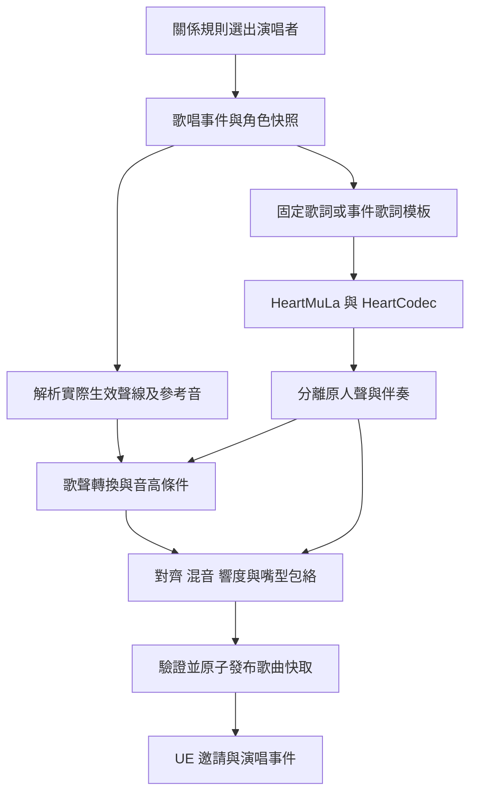

# 女主專屬歌唱功能實作計畫

日期：2026-10-23。狀態：P0～P3 已實作並在遊戲中實測；三個模型階段（HeartMuLa＋HeartCodec、Demucs、Seed-VC）已改為原生 Rust + CUDA，遊戲執行不需要 Python。結果、數值核對與限制見 [HEROINE_SINGING_VALIDATION.md](HEROINE_SINGING_VALIDATION.md)；音色人工評分尚未完成。本文件其餘的介面、路徑與數值為原始設計提案。

目標：玩家遊玩期間，由對玩家好感最高的女主，以她目前的角色聲線演唱一段歌曲。HeartMuLa 負責歌曲生成，歌聲轉換模型負責角色音色，遊戲負責觸發、播放、嘴型及演出。先驗證一位女主的 20～30 秒副歌，再完成可取消、可快取、可存檔的遊戲整合。

## 1 使用者需求與第一版範圍

### 必須完成

- 使用遊戲既有關係資料選出好感最高的女主，不能選成目前對話對象或列表第一人。
- 使用她實際生效的聲線，包含角色卡內自訂聲音與預設聲音；不能只依性格文字重新設計音色。
- 生成包含演唱與伴奏的短歌，遊戲內播放；她唱歌時有嘴型、站立演出及基本鏡頭。
- 背景工作不能阻塞 UE game thread。任務未完成時，玩家可以繼續遊玩。
- 支援失敗、取消、換場景、角色離開、換聲及讀檔；不得播放過期結果。
- 交付可聽的音訊、可執行工具、遊戲整合及驗收證據。

### 第一版預設

- 單人獨唱、繁體中文字幕、中文歌詞、20～30 秒目標長度；模型最大長度設定不等於成品一定唱滿此長度。
- 先用人工固定歌詞與曲風驗證，再接「共同經歷填入歌詞模板」。LLM 自動寫詞另列擴充。
- 先生成完整歌曲再播放，不要求生成中串流演唱。
- 以自動事件為正式入口，保留開發用手動觸發與狀態查詢。
- 首次功能預設關閉；完成品質與效能驗收後，再啟用正式預設。
- 不要求第一版做到音素級嘴型、跳舞編舞、多人合唱、完整長歌或逐字卡拉 OK。

## 2 已確認的基礎與限制

| 項目 | 現況與實作影響 |
|---|---|
| HeartMuLa | 已下載至 `E:\HeartMuLa`，當時程式碼 commit 為 `5858ca8`。實作前重新記錄版本，不默默更新。 |
| 模型 | `ckpt/HeartMuLa-oss-3B` 是 happy-new-year 版；`ckpt/HeartCodec-oss` 是 20260123 版；另有 tokenizer/config。模型約 22.4 GB，不能把磁碟大小當成顯存需求。 |
| 指定聲線 | 本機 `src/heartlib/pipelines/music_generation.py` 對 `ref_audio` 拋出 `NotImplementedError`。不能把 Qwen x-vector 傳給 HeartMuLa 就宣稱完成角色歌唱。 |
| 角色聲音 | `Tools/ok-tts/src/profile.rs` 的 `.okvoice` 保存 metadata、bf16 embedding、24 kHz 單聲道 OGG 參考音訊。 |
| 卡片聲音 | `Tools/ok-tts/src/voicemgr.rs`、`cardvoice.rs` 與 `OKStreetSocialVoicePick.inl` 已有卡內 `okVo` 聲音流程；卡內聲音優先於性格預設。部分檔案在本次規劃時尚未提交，實作 AI 必須檢查自己的 checkout。 |
| 關係尺度 | `Tools/ok-rules/src/relation.rs` 的 `Relation::liking()` 將 stranger/friend/lover 映射到共用 0～100 尺度。原始 favor 跨階段不能直接排名。 |
| 語音播放 | `OKCrowdRuntimeScene.cpp` 有非同步準備、speech epoch、UE AudioComponent、RMS 嘴型及停止流程，可作生命週期參考。歌曲需要獨立時間軸與嘴型來源。 |
| 現有文件 | `STREET_SOCIAL_TTS_VOICE.md` 含舊 VoiceDesign 流程；最新行為以目前程式與使用者指定的 Base 1.7B＋x-vector 為準。 |

Seed-VC 的歌唱轉換路徑列為首選原型候選，必須用支援歌唱與 F0 條件的權重及入口，不能用一般說話轉換結果代替。說話參考音轉成高音、長音、氣聲的相似程度尚未驗證。若原型不合格，保留介面替換模型；RVC 每聲線訓練是後續備案，不在第一版預設替每位女主訓練。

## 3 工作位置與專案限制

1. 先讀根目錄 `AGENTS.md`、`Docs/DUAL_LINE_DEVELOPMENT.md`、目前 checkout 的相關檔案與 git status。
2. 本功能以 C 線 StreetSocial 大世界事件整合為預設：`C:\portable\OpenKoikatsu`，引擎 `D:\PhysX\UE5.8`。若另由 E 線實作，先核對實際分支；使用者說明為 `duo2`，舊雙線文件仍寫 `duo`，不要自動切回舊分支。
3. 不碰 `StreetSocialCity/`，不覆蓋其他 session 的未提交修改。大檔只加必要掛鉤，功能寫進新模組。
4. 專案腳本使用 Lua；交付工具使用 Rust；不新增 `.py`／`.ps1`。
5. 原型可由 Lua/Rust 呼叫 `E:\HeartMuLa` 等外部上游既有推論入口，使用隔離環境並固定版本。這只是外部推論依賴，不得把 Rust launcher 包裝成「已完成原生 Rust 推論」。若要新增 Python adapter，需改以 Rust/Lua 或上游已有介面完成；原生模型移植另列里程碑與成本。
6. 角色卡、`.okvoice`、參考音、生成歌、權重及私人測試產物只留本機。版本控制只加入通用程式、設定模板與文件，先檢查 ignore，不能強制加入私人資料。
7. 啟動器只管理本實例的子程序，使用 `local-instance.json` 與既有 `ok_instance.lua`。不得終止另一份 clone 的 TTS 或遊戲程序。

## 4 模組與資料流程



分離器是新增依賴，P1 必須選定可本機執行的人聲／伴奏分離模型、固定版本並記錄權重。以分離殘留、耗時、記憶體與現有入口可用性選型；不能假定 HeartMuLa 原生輸出乾淨分軌。人聲換聲前後保持同一時間起點，禁止各自 trim silence 導致伴奏錯位。

### 建議檔案邊界

| 位置 | 職責 |
|---|---|
| `Tools/ok-song/` | 新 Rust 工具：工作佇列、依賴檢查、模型 backend 呼叫、快取、音訊驗證、服務與 CLI。 |
| `Tools/ok-song/src/backend/` | 分別封裝 generate、separate、convert；使模型可替換。每階段用明確輸入輸出及退出碼。 |
| `Tools/ok-tts/` | 最小新增唯讀聲線匯出能力，重用實際 profile/card 解析；不要重寫聲線選擇規則。 |
| `Tools/ok-rules/src/song.rs` | 新歌唱資格與排名規則、冷卻與事件結果；沿用既有規則 dispatch。 |
| `Source/OpenKoikatsu/OKStreetSocialSong.*` | 歌唱事件、請求、狀態機、UI 與生命週期。具體類別形式依現有模式決定。 |
| `Source/OpenKoikatsu/OKStreetSocialSongState.h` | 集中事件狀態，主狀態僅保留必要成員，不散加欄位。 |
| `Tools/song_smoke.lua` | 離線及遊戲 smoke 驗收入口，使用專案既有控制通道。 |
| `Saved/StreetSocial/Songs/` | 本機工作目錄、歌曲快取、診斷報告。 |
| `Docs/HEROINE_SINGING_VALIDATION.md` | 實作後補上的測試結果、限制及實際指令。 |

## 5 演唱者選擇與事件規則

### 排名

- 範圍為本存檔已認識且仍有效的女主；不以目前已載入 Actor 的集合取代存檔角色集合。
- 呼叫既有 `Relation::liking()` 或等價既有規則輸出排名，處理非有限數值為無效資料，不複製另一套 favor 公式。
- 分數相同時使用穩定角色 ID 字典序決勝，避免 Actor 索引、載入順序或隨機種子改變結果。
- 最高者不在場或忙碌時延後演出，不自動讓第二名頂替。
- 選角結果回傳穩定 ID、liking、聲線身分及選擇原因，供控制通道診斷。

### 預備與正式觸發

提案預設：遊玩累計 10 分鐘、最高 liking 至少 50、沒有既有有效歌唱事件時，可排入背景準備；每個遊戲日最多一次自動演唱，完成後另有至少 30 分鐘實際遊玩時間冷卻。以上集中設定，開發 smoke 可略過門檻，不在多處寫死。

背景生成鎖定候選角色與聲線版本。準備完成後、顯示邀請前重新排名：如果最高者已改變，舊歌保留快取但不得用舊人選冒充目前最高者；待短暫穩定後再準備新人選。不要每幀取消重建任務。

玩家接受邀請時鎖定本場演唱者，此後好感排名變動不換人。邀請必須可接受、稍後或婉拒；婉拒僅加邀請冷卻，不扣好感。女主正在對話、觸碰、邀約過場、通話或配對互動時，不搶占演出。

完成演唱第一版不改好感，避免歌曲自行循環刷分；後續若加獎勵，使用穩定 event ID 與既有 committed 機制，只能提交一次，跳過、失敗或讀檔重試不能重複領取。

## 6 聲線解析與歌詞契約

### 聲線

提供唯讀匯出功能，例如 `ok-tts voice-export` 或等價本機 HTTP 端點，具體名稱可配合現有服務。輸入角色卡路徑、預設聲音鍵及年齡；解析優先序必須與目前 TTS 完全相同。

輸出包含：穩定角色 ID、來源種類、profile schema、embedding tag、參考音內容 hash、解碼後參考音格式及本機路徑。聲線版本由有效 profile 內容決定，不能只用角色名稱、卡片 mtime 或性格編號。

卡內 `okVo` 存在時優先讀它；否則使用現行預設 `.okvoice`。缺檔、損壞、空音訊、schema 不支援時回報結構化錯誤，不悄悄重設聲音或寫入卡片。

優先使用 `.okvoice` 內參考 OGG；不足以換聲時，可用同一 Base profile 合成較長參考語音作比較，保存來源及品質結果。不能假定合成更長就一定更像，也不能把 Qwen embedding 當成 Seed-VC embedding。

### 歌詞

P1 使用固定、可重複的中文短副歌。P3 以模板填入遊戲已發生的共同經歷；玩家名與女主名可選，避免難讀名字破壞主旋律。不同聲線比較使用相同原始歌、相同參數及種子。

UI 保留繁體歌詞；模型所需正規化另存欄位，不能覆蓋顯示文字。限制段落、字數、總長度，清除控制字元。模板與版本納入快取鍵。第一版顯示整段歌詞，不產生虛構逐字時間戳；後續對齊工具有可信結果才加逐行高亮。

## 7 音訊處理與嘴型

1. 保存 HeartMuLa 原始成品，先驗證可解碼、非靜音且長度合理。
2. 分離人聲與伴奏；保存共同 sample rate、frame count、起點及模型延遲。
3. 以角色參考音執行 F0 條件歌聲轉換。第一版保持原旋律；自動移調預設關閉。若須移調，需協同處理伴奏並重新驗收和聲。
4. 所有輸出重取樣至同一標準：提案 48 kHz；人聲可為 mono，混音為 stereo。保存演算法延遲補償，不能只以補零掩蓋未知偏移。
5. 產生混音與轉換後人聲的 RMS 包絡，提案每 10 ms 一點，附 time origin、sample rate、總 frame count、平滑參數及版本。
6. 混音提案目標 -16 LUFS integrated、true peak 不高於 -1 dBTP。短曲以實測為準，不因強行達標放大雜訊；若響度測量器不可用，明確記錄降級，不能假報 LUFS。
7. 發布前核對 finite PCM、聲道、長度、削波、檔案 hash 及人聲／伴奏時間一致性。

UE 第一版只播放一份混音，嘴型從獨立人聲包絡驅動，共用播放時鐘。不要另外播放一條無聲人聲軌來維持嘴型，也不要使用混音 RMS，否則鼓點會讓嘴巴動。

歌曲播放時 `pitch multiplier=1`；不要沿用角色對話的 VoicePitch 導致整首歌連伴奏移調。輸出音量可跟隨遊戲音訊設定，不能影響嘴型時間。

建立明確的嘴型 owner：歌唱期間取得所有權，結束時釋放，並恢復之前有效的嘴型控制。眼睛與眨眼仍可運作。音訊暫停、裝置切換、結束回呼及場景銷毀均必須同步處理嘴型；game thread 自增秒數只能作診斷，不能作唯一播放時鐘。

## 8 工作服務與狀態契約

Rust 工具建議提供 `doctor`、`generate`、`serve`、`status`、`cancel` 子命令。`doctor` 列出權重、revision、依賴、可用 GPU、音訊工具及真正的 backend 能力；不能只測 TCP 連線。

本機 HTTP 建議介面：

| 介面 | 行為 |
|---|---|
| `GET /health` | schema、版本、backend readiness、GPU busy、佇列長度。 |
| `POST /jobs` | 驗證輸入、計算 artifact key；回 202 與 job ID，快取命中也回明確狀態。 |
| `GET /jobs/{id}` | stage、已耗時、可確定的進度、錯誤、結果 manifest。未知百分比不捏造。 |
| `POST /jobs/{id}/cancel` | 冪等取消；保留診斷，禁止發布晚到結果。 |

請求提案：

```json
{
  "schema": 1,
  "request_id": "uuid",
  "instance_id": "local-clone-id",
  "save_id": "stable-save-id",
  "event_id": "uuid",
  "generation": 1,
  "heroine_id": "stable-character-id",
  "voice_revision": "content-hash",
  "voice_reference_id": "registered-local-reference",
  "lyrics_display": "繁體歌詞",
  "lyrics_model": "模型輸入歌詞",
  "tags": ["piano", "warm", "female vocal"],
  "seed": 12345,
  "max_duration_ms": 30000,
  "recipe_version": 1
}
```

這些欄位為新契約，不能假定目前服務已有。相同 request ID＋相同 payload 必須回同一任務；相同 ID 不同 payload 回衝突。Artifact key 排除 request/event ID，以便相同內容重用快取。後端不提供任意 shell 字串或任意輸出路徑；輸入參考須先註冊並限制在本機允許範圍，輸出固定在本實例工作根目錄。

工作狀態：`queued → resolving_voice → generating → separating → converting → mixing → validating → ready`；任何非終態可到 `cancelled` 或 `failed`。錯誤至少有 code、stage、message、retryable；例如 `VOICE_MISSING`、`MODEL_MISSING`、`GPU_OOM`、`BACKEND_TIMEOUT`、`INVALID_AUDIO`、`CANCELLED`。

遊戲事件狀態另行保存：`idle → preparing → ready → offered → intro → singing → outro → completed`，以及 deferred/declined/cancelled/failed。工作 ready 不代表角色正在唱，播放結束不等於生成完成。

UE 回呼必須核對 weak owner、world/session generation、save ID、event ID、heroine ID、voice revision。任一不符就丟棄；不能只核對陣列索引。

## 9 快取與存檔

建議目錄：

```text
Saved/StreetSocial/Songs/
  jobs/<job-id>/                 暫存輸出、階段日誌
  cache/<artifact-key>/
    manifest.json
    song.ogg                     正式播放混音
    vocals.ogg                   轉換後人聲，診斷及重建包絡
    mouth.json                   人聲包絡
    lyrics.txt
  reports/<run-id>/              效能與品質驗收
```

快取鍵至少涵蓋：實際參考音 hash、聲線版本、歌詞兩種表示、tags、seed、模型與 tokenizer revision、分離器、轉換器、F0/移調參數、重取樣、混音與包絡 recipe。相同主曲可分階段快取，換女主時重用已生成歌曲與分軌，但最終產物不能共用錯誤聲線。

manifest 記錄 schema、artifact key、各 backend revision、參數、格式、duration/frame count、各檔案 SHA256、各階段耗時與量測顯存。未能量測的欄位使用 null 與原因，不填 0 假裝量測成功。

先在 jobs 完整生成與驗證，再以同磁碟原子發布＋最後寫入完成標記；讀取方只有在標記、manifest、必要檔案及 hash 通過後才視為命中。同一 key 使用鎖，防止兩個請求相互覆蓋。取消或崩潰殘留不得成為有效快取。

存檔只保存事件 ID、角色穩定 ID、voice revision、artifact key、狀態、冷卻與完成紀錄，不能保存跨啟動有效的 HTTP request 或 UObject。讀檔使所有舊回呼失效；磁碟 ready 產物重新驗證。唱到一半讀檔，第一版回到可重新邀請／從頭播放，不做中途精確續唱。新遊戲不能沿用上一存檔的事件完成狀態。

設定快取容量上限；LRU 清理不得刪除正在播放、正在寫入或被有效事件引用的檔案。產物只在專用根目錄管理；遵守 Windows junction 規則，不遞迴刪除 stage 或其他使用者路徑。

## 10 GPU 排程與遊戲表現

先量測本機 GPU、VRAM、現有 UE/TTS/ASR 使用量，再設定預算。文件中的 22.4 GB 是權重檔案大小，不能由此推導可同時常駐。

- 生成、分離、換聲、codec 預設依序執行，一個實例最多一個重型音樂任務。
- 採用已驗證的 lazy loading／卸載策略；禁止默默使用較低精度 HeartCodec 並宣稱音質無損。
- TTS 與互動優先。重型模型無法中途讓出資源時，先延後啟動；「低優先序程序」不保證 GPU 可被即時搶占。
- 高負載時顯示準備中，於設定允許的空閒／選單時間完成；不能凍結遊戲等歌曲。
- OOM 最多依明確策略重試一次，例如清除本任務模型後延後；不能無限循環，也不能停止其他 session 程序。
- 設定每階段與總 timeout、取消的終止等待時間。只終止本任務子程序樹，並使晚到檔案無法發布。
- localhost 端點由本實例配置，新增埠須先查衝突，不硬編碼已占用的 TTS/ASR/control 埠。

提案效能門檻：相同場景、相機、角色數、解析度，暖機後各量測至少 60 秒，重複三次。背景生成開啟時 p95 frame time 劣化不超過 15%，且無持續卡頓；若不達標，第一版使用空閒時準備並明確記錄能力，不能宣稱任意遊戲負載下均可背景生成。額外記錄 TTS 首音延遲，若超過 baseline 1.5 倍則調整排程。

## 11 遊戲演出與控制

Ready 且人選仍符合規則時，女主以現有 TTS 說開場白。玩家接受後進入簡單站立演出：取得相機與動作 ownership、降低環境背景音量、開始歌曲及人聲嘴型。保留跳過／離開操作。歌曲結束再由同一聲線說結尾台詞，最後恢復輸入、相機、背景音及嘴型 ownership。

角色離開有效範圍或 Actor 銷毀、玩家切地圖、停止遊戲時，淡出並釋放資源。對話或電話需定義互斥；第一版延後新事件，緊急中斷則結束歌唱，不能同時讓兩套 speech writer 控制嘴型。

新增控制通道提案：`song state`、`song prepare`、`song play`、`song cancel`、`song skip`；遵循 `Tools/street_play.lua` 現有協定實作。輸出排名、鎖定角色、voice revision、job stage、cache hit、播放秒數、嘴型 owner、錯誤。開發指定角色功能必須標記 override，正式自動事件不得使用 override。

UI 文字加入各語言自己的歌唱區段，顯示準備、邀請、播放、重試等玩家需要的資訊；模型名稱與檔案路徑放在開發診斷。所有恢復操作以取得的 ownership/token 為準，不覆蓋新事件已接手的相機或音量。

## 12 分階段任務與交付

### P0 契約與環境盤點

- [ ] 核對 checkout、未提交修改、相關 AGENTS、實際聲線選擇及關係排名路徑。
- [ ] 記錄 GPU/VRAM/驅動、HeartMuLa commit、權重 revisions、外部環境與模型授權檔。
- [ ] 檢查所選 Seed-VC 與分離器的實際推論入口、Windows 相容性及下載量。
- [ ] 建立私人測試輸出目錄及 ignore；實作唯讀聲線匯出，不改原卡。
- [ ] 輸出 doctor 報告、可重跑命令及實際介面修訂。

完成條件：能從一位女主實際生效的 profile 匯出可播放參考音，並核對與對話聲線相同。

### P1 離線音色可行性

- [ ] 產生固定 20～30 秒歌曲並保留原始音訊。
- [ ] 分離人聲／伴奏，以角色參考音換聲，完成對齊與混音。
- [ ] 輸出角色說話、原歌、原人聲、換聲人聲、最終歌與參數 manifest。
- [ ] 用同一原歌再測另外兩位音色不同的女主；至少涵蓋長音與較高音。
- [ ] 記錄各階段實際時間、顯存與失敗；人工試聽評估音色、旋律、清晰度及殘留原歌手。

品質提案：使用者評分每項 1～5，音色相似與自然度至少 4、歌詞清晰至少 4，無明顯雙重人聲或錯拍。AI 的 speaker similarity 只能輔助，不能代替人工試聽。等待使用者試聽時可繼續獨立介面工作，但不能把音色品質標記通過。

### P2 Rust 工作服務與可靠性

- [ ] 完成 CLI/HTTP、工作狀態、取消、timeout、idempotency 及結構化錯誤。
- [ ] 完成 backend 邊界與版本固定；外部依賴安裝在專用環境，不污染既有 TTS。
- [ ] 完成階段快取、原子發布、hash 驗證、磁碟容量與重啟復原。
- [ ] 完成音訊與嘴型包絡契約、效能量測及 GPU 排程。

完成條件：重複相同請求命中快取，取消／崩潰不發布半成品，換聲或改模型版本可靠失效。

### P3 關係規則與遊戲播放

- [ ] 完成排名、門檻、平手、冷卻、人選重驗、事件持久化。
- [ ] 完成非同步請求與 stale callback 防護。
- [ ] 完成歌曲播放與獨立人聲包絡嘴型；歌曲音高固定 1。
- [ ] 完成邀請、開場、演唱、結尾、跳過與 ownership 恢復。
- [ ] 加入模板歌詞與控制通道；完成多語系基本 UI。

完成條件：真實遊戲由正確最高好感女主演唱，換聲、讀檔及退出時不串人、不殘留音訊或嘴型。

### P4 打包與交付驗收

- [ ] 使用專案 Lua 建置／staging 流程產生新 tag，保留舊 stage，不遞迴刪除 junction。
- [ ] 模型與外部推論依賴以明確設定定位；不得把開發機的 E 路徑當成所有玩家的必備路徑。
- [ ] 在遊戲負載下量測效能，與純 TTS／無歌唱 baseline 對照。
- [ ] 跑完下一節驗收矩陣，更新驗收文件與必要的街區錯誤紀錄。
- [ ] 交付啟動方式、設定、模型取得／檢查方式、實際限制、音訊及遊戲錄影或截圖。

原生 Rust 推論移植、長歌、舞蹈、逐字字幕與串流歌唱列為 P5 擴充；不可把尚需 Python backend 的版本描述為免 Python 交付。

## 13 必測矩陣

| 類別 | 案例 | 通過條件 |
|---|---|---|
| 排名 | friend favor 高於 lover 原始 favor、平手、空名單、NaN | 使用正確 liking、平手穩定、無人選時不啟動。 |
| 在場條件 | 最高者不在場或忙碌 | 延後；不以第二名頂替。 |
| 排名變動 | 生成中換第一名、接受後換第一名 | 邀請前重驗；接受後保持本場演唱者。 |
| 聲線 | 卡內聲音、預設聲音、缺檔、損壞 | 與對話同優先序；失敗可診斷且不改原卡。 |
| 聲線變動 | 生成中換聲、ready 後換聲、改性格預設 | 版本重驗，舊產物不得冒充新聲線；卡內固定聲音不受無關預設修改影響。 |
| 音訊 | 長音、高音、靜音間奏、分離殘留 | 不錯拍、無明顯雙聲；純伴奏時嘴巴接近閉合。 |
| 嘴型 | 暫停／繼續、自然結束、跳過 | 包絡與音訊偏差目標不超過 80 ms，停止後 200 ms 內恢復中立或下一 owner。 |
| 對話 | 開場／結尾與歌唱交界、來電、互動中觸發 | 同時只有一個嘴型 owner，不搶占既有互動。 |
| 生命週期 | 換場景、Actor 銷毀、讀檔、新遊戲 | 舊回呼無效，無 crash、殘音或重複事件。 |
| 快取 | 同參數、改歌詞、改聲線、改模型、檔案截斷 | 正確命中／失效；損壞檔不能播放。 |
| 任務 | 相同 ID 重送、同 ID 不同內容、服務重啟、取消後晚到 | 冪等或衝突明確，晚到結果不能改狀態。 |
| 資源 | 模型缺失、GPU OOM、timeout、磁碟滿 | 返回可理解錯誤，遊戲仍能繼續，無無限重試。 |
| 雙實例 | C/E 同時開啟 | 不互殺程序、不共用錯誤工作狀態；共用 GPU 時有可見的 busy/backoff。 |
| 效能 | 遊戲無歌唱、背景產歌、播快取歌 | 記錄 frame time、TTS 延遲、VRAM、生成耗時；達不到門檻則採明確降級策略。 |
| 打包 | 新 stage、離線既有模型、關閉功能 | 新 stage 可啟動，關閉功能不影響原對話。 |

單元測試聚焦排名、快取鍵、狀態轉移、epoch 與冪等；模型品質靠真實音訊，遊戲時序靠整合測試。Mock backend 可測錯誤與延遲，但不能作為歌唱已完成的唯一證據。

## 14 實作 AI 交付格式

每階段回報：實際完成項目、修改檔案、重跑指令、測試輸出位置、音訊／遊戲證據、未解問題及下一步。只完成下載、HTTP 空殼、固定播放預製歌曲或普通 TTS 朗讀歌詞，都不等於完成本功能。

可直接交給實作 AI 的任務：

> 請閱讀本計畫與專案 AGENTS.md，依 P0→P4 實作女主專屬歌唱。先確認目前 checkout 與他人修改，再用現有 .okvoice／卡內 okVo 匯出實際聲線，完成 HeartMuLa→人聲分離→歌唱換聲→混音的短曲原型。以使用者試聽作為音色驗收，其他可獨立工作持續推進。交付工具使用 Rust、專案腳本使用 Lua；外部上游推論依賴與原生 Rust 能力如實標明。選角使用既有跨階段 liking，遊戲必須包含取消、快取、存檔、嘴型與生命週期。不能覆蓋他人改動、提交私人卡／聲音／歌曲或以模型宣傳數字代替本機量測。完成後提供可重跑指令、驗收報告及可聽的成品。

## 15 參考入口

- [HeartMuLa 官方專案](https://github.com/HeartMuLa/heartlib)：生成與模型部署；實作時固定版本。
- [HeartMuLa 生成 pipeline](https://github.com/HeartMuLa/heartlib/blob/main/src/heartlib/pipelines/music_generation.py)：參考音訊支援邊界以固定版本原始碼為準。
- [Seed-VC 官方專案](https://github.com/Plachtaa/seed-vc)：歌唱換聲與 F0 條件；模型、入口及參數需在 P0 實測。
- [Qwen3-TTS 官方專案](https://github.com/QwenLM/Qwen3-TTS)：Base voice clone 與 x-vector 模式。
- [雙線開發](DUAL_LINE_DEVELOPMENT.md)、[既有 TTS 整合](STREET_SOCIAL_TTS_VOICE.md)、[TTS 優化紀錄](TTS_OPTIMIZATION_PLAN_20261022.md)。
