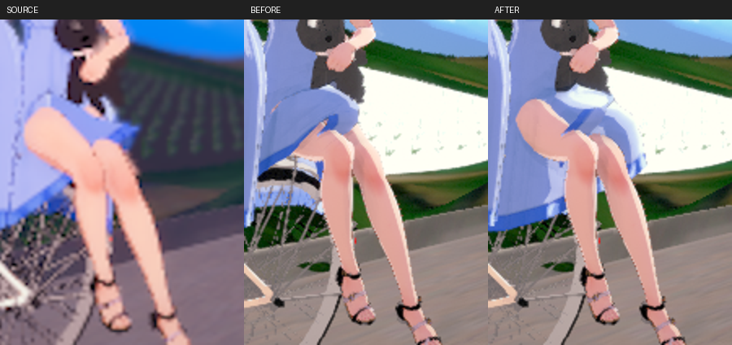

# 4432 裙擺動態修正（2026-10-21）

`koikatu_cs0004432` 的後座裙擺原本停在舊姿勢，腿部改成騎乘 FK 後仍穿過裙片。現在 Studio 會讓衣物持續接收目前姿勢與實際經過時間，後座裙片已隨抬腿姿勢展開。

## 根因與實作

Studio 停用各角色 Actor 的 Tick，由場景統一更新；舊 `AdvanceAnimations` 卻固定呼叫 `ApplyPoseFrame(0, false)`，擷取時的相位暫停更會完全略過角色更新。普通衣物 DynamicBone 因此沒有正的時間步進，無法隨腿部姿勢解算。原作的裙子 FK 關閉時會啟用裙子動態，不能把場景內保存但未啟用的裙子 FK 強行套上。

`AdvanceCharacterFrames` 將動畫相位與每幀姿態／動態分開：正常播放依角色速度推進相位，暫停與零速度保持相位；所有 Studio 角色每幀仍收到一次真實 DeltaSeconds。沒有動畫播放器的靜態 FK 角色也執行收尾求解。追視目標先準備，再做同一次姿態更新，避免靜態角色重複步進動態。

這條流程共用於一般播放、固定相位比較與 sequence 顯示。沒有依場景編號分支、裙子骨頭角度補丁、身體隱藏或變更相機／曝光，也沒有修改共用庫與 Rust 的零時間 seek 契約。

## 實際細節

來源縮圖本身可見抬起的大腿與裙口；驗收目標是讓裙片隨姿態解算，而不是遮掉來源原本外露的腿。圖中裙擺形狀與陰影仍和原作略有差異，本次沒有宣稱所有衣物、任意動作的每個三角面都保證不相交。

## 驗收

- Editor 與一般遊戲 Development 建置成功。
- 六項 Studio 自測全部 PASS：GameSelfTest、PatternTest、EyeSetTest、BloomTest、TransparencyTest、EditorSelfTest。透明度測試包含 101 張 GPU 證據圖。
- GameSelfTest 新增暫停保持角色／道具時鐘、零速度只保持角色相位、無播放器靜態 FK 確實套入原生骨架的三項整合檢查，全部 PASS。
- 七項 Studio／材質／陰影 Automation 全部 Success。
- 4432 單獨重拍與完整序列內重拍均可見後座裙片隨腿部姿勢展開；修正前後相機追蹤的 view、FOV、aspect 與 active camera 完全一致。
- 14／14 場景完成實際擷取與 PNG 完整性檢查，已檢視比較圖；1901 底部白光區域的全白像素比例仍為 0%。3800 在完整序列中仍有先前已知的景深模糊，本次沒有宣稱修復該差異；14／14 不代表全部細節逐像素吻合。
- 本次沒有修改 Rust／共用模型資料，不引用前次的 Rust suite 或乾淨共用庫結果當成本次新跑測試。

驗收紀錄及圖檔雜湊見 [manifest](images/OKStudio/Cloth4432_20261021/manifest.json)。錯誤與修正保留於 `Docs/ERROR_LOG.md`。

本機證據：`Saved/OKStudio/Verify-Cloth4432Before/`、`Verify-Cloth4432Frame/`、`Verify-Cloth4432AcceptedSelfTests/`、`Verify-Cloth4432AcceptedCompare/`、`Verify-Cloth4432Automation/`、`4432-tested-editor-build.log`、`4432-game-build.log`、`4432-final-validation.json`。
