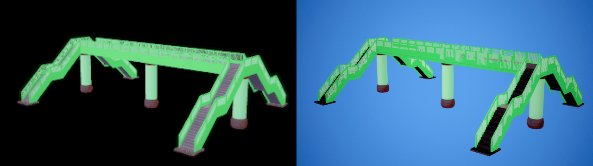
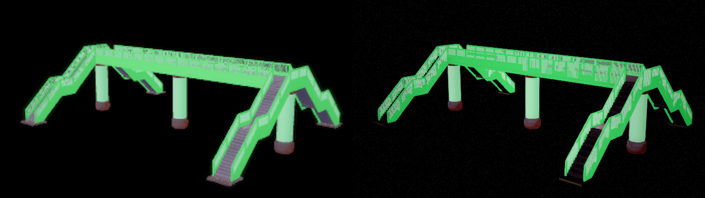
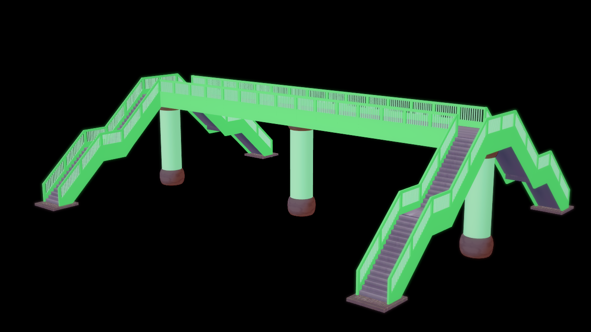
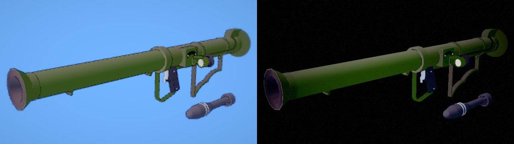
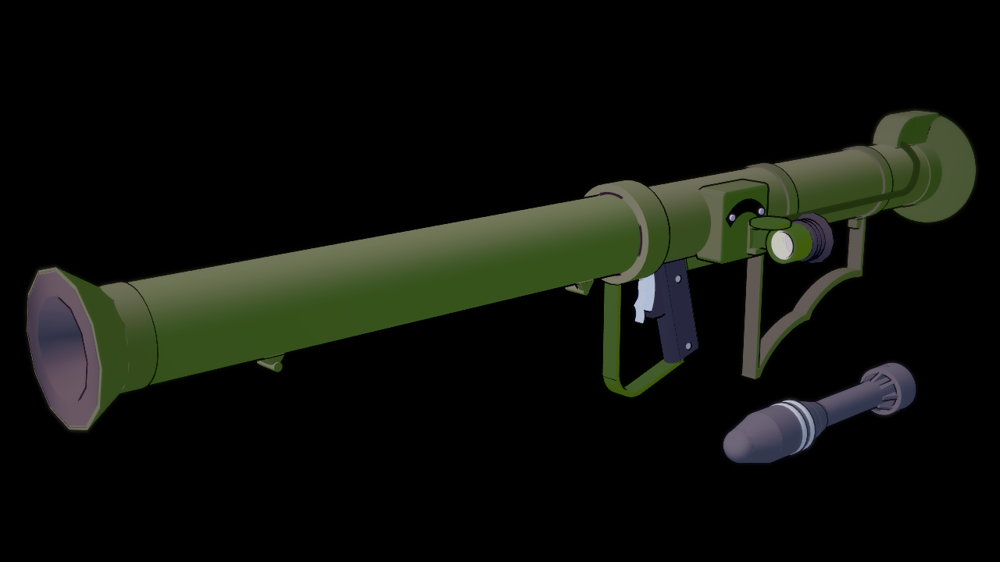

# Studio 無地圖背景與環境光（2026-10-21）

接續 [原生照明與反射驗收](OK_STUDIO_NATIVE_AMBIENT_20261021.md)。本輪修正盤點中的5698背景及無地圖來源環境，不使用場景編號分支。

## 原因與共用修正

原作 `StudioScene.Start` 從 `Config.EstData.BackColor` 初始化主相機；`Studio.ConfigCtrl` 背景色控制也寫同一設定。`System/Est/BackColor` 缺省為黑色，和 `H/BackColor` 分開。主相機使用SolidColor，保存藍色的子相機只清Depth。之前匯入器將所有無地圖／背景圖片／天空的場景固定成藍色，這是錯誤來源假設。

現在匯入讀已設定遊戲安裝的Est背景RGB，無遊戲或設定缺失時使用原作黑色缺省，並保存到 `.okscene`；重新開啟或使用者編輯後不會每幀重新套安裝設定。原作背景圖片及天空仍優先。顏色維持顯示RGB，沒有額外gamma解碼；背景圖層使用不透明alpha。

原作空場景、2534與5698共81個SH係數全為零；之前無地圖會套Maker環境光，而且道具沒有接到場景SH。現在map=-1有明確零環境，角色及道具一併更新；有地圖或天空仍走其來源環境。這也避免用人物展示照明修改Studio道具。

## 驗收

核心提交 `f8cde6f6e`。最後 Editor／一般 Game Development 建置成功（26.25／41.21秒）。Rust及基礎資源沒有改動，前輪421 Rust／716 LFS的結果仍屬前輪驗證，沒有冒稱本輪重跑Rust或卡片轉換。

| 驗收 | 結果 | 本機證據（Saved/OKStudio/） |
|---|---|---|
| 最後六項Studio整合 | 全PASS，含101張透明GPU圖 | Verify-EmptyEnvironmentAcceptedSelfTests/results.json |
| 最後九項Automation | 全部Success、零Fail | Verify-EmptyEnvironmentAcceptedAutomation/Automation.log |
| 實際空環境材質 | 69個角色／道具材質，RGB與alpha常數為零；112個未使用L2項不要求宣告 | 同輪GameSelfTest.log |
| 背景設定 | Est/H作用域、非零自訂RGB、無設定黑色、無效值fallback、匯入與另存重開PASS | ClearColorSettings與GameSelfTest |
| 原作空環境 | empty／2534／5698共81個SH係數全零，主相機SolidColor黑色 | VertexLighting20261021/native-empty-environment-verification.json |
| 最新全樣本實拍 | 14／14，PNG完整性與hash通過；峰值20.6GB、卸載後13.3GB | Verify-EmptyEnvironmentFinalAll/results.json、ACCEPTANCE.md |

乾淨clone同步合併版 `070ba567d` 且status clean，716個LFS payload（8,649,422,696bytes）再次逐檔SHA核對，35個來源blob與實際工作檔／Git物件一致；基礎資源樹未變。合併遠端街頭付款修正後，Editor／Game再建置成功（66.71／73.54秒），Studio來源與已測核心完全相同。

第一輪新增GameSelfTest因要求眼睛等材質未使用的L2參數而FAIL，該輪未算成功。修正檢查的宣告範圍並補alpha檢查後，另跑全新六項輪次全PASS；失敗log及修正原因保留在 [ERROR_LOG](ERROR_LOG.md)。沒有在UE仍執行時覆寫Editor DLL。

實拍於 `1eee55d5c+worktree` 執行，對應本輪production改動；之後只修正新增GameSelfTest檢查，繪圖邏輯沒有再改。完整分組數值證據在 `VertexLighting20261021/empty-final-validation.json`。

## 真實圖片

以下均為未重繪、未調色的實際PNG；[manifest](images/OKStudio/EmptyEnvironment20261021/manifest.json)列出14張最新對照、2張原作重載及1張修正前圖的SHA-256、尺寸與長度，IEND後無附加payload。

### 5698：修正前

### 5698：最新實拍

右側背景角落RGB為(0,0,0)。幾何、道具明暗與原作仍有差異，不能把清屏色正確寫成整個shader吻合。

### 2534：歷史縮圖與目前安裝設定

對照前輪的2534前景內部，31,236個侵蝕遮罩像素RGB MAE為0.0633／255，主要改動是清屏背景；此區域診斷不代表全景或原作畫面相等。

### 全部14景

- [koikatu_cs0000001](images/OKStudio/EmptyEnvironment20261021/koikatu_cs0000001.png)
- [koikatu_cs0000010](images/OKStudio/EmptyEnvironment20261021/koikatu_cs0000010.png)
- [koikatu_cs0000059](images/OKStudio/EmptyEnvironment20261021/koikatu_cs0000059.png)
- [koikatu_cs0000633](images/OKStudio/EmptyEnvironment20261021/koikatu_cs0000633.png)
- [koikatu_cs0001268](images/OKStudio/EmptyEnvironment20261021/koikatu_cs0001268.png)
- [koikatu_cs0001901](images/OKStudio/EmptyEnvironment20261021/koikatu_cs0001901.png)
- [koikatu_cs0002534](images/OKStudio/EmptyEnvironment20261021/koikatu_cs0002534.png)
- [koikatu_cs0003167](images/OKStudio/EmptyEnvironment20261021/koikatu_cs0003167.png)
- [koikatu_cs0003800](images/OKStudio/EmptyEnvironment20261021/koikatu_cs0003800.png)
- [koikatu_cs0004432](images/OKStudio/EmptyEnvironment20261021/koikatu_cs0004432.png)
- [koikatu_cs0005065](images/OKStudio/EmptyEnvironment20261021/koikatu_cs0005065.png)
- [koikatu_cs0005698](images/OKStudio/EmptyEnvironment20261021/koikatu_cs0005698.png)
- [koikatu_cs0006331](images/OKStudio/EmptyEnvironment20261021/koikatu_cs0006331.png)
- [koikatu_cs0006964](images/OKStudio/EmptyEnvironment20261021/koikatu_cs0006964.png)

## 來源與限制

原作實測為 `Saved/Tests/NativeBackground5698/`、`NativeEmptyAmbient/`；81係數與三個主相機的清屏模式在 `Saved/OKStudio/VertexLighting20261021/native-empty-environment-verification.json`。來源反編譯：`D:/KoikatuSunshine/kks_decomp/Managed/CharaStudio_Data/Assembly-CSharp/StudioScene.cs`、`Studio/ConfigCtrl.cs`、`Config/EstheticSystem.cs`。

2534舊縮圖為藍色，但目前原作重載也是黑色；背景色來自安裝設定，未保存於原作SceneInfo，因此不按縮圖替單景加特例。5698的縮圖及原作重載均為黑色。舊版匯入已保存固定藍色的 `.okscene` 需重匯原作PNG；不擅自改寫使用者已存的背景。

6331另外完成關AO診斷1／1，灰棕髮／灰白臉仍存在，沒有把關AO交付成修正。6331色調／表情、動態天空及完整shader還原等原逐景盤點尚未全部完成；本輪只對上述可證實的共用路徑驗收。
