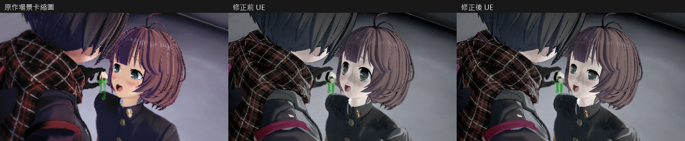
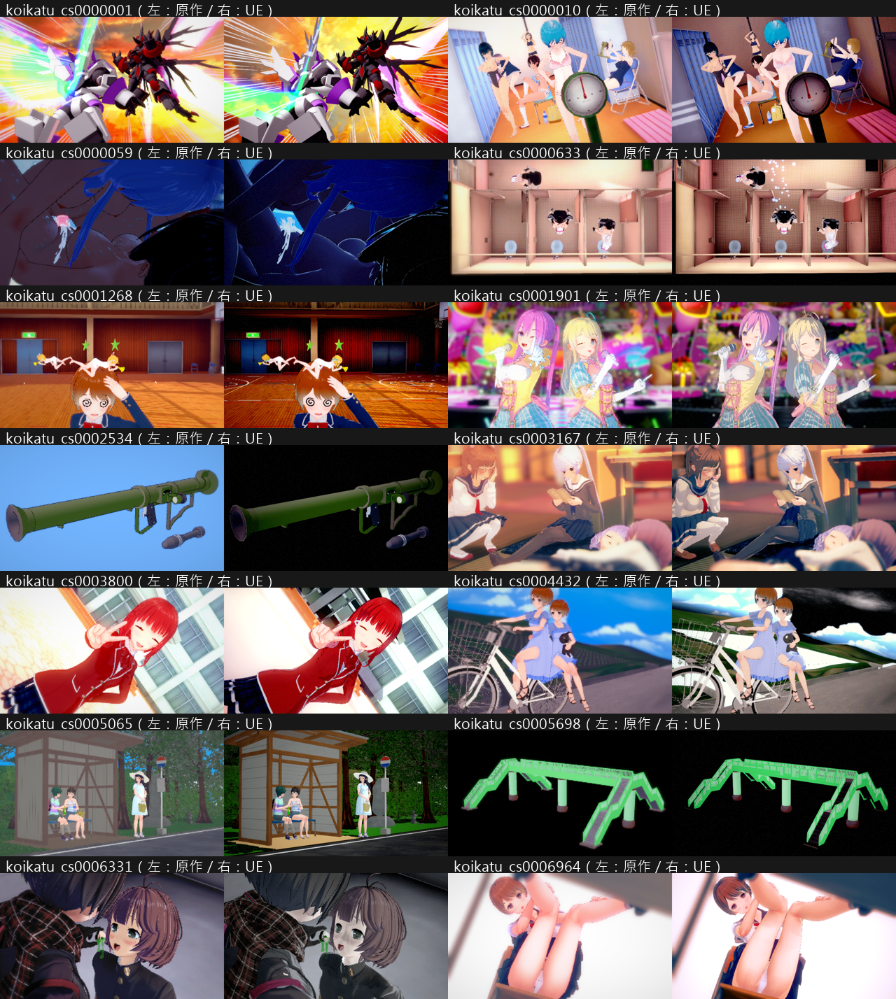

# Studio 保存視線與表情驗收（2026-10-21）

6331 的眼睛過度張開，包含一個已確認的共用匯入問題：來源保存的 FIX 視線被丟棄，眼皮依視線計算的修正也跟著遺失。本輪恢復來源流程；髮色、膚色與其他材質差異仍獨立追查。

## 修正與來源依據

原作 `Studio.AddObjectAssist.ChangeChara` 先設定 `eyesLookPtn`，再呼叫 `EyeLookCalc.LoadAngle`。保存資料是雙眼 local quaternion，及自場景版本 0.0.8 起的 `H0,H1,V0,V1`；NO_LOOK row 保持這些角度，並依來源角度限制產生虹膜／眼皮所用的 rate。

原先 Rust parser 只讀 eyes data 長度後略過。現在保存完整資料，驗證長度、有限數值與 quaternion，再經 C ABI 按來源 NO_LOOK row 求解。一般追視 row 不接受 FIX 資料，拒絕時保留現用狀態。場景檔可保存／重開 FIX 資料，UI 可切回已保存的 FIX；切換模式或重建角色會清除套用快取。沒有場景編號分支或眼角補償值。

匯入器也移除了讀完狀態後無條件重設 `EyesLook=Animation` 的舊行為；缺省只在匯入角色建立時指定，來源看向相機設定會保留。既有 `.okscene` 若已遺失來源眼睛資料，需重新匯入原作 PNG，不能從零值推造保存角度。

## 實拍

下圖依序為原作場景卡縮圖、修正前 UE、修正後 UE。修正後眼皮與視線已恢復來源數值；仍可見的灰棕髮／灰白膚色沒有列為本次已解決。

14 景全部重新匯入、運行實際影格並擷取。每組左為來源縮圖、右為目前 UE；出圖成功不代表所有色調與材質已吻合。

## 驗收結果

核心實作 `ae9894f01`，合併街區變更後驗收版本 `5886137a0`。後續只增加可選的唯讀材質／原作資料稽核，正常渲染流程未再修改。

| 驗收 | 結果 | 本機證據（Saved/OKStudio/） |
|---|---|---|
| Rust 完整測試，單執行緒 | 422 PASS、0 FAIL、476 ignored | GeometryInputs20261021/rust-all-serial.log |
| 保存 eyes data 版本／格式／異常值 | PASS | GeometryInputs20261021/rust-eyes-layout.log |
| 原作 FIX eyes 數值與拒絕／保留狀態 | 1 PASS；最大 rate 誤差 1.2e-7 | GeometryInputs20261021/rust-native-fixed-eyes.log |
| Studio 六項整合 | 全 PASS；101 張透明 GPU 圖 | Verify-FixedEyesAcceptedSelfTests/results.json |
| Automation 九項 | 全 Success，含 SavedPose 保存／清除／重開 | Verify-FixedEyesAcceptedAutomation/Automation.log |
| 14 景完整實拍 | 14/14、PNG／IEND／SHA 全通過；峰值 20.6 GB、卸載後 11.9 GB | Verify-FixedEyesAcceptedAll/results.json |
| UE 實際載入的 6331 FIX | 六角色各保留 12 個來源值；第一女角 rate 最大誤差 1.2e-7，眼皮 52%／48% 與原作一致 | GeometryInputs20261021/AcceptedGeometry/koikatu_cs0006331.geometry.json |
| Editor／Game 合併建置 | 成功；77.01／85.83 秒 | GeometryInputs20261021/*-accepted-build.log |
| 後續唯讀稽核建置 | Editor／Game 成功，32.72／49.53 秒；CLI／原作 C#／D3D11 probe 編譯成功 | GeometryInputs20261021/ |

圖片目錄有 14 張獨立場景比較、修正前圖、前後圖與總覽，共 17 PNG。`manifest.json` 保存尺寸、bytes 與 SHA-256。來源卡與含人物的場景 PNG 均未提交。

## 幾何假說的排除範圍

新唯讀快照保存原作 sharedMesh／BakeMesh、UV、骨架矩陣及表情權重；UE 快照明確區分來源 view 與 GPU reference stream。6331 第一女角共 2,739 頂點：reference normals 對原作最大誤差 `1.4928e-7`，UV0 最大誤差 `2.9755e-8`。GPU 的 UV 有既定 V 翻轉及 half 量化；法線 packing 最大誤差約 `0.00394`。這些數字不等於已比對每個最終 fragment 的世界法線。

原作同臉 87 個 morph 的法線增量全為零，包含當下啟用的三個表情；因此沒有為這個假說擴充模型格式或重建基礎庫。D3D11 額外記錄 vertex buffer／stride／offset，但尚未解碼完整 input layout；單獨 DrawRenderer 也不是場景相機的幾何金標。

## 尚未結案

目前 `all_visual_differences_resolved=false`。本輪確定恢復保存視線與眼皮修正，沒有將 6331 剩餘髮色／膚色／服裝明暗差異一併宣稱修復。完整逐景問題仍見 [視覺盤點](OK_STUDIO_VISUAL_AUDIT_20261021.md)；全材質參數核對持續進行。
