# HANDOFF_E 圖文驗收紀錄（2026-10-20）

本報告補入最後一次連續驗收的實際圖片。每張對照圖**左側為原作場景內的預覽縮圖，右側為 Unreal 實作結果**；不是兩次相同解析度的即時渲染比較。原圖直接複製，沒有重新調色或修圖。圖片是普通 PNG 截圖，不含人物卡或 Studio 場景資料。

驗收對象為 HANDOFF_E 本輪來源材質、構圖、日照、場景生命週期與擷取流程修正。**14／14 表示成功載入並寫出圖片，不表示 14 張畫面全部吻合。** 尚有色調、景深、bloom、角色顯示與卸載後記憶體差異；詳見各圖說明。MRQ、SkinEffects 等既有 roadmap 項目未列為完成。

## 14 張總覽

總覽按 0001、0010、0059、0633、1268、1901、2534、3167、3800、4432、5065、5698、6331、6964 排列；下面提供完整尺寸單張圖。

## 功能驗收結果

| 項目 | 結果與界線 |
|---|---|
| Rust default suite | 416 PASS，461 ignored；ignored 不計為通過 |
| 原作 oracle | MDK、方向 lightmap、renderer shadow policy 各 1 PASS |
| Automation | 材質弱參照生命週期、MDK 配方，共 2 PASS |
| UE 自測 | GameSelfTest、PatternTest、EyeSetTest、EditorSelfTest 全部 PASS；最後主線整合後三項遊戲自測亦 PASS |
| 建置 | Editor 與一般遊戲 Development 成功 |
| 場景連續擷取 | 14／14 成功出圖；視覺差異如下 |
| 記憶體 | 同批場景擷取峰值 30.4 → 23.6 GB；Windows 程序峰值 23.709 GB；最後卸載 13.0 GB，仍高於啟動約 4.4 GB |
| 原作卡與乾淨共用庫對照 | 完整庫與乾淨庫各 5 女角 MATCH；各 2 男角保留既有 `_Texture2` sampler DIFFERENT，未列為通過 |
| OK 卡 | 兩庫各 5 張 live／closed MATCH，gaps=0、game_reads=0 |

## 單張對照

### 0001：深度與道具顯示

檢查道具遮擋與原作材質路徑；仍可見角色、色彩與後處理差異。

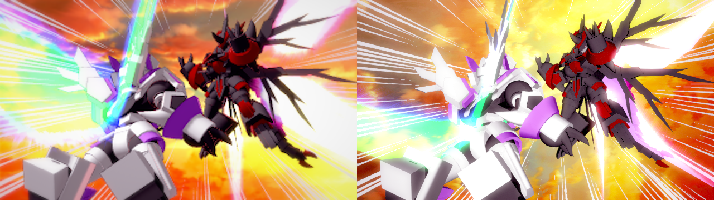

### 0010：儀表貼圖與 MDK

前景圓盤實為 Standard 儀表，刻度與紅指針已能辨識，來源貼圖行方向修正生效；儀表仍比原作暗、偏紫，不能視為白亮程度已吻合。

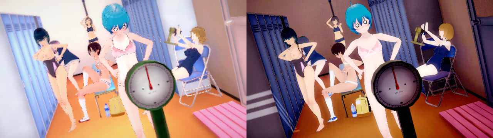

### 0059：場景載入與擷取

本張成功載入並產出對照圖；此項只確認載入／擷取流程，不代表角色與光照完全吻合。

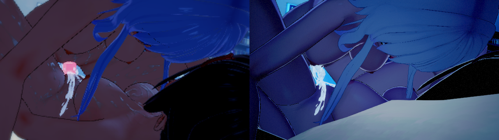

### 0633：Standard 光照與反射

移除重複 albedo emission 後，反射開啟時牆面不再大片白化、暖色恢復；亮度與色調仍有差異。

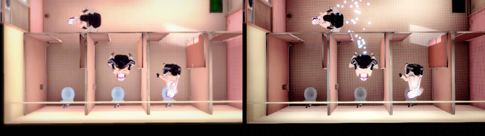

### 1268：場景載入與擷取

本張成功載入並產出對照圖；保留原作縮圖供檢查構圖、材質與角色顯示差異。

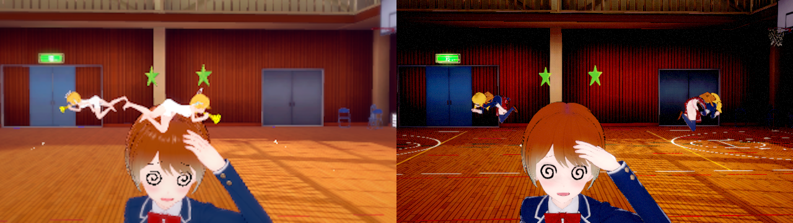

### 1901：Legacy Additive 粒子

確認使用來源 SrcAlpha/One、Linear tint、soft depth fade 與 BeforeDOF 材質；右下 flare 仍比原作亮，bloom 與角色明暗尚有差異。

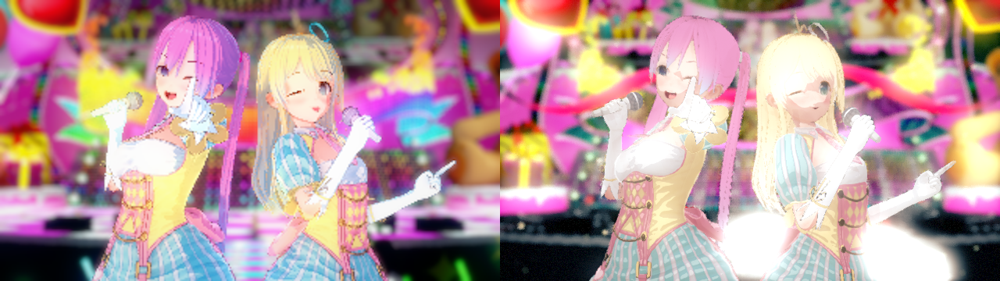

### 2534：場景載入與擷取

本張成功載入並產出對照圖；未以出圖成功宣稱視覺完全還原。

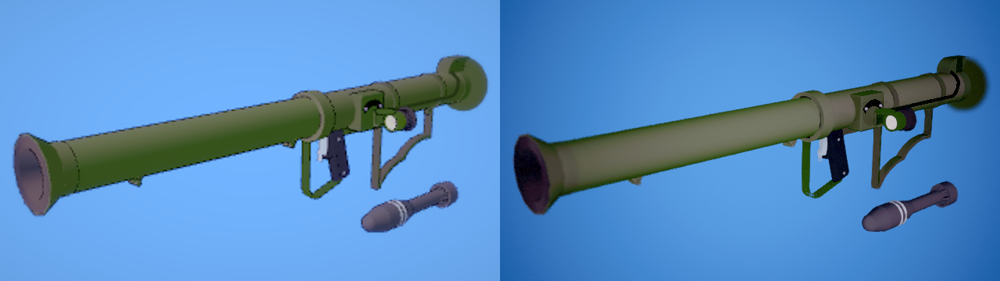

### 3167：地圖日照

來源 Sun 已啟用；整體仍較暗灰，未完全還原原作暖黃色調。

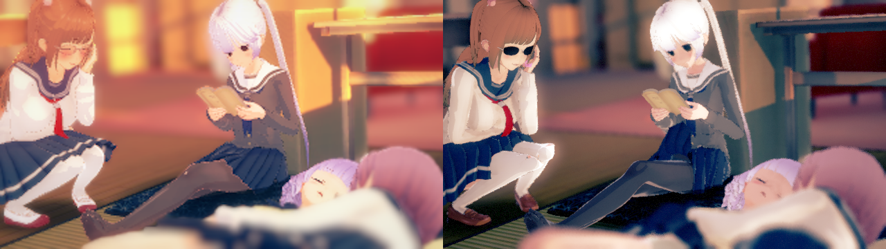

### 3800：場景載入與擷取

本張成功載入並產出對照圖；保留構圖與光照的可見差異。

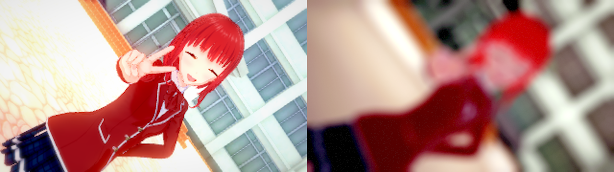

### 4432：場景載入與擷取

本張成功載入並產出對照圖；保留構圖、景深及角色顯示的可見差異。

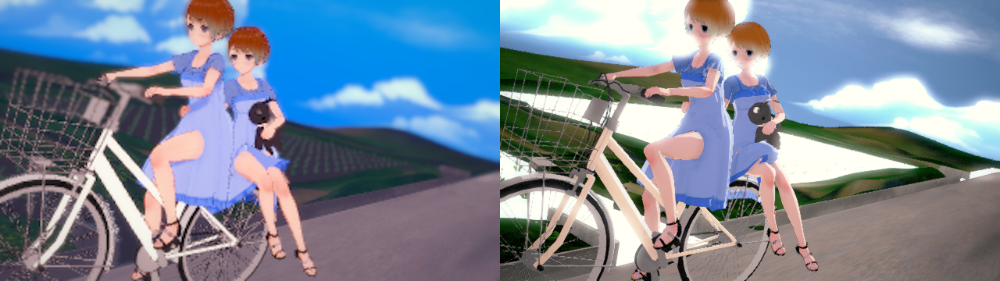

### 5065：場景載入與擷取

本張成功載入並產出對照圖；未以成功輸出代替逐項視覺判定。

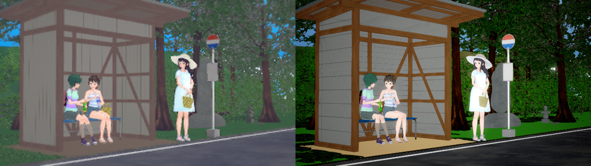

### 5698：場景載入與擷取

本張成功載入並產出對照圖；仍以左右實際畫面作為差異證據。

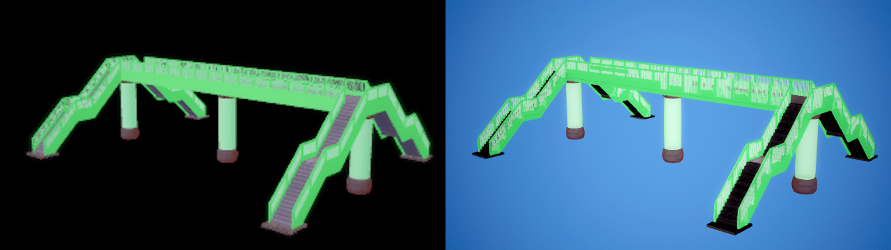

### 6331：ShadowsOnly 遮光

來源只投影模型重新參與遮光後，地板恢復灰色，避免太陽直接照入而變橘；角色與整體光照仍有差異。

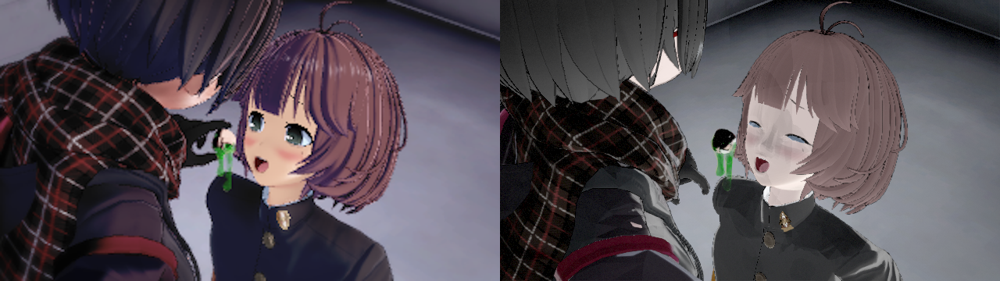

### 6964：道具根 TRS 與構圖

消除已烘入 geometry 的 prefab 根 TRS，再套場景覆寫，人物不再被桌面遮住；此圖驗證構圖修正，並不表示角色材質與原作一致。

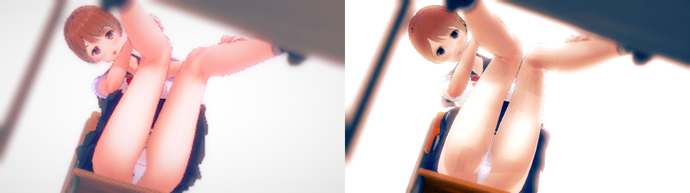

## 證據與檢查方式

圖片來源為本機 `Saved/OKStudio/compare/`，對應 `Saved/OKStudio/Verify-HandoffERelease/CompareKStudio.log` 的最後 14 張擷取。出圖與記憶體結果在同目錄 `results.json`；程序峰值在 `Saved/OKStudio/handoff_e/release-process-memory.json`；最後整合後自測在 `Saved/OKStudio/Verify-HandoffEPushRetry/results.json`。這些執行記錄保留本機；本文圖片隨文件提交，可在其他 checkout 直接檢視。

[圖片雜湊清單](images/OKStudio/HandoffE20261020/manifest.json) 記錄 14 張來源圖的 SHA-256、大小與 PNG chunks。補圖時逐一確認 PNG 可解碼、尺寸 1280×360、IEND 後沒有附加資料、沒有卡片 payload，並確認文件所有圖片連結均存在。此次只補驗收文件，沿用上述已完成的功能驗收，沒有將文件檢查冒充重新執行遊戲測試。

實作與完整界線見 [OK Studio 計畫 S5 第十二輪](OK_STUDIO_PLAN.md#s5-第十二輪handoff_e-接手2026-10-20)。
