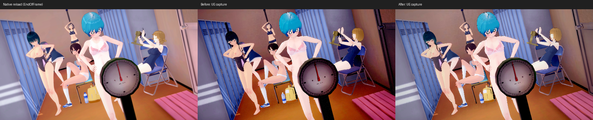
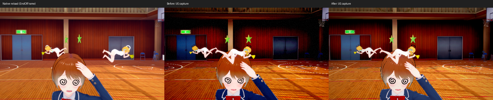

# Studio 光影、LUT 與擷取驗收（2026-10-21）

先修正原生對照圖的頭髮離體問題，詳見 [擷取時序驗收](OK_STUDIO_NATIVE_CAPTURE_20261021.md)。本輪使用完成 LateUpdate 的原生重載圖比較光影，不再使用錯位圖作幾何基準。

## 共用修正

- SceneCard 的 LDR 擷取改為線性 RGBA8 target，明確設定 display gamma=2.2。由 tonemapper 編碼一次後保存像素，避免 sRGB target 與 gamma 設定組合造成額外暗部曲線。
- 保留原生 32³ LUT，於線性光乘上來源曝光後轉 sRGB，在原始 1024×32 表格三線性取樣，依強度混合再回到線性光。材質父資產隨專案 cook；無來源 filter 時明確使用 identity LUT，避免沿用其他 volume 的 LUT。
- Standard 地圖材質補上 `_BumpMap`、來源 `_BumpScale`、UV ST 與 sampler；方向性 lightmap 使用像素法線。`[Gamma] _Metallic` 的來源值依原作轉為線性值，貼圖 metallic 仍維持線性資料。
- 外部材質貼圖的影像與 sampler 都依記錄的依賴來源重播。靜態貼圖不使用動態 RenderTexture 的生成 mip policy；這不代表 PNG 橋接已保留原生靜態完整 mip chain。

沒有依場景編號加曝光、改 LUT 強度或移動光源。

## 實際圖片

每列由左至右：原生重載、修正前 UE、修正後 UE。原生與 UE 動畫相位不同，這些圖用於比較背景與明暗，不能宣稱角色逐像素一致。

0010：



1268：



1268 球場白線曾因錯用生成 mip policy 消失，最終重拍已恢復。兩景的背景仍與原生有明暗、材質與取樣差異，不能把色票通過寫成完整 shader 還原。

## 可重現驗證

`OKStudio.GradeTest exit` 對照原生 Amplify Color HDR/Linear 的 43 組輸入／輸出，同時驗證 HDR 與實際 `FOKSceneCard::Capture` 像素。最新最大線性誤差 0.0166015625，最大顯示誤差 4/255；舊截圖流程最大顯示誤差 32/255。測試固定門檻為線性 0.02、顯示 0.04，沒有因失敗調寬。

失敗 CSV、建置日誌及擷取紀錄保留在 `Saved/OKStudio/LightingLut20261021/`。原生 0059 在目前安裝重載仍為黑畫面，不列為有效的原生視覺金標；PNG 檔案存在與畫面有效分開判斷。

```text
Tools/lua/lua.exe Tools/verify_ok_studio.lua --engine E:/PhysX/UE5.8 --tag LightingLutFresh --editor --compare
ok-extract D:/KoikatuSunshine --oklib studio-standard-textures Content/IndependentResources/base_v1 <bundle-suffix,...>
```

補錄工具適用任意來源地圖 bundle；省略清單會處理完整 catalogue。本輪完整實拍回歸範圍是既有 14 場景樣本，涉及 8 張地圖，不宣稱已目視原遊戲全部場景。

來源補錄 8 張地圖共 616 個貼圖名稱。重播測試確認體育館 78 個、置物櫃室 54 個部件具有 Standard 法線貼圖，來源 sampler 存在且靜態 mip policy 為 0；不存在的 sampler 名稱不增加 library misses。

最新 Rust 全套 422 PASS／0 FAIL／477 ignored；另跑上述來源重播斷言 1 PASS。7 項 Studio 整合測試、9 項 Automation 全通過，LUT 父材質 Windows cook 通過。完整庫與乾淨資源 checkout 的原卡 `kks-verify` 各 MATCH；既有 OK 卡的 recorded／closed／live digest 兩庫皆相同，均 1 MATCH／0 DIFFERENT、gaps=0、game_reads=0。原卡驗證仍使用來源 fallback，不宣稱原卡完全離線。

首次舊卡檢查雖 digest 相同但 gaps=5，已保留失敗證據；修正為只有已記錄外部依賴的名稱才走 sampler fallback 後重驗通過。
