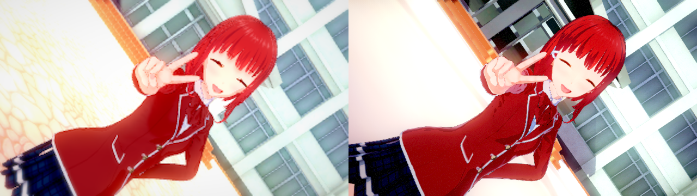
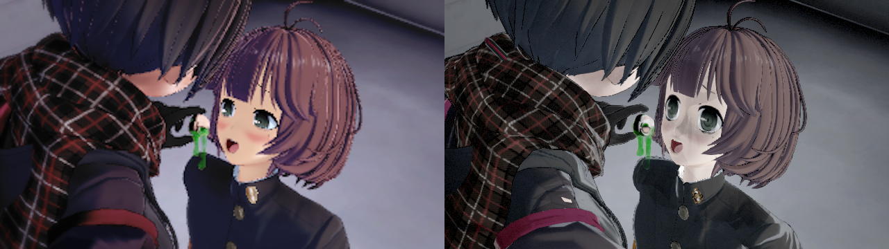

# Studio 原生環境光與反射驗證（2026-10-21）

接續 [全樣本盤點](OK_STUDIO_VISUAL_AUDIT_20261021.md)。修正依來源 shader／renderer 契約套用，沒有場景編號分支、曝光補償或手動染髮。

## 已實作的來源路徑

- Koikano skin、Sun hair 與 clothes 的原作 vertex program 會先計算高階 SH，再插值給 pixel program。舊路徑將這個 varying 清零；現在傳遞全部 27 個係數，保留逐頂點求值順序。衣服 item 的環境光是 v6，並非其 screen position v5。
- Studio 使用新的 `StudioDisplay28` 共用父材質（90 個資產）；原有 Gallery／街區父材質不被覆寫。
- 地圖預設及局部反射由 RenderSettings／ReflectionProbe 的完整 FileID／PathID 指標解析；保留原始 BC6H／RGBAHalf、六面與全部 mip，沒有透過 PNG 截斷 HDR。72 個地圖列中 36 個具有烘焙預設 cube，另有31個按 prefab root／node 識別的局部探針；全部去重為51個檔案，共12,985,920 bytes。動態 sky 不使用過時的烘焙預設 cube；局部烘焙探針仍依 renderer 選定的 node 綁定。
- `OKCUBE01`：8-byte magic，四個 little-endian u32（size／mips／DXGI format／reserved=0），u64 payload length，共32-byte header；payload 為 face-major mip chains。UE 載入時重排成每個 mip 包含六面。檔名為完整檔案 SHA-256，JSON 與 cube 都列為 NonUFS。
- 無 lightmap 的 Standard 地圖表面補上 vertex L2 + pixel L0/L1 的間接漫反射，乘來源 albedo 與 oneMinusReflectivity；有 lightmap 的表面保留既有烘焙路徑。參數寫入各 renderer 的 MID，不修改共用圖。
- Studio以明確 `bSourceMapShading` 設定地圖材質語義，不借用Gallery世界／相機生命週期旗標。局部probe由prefab root與node綁到各renderer，沒有用default cube蓋掉全部局部環境。
- 髮卡的glossColor提交到原生材質，缺省217/255；髮飾插件缺省保留0.8490566，colour-match繼承主髮，Material Editor優先。Session cache revision20，避免暖載入保留舊光澤。
- 原生臉部唇色／腮紅從 canonical source material 傳到 C ABI，避免被舊 body overlay 的中性缺省覆蓋；舊 portable snapshot 不必更改格式，身體乳頭色通道保留原行為。
- 舊StreetDisplay26在Maker沒有高階SH覆寫時仍可綁定；明確非零SH必須使用具備頂點環境光的父材質。
- 地圖太陽與角色燈共用 Unity legacy gamma/HDR 強度換算。地圖燈的 HDR 能量移到 UE intensity，避免 FColor 截斷；仍有 UE 色彩量化誤差。

## 原作實測證據

- D3D11 stream output 直接執行原作 VS DXBC，六個 shader 家族、地圖20／33，各2048個法向，共24,576個原生 GPU 頂點。最大環境光差異 `1.2978327454393757e-8`。
- 地圖33預設 cube 的六面八層共48個 subresource、131,232 bytes，與原作 GPU lossless staging 讀回逐 byte 完全一致。Rust 具名 oracle `map_default_reflection_matches_native_gpu_bytes` PASS。
- 原作3800窗牆 renderer 為 `lightmapIndex=-1`／`BlendProbes`；其 GPU 七組SH常數對地圖20探針最大誤差 `9.313225746154785e-9`。原作 map sun GPU RGB 為 `(0.964627564,1.11674428,0.959291399)`，證實強度須在 gamma 色彩階段相乘。
- 原作3800窗牆實際選到Map/Reflection Probe，weight=1，使用ReflectionProbe-1；root=Map／node=1的無損cube與其原作GPU 54個面／mip、524,448 bytes逐byte相同。這是局部probe，不是預設ReflectionProbe-0。
- 原作 hair Sun 與 SunFront 的選定 DIRECTIONAL／OLDHAIR pixel program 相同；不能單靠 shader 名稱不同解釋6331色差。

## 驗收與限制

本輪核心提交 `321c2e755`、`29f9ee3a0`。最新 Editor／一般 Game Development 建置成功（45.47／43.70秒）；合併遠端街頭修正後再建置成功（79.91／86.78秒）；Rust **421 PASS／0 FAIL／475 ignored**。另跑原生臉色與封包往返兩項 PASS、髮 gloss 原作 oracle PASS、三組 default／local cube byte oracle PASS。ignored 是依賴特定來源或專項執行的測試，未當作一般全跑成功。

| 驗收 | 實際結果 | 本機證據（Saved/OKStudio/） |
|---|---|---|
| 六項 Studio 整合 | 全 PASS，含101張透明 GPU 測試圖 | Verify-NativeFaceColorAcceptedSelfTests/results.json |
| 材質／Studio／shadow Automation | 八項 Success，零 Fail | Verify-NativeFaceColorFinalAutomation/Automation.log |
| 地圖實際 MID | 280個 native HDR cube；280個無 lightmap SH MID，誤差0；父材質缺省保持0 | 同輪 GameSelfTest.log |
| 實際場景載入／擷取 | 14／14，PNG解碼、IEND及SHA-256全通過；峰值22.3GB，卸載後12.7GB | Verify-NativeFaceColorAcceptedAll/results.json、ACCEPTANCE.md |
| 原卡完整／純追蹤庫 | 各1 MATCH；純追蹤庫3個庫外引用由原作來源補足 | VertexLighting20261021/*-committed-kks.log |
| OK卡完整／純追蹤庫 | closed/live各1 MATCH／0 DIFFERENT，gaps=0、game_reads=0 | VertexLighting20261021/*-committed-cardcheck.log |
| 乾淨 sparse clone | 716個LFS payload／8,649,422,696 bytes逐一核對；617個模型全tracked，status clean | VertexLighting20261021/clean-final-payload-verification.json |

90個StudioDisplay28資產是普通Git blobs，另核對OID與SHA-256，不冒稱LFS。失敗的中間輪、錯誤fixture與0個cube綁定記錄保留在本機及 [ERROR_LOG](ERROR_LOG.md)，未計入上述通過結果。實拍時版本標籤為 `321c2e755+worktree`，對應後續提交 `29f9ee3a0` 的實作；提交前後沒有改動 production 邏輯。

合併版本的 GameSelfTest 再次 PASS、3800／6331 重拍2／2。最終 renderer 稽核包含54個6331材質，全都綁場景ramp且SRGB=false；7組SH對原作誤差0，三個相同女角的唇色／腮紅對native常數誤差小於1e-6。原作face RT為sRGB，來源髮ColorMask解碼RGB逐byte一致。關濾鏡A/B仍未消除色差，沒有把濾鏡關閉交付成修正。證據：`VertexLighting20261021/final-mid-input-verification.json`；完整分組驗收：`VertexLighting20261021/final-validation.json`。

## 真實圖片

以下每張左半為來源場景內嵌縮圖，右半為本輪 Unreal 畫面。全部14張原始對照PNG均未修改；尺寸、SHA-256與來源路徑在 [manifest.json](images/OKStudio/NativeAmbient20261021/manifest.json)。圖片通過代表載入／實拍流程可用，視覺差異仍須逐項判定。

### 3800：高光、地圖照明與相機

髮光澤、地圖間接光與原生局部反射已接回，序列中的鏡頭保持清晰。仍存在材質亮度及地圖細節差異，沒有用曝光或場景編號補償。

### 6331：臉部化妝色與仍可見的差異

唇色／腮紅與髮gloss的來源數值已修正；來源face MainTex RGBA逐byte相同。髮／衣服仍偏灰、眼形與表情影格不同，不能宣稱整體shader已完全還原。來源縮圖與目前安裝的KKS重載本身也不完全相同；隔離renderer的原作probe畫面只是診斷，不能冒作同鏡頭golden。

### 全部14景

- [koikatu_cs0000001](images/OKStudio/NativeAmbient20261021/koikatu_cs0000001.png)
- [koikatu_cs0000010](images/OKStudio/NativeAmbient20261021/koikatu_cs0000010.png)
- [koikatu_cs0000059](images/OKStudio/NativeAmbient20261021/koikatu_cs0000059.png)
- [koikatu_cs0000633](images/OKStudio/NativeAmbient20261021/koikatu_cs0000633.png)
- [koikatu_cs0001268](images/OKStudio/NativeAmbient20261021/koikatu_cs0001268.png)
- [koikatu_cs0001901](images/OKStudio/NativeAmbient20261021/koikatu_cs0001901.png)
- [koikatu_cs0002534](images/OKStudio/NativeAmbient20261021/koikatu_cs0002534.png)
- [koikatu_cs0003167](images/OKStudio/NativeAmbient20261021/koikatu_cs0003167.png)
- [koikatu_cs0003800](images/OKStudio/NativeAmbient20261021/koikatu_cs0003800.png)
- [koikatu_cs0004432](images/OKStudio/NativeAmbient20261021/koikatu_cs0004432.png)
- [koikatu_cs0005065](images/OKStudio/NativeAmbient20261021/koikatu_cs0005065.png)
- [koikatu_cs0005698](images/OKStudio/NativeAmbient20261021/koikatu_cs0005698.png)
- [koikatu_cs0006331](images/OKStudio/NativeAmbient20261021/koikatu_cs0006331.png)
- [koikatu_cs0006964](images/OKStudio/NativeAmbient20261021/koikatu_cs0006964.png)

## 尚未完成的視覺範圍

盤點仍以 [全樣本逐景表](OK_STUDIO_VISUAL_AUDIT_20261021.md) 為準。6331色調／表情、動態天空反射、Unity probe blending／box projection、其他 vertex varying 與完整後製尚未全部核對；局部probe沿用既有renderer選定規則，不宣稱涵蓋全部混合探針。動態天空的ambient仍為既有L1近似，沒有假稱所有天空都完成高階SH。掃描7656場景中7652可解析，不等於7652景逐圖驗收；四個結構失敗與885個清單外道具引用仍列在盤點中。

舊場景若缺少先前新增的來源資料需重匯原作PNG；本輪臉色view修正可直接讀舊封包已有canonical資料。沒有提交私有角色卡、含角色場景或第三方mod模型。`all_visual_differences_resolved=false`。
