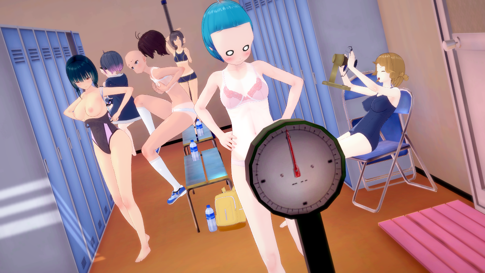
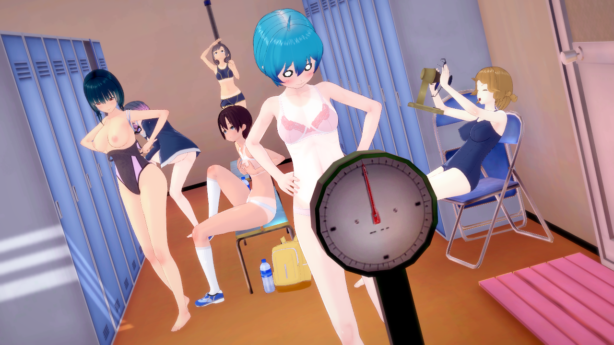

# 原作 Studio 擷取時序修正（2026-10-21）

0010 原作診斷圖曾出現頭髮離體，不能拿這種中間狀態比較角色外觀。

`AuditStudioScene` 原本在一般 coroutine continuation 手動呼叫 `Camera.Render`。此時 Animator 已更新，但 Studio 的 LateUpdate（FK、臉部、附件跟隨）尚未完成。現在暖機後與最後擷取前都等待 `WaitForEndOfFrame`，讓同一影格的更新完成再渲染；不改角色、場景或頭髮偏移。

修正前：

修正後：

原作實跑 `LightingLutEndOfFrame0010` 成功，已檢視完整圖片，頭髮、頭部與身體對齊，後方角色也不再混用中間姿態。C# 探針編譯成功，臨時安裝的探針已由 runner 移除。舊錯位圖片保留作錯誤證據，不作完整外觀的驗收金標。光影／LUT 主線將使用修正後重新擷取的基準。
