# OK Studio 計畫（2026-10-16）

依據：盤點 `Docs/OK_STUDIO_INVENTORY.md`；決定：物件樹共用，遊戲內與 Unreal 編輯器各一套 UI；KStudio 只匯入；原版道具／地圖全收、mod 道具只收場景用到的；PairedAnimations 換成 OK 動畫。只用 OK 共用資源與 OK 卡，舊 okPv 卡不處理。

## S1 物件樹與編輯器 UI ✅
- [x] 外掛 `Plugins/OKStudio`（Runtime `OKStudio`、Editor `OKStudioEditor`），加入 `.uproject`
- [x] `UOKSceneDocument`：資料夾、角色、道具（基礎庫模型）、燈光、相機；父子關係、新增、刪除（含子樹）、改父物件（保留世界座標、擋循環）、複製子樹、世界變換、顯示繼承
- [x] `.okscene`（JSON，format/version，只寫該種類的資料）存讀與驗證
- [x] `AOKSceneActor`：角色＝OK 卡（`FOkSession::Open`，衣服狀態、表情、看鏡頭、OK 動畫）、道具＝基礎庫模型、燈光／相機元件；內容變了才重建
- [x] 編輯器 `OKStudio.Open`／Tools 選單：大綱（拖放改父）、屬性、預覽、工具列（新增各物件、複製、刪除、移到根層、用此相機、新／開／存／另存）
- [x] 自測 `OKStudio.EditorSelfTest`：RESULT PASS

## S2 遊戲內 UI（進行中）
- [x] `UOKStudioGame` + Slate 面板（`OKStudio.Play [file]`）：大綱、物件屬性（變換、卡片清單、服裝組、9 部位衣服狀態、表情、燈光、相機）、場景按鈕、滑鼠繞行／平移／縮放、透過相機物件觀看
- [x] 自測 `OKStudio.GameSelfTest`：RESULT PASS（20 項；道具開啟從 3.5 分鐘降到秒級：`okmodel_view::contents` 每個 prefab 只建一次）
- [x] 3D 移動／旋轉／縮放把手（W／E／R，世界 X／Y／Z 軸，拖曳換算回父物件座標；自測模擬螢幕拖曳）
- [x] 捏人畫面「進入工作室」開新的 Studio（目前角色當第一個角色，站在原位；「離開」回捏人畫面）；舊時間軸改名「動作時間軸」暫留，S7 併入。驗收 `ok.GalleryOkStudioAudit`
- [x] 遊戲內場景清單（`UserData/Studio/scene/*.okscene`，取名存檔、點選讀取）
- [x] 獨立的場景編輯器（2026-10-22）：`SceneEditor.cmd [場景檔]`（`Tools/run_scene_editor.lua`，`-Scene`、`-WindowWidth/Height`、`-NoBuild`、`-DryRun`，可把檔案拖到 cmd 上）。開 `/Engine/Maps/Entry?game=/Script/OKStudio.OKStudioGameMode`：`AOKStudioGameMode` 不建立讀卡畫面的 HUD／Gallery，啟動時開 `-OKScene=<檔案>`（.okscene、OK 場景卡或 KStudio PNG；沒有就是新場景），只顯示 Studio 面板與觀看相機；引擎畫面訊息（`GAreScreenMessagesEnabled`）關閉；「離開」關閉程式。讀卡畫面的「進入工作室」維持原樣

## S3 Studio 道具與地圖進基礎庫（進行中）
- [x] 轉換器：原版 `abdata/studio/`（道具、材質、天空、地圖、清單；動畫與音效除外）進基礎庫（`oklib_convert` 的 `STUDIO_PREFIX`），清單的 prefab 當提示；mod 的 Studio zip 不收（S5 按場景轉入）。Studio 地圖都在 `studio/map`，劇情用的 `abdata/map` 不需要
- [x] 道具清單：`studio_items.rs` 讀 `studio/info` 的 ExcelData（ItemGroup／ItemCategory／ItemList／Map／MapCategory／Light），鍵為（group, category, no），轉換時寫成 `base_v1/studio_items.json`（每筆帶基礎庫模型 id）：16 大分類、143 中分類、2,447 道具、72 地圖、3 燈光
- [x] `FOKSceneItem` 可用（Group, Category, No）指定（保留直接模型 id）；`FOKStudioCatalog`
- [x] 場景地圖：`UOKSceneDocument::Map`（存進 .okscene），`AOKSceneActor` 從基礎庫生成
- [x] 道具瀏覽器：遊戲內（大分類→中分類→道具清單；沒選物件時的場景設定有地圖選單）；編輯器工具列「+ Studio Item」（分類子選單）與「Map」
- [x] 道具顏色：`FOKSceneItem::Colors`（sRGB，清單有開放的顏色欄才顯示），`AKKPreviewActor::ItemColorOverrides` 在載入時取代 item_draw 材質的 _Color..；改色會重建該道具。遊戲內為「#RRGGBB」輸入
- [x] 花紋（柄）：資料、匯入、UI、覆寫；道具材質與貼圖從依賴包讀進基礎庫（R4，2026-10-18）
- [x] Studio 地圖是場景 bundle：目錄記錄場景頂層物件（`roots`），每個各生成一個
- [x] 驗收 `ok-extract <game> --oklib studio-check <lib>`（replay，只用基礎庫）：地圖 72／72；道具 2,193 有網格、206 本來就不可見（3DSE 音效、無物件機關）、29 粒子特效，缺 19 個
- [x] 跨 bundle 網格：MeshFilter／SMR 的 `m_Mesh` 帶 `m_FileID` ≠ 0 時，照 `externals[FileID-1]` 的 CAB 名稱經 `references::load_external_with_streams` 讀依賴 bundle（含 `.resS`）解碼；`meshes_for_maindata` 在轉換時記錄，replay 只用基礎庫。`OKLIB_REFRESH=meshes_for_maindata` + `convert <lib> 6 @list` 重錄 `studio/01`、`studio/64` 後 studio-check：道具 2,211 有網格，樹、草叢、甘蔗、動物 18 個補上
- ~~粒子特效 ParticleSystem → Niagara 轉換~~ 不做（2026-10-17 決定）：KKS 原本的 29 個粒子特效（含螢火蟲 6/148/2529）不轉，改成 OK 自己的 Niagara 特效物件（見下方「剩餘工作計畫」R1）
- [x] 子物件接點（`child`）、燈光道具（Light 清單）；剛體物件的道具 FK（R4，2026-10-18）
- 驗收：原版道具全部能在場景生成、無缺口；地圖可載入

## S4 姿勢（進行中）
- [x] FK：Rust session 的 `user_fk`（骨骼 → Unity local 歐拉角），在 `finish_animator_transforms` 取代動畫旋轉（所有播放模式都經過）；FFI `ok_session_set_fk`／`ok_session_bone_euler`；`AKKPreviewActor::SetUserFk`（靜止姿勢也重算）；`FOKSceneCharacter::Fk` 存進 .okscene，改 FK 不重建角色
- [x] FK 骨骼清單：`studio/info` 的 Bone 表（355 根）寫進 `studio_items.json` 的 `fk_bones`；遊戲內選骨、XYZ、「取目前姿勢／移除此骨／清除 FK」
- [x] FK 旋轉把手：屬性勾「用 3D 把手轉這根骨骼」，旋轉環畫在骨骼自己的 local 軸（Unity 軸經 B 轉到 UE，B 為真旋轉），拖曳經 `ok_unity_euler_rotate`（Rust，和 FK 套用同一套四元數）寫回 FK；自測驗證拖曳後 FK 值＝Rust 計算值＝姿勢讀回值
- [x] 編輯器的 FK UI（R5 的 Pose 分頁）
- [x] 手型（遊戲的 24 種手指形狀，左右各一，-1 照動畫）、脖子看鏡頭；角色只有卡片／服裝組／衣服狀態／動畫改變才重建，表情與姿勢就地套用
- [x] IK：Rust session 的 Studio IK（遊戲 body-bone prefab 建的 FullBodyBipedIK，迭代 ≥ 12），在 ABMX 之後解算（目標＝肢體最後的位置）；效果器 0 身體、1/2 肩、3/4 大腿、5/6 手、7/8 腳；FFI `ok_session_prepare_studio_ik`／`set_studio_ik`／`ik_effector_position`；`FOKSceneCharacter::Ik`（角色空間 cm）；遊戲內選效果器、啟用（從目前位置開始）、XYZ、3D 移動把手。Rust 測試：手到達目標誤差 0、關閉後還原。共用資源暫時用 PairedAnimations 根目錄（同身體反應），S6 一起搬進基礎庫
- [x] 視線／脖子模式：眼睛、脖子各自「照動畫／看鏡頭／看注視點」（`EOKSceneLook`），注視點是角色空間的 cm；鏡頭位置每幀由遊戲的觀看相機或編輯器視窗相機給 `AOKSceneActor::ViewLocation`，`UpdateLooks` 設眼睛目標並推進追蹤、脖子走 session 的 head look（靜態角色當場重算姿勢）；匯入的角色眼睛照動畫。自測：脖子看側邊注視點頸骨轉 Y −19.5°，切回照動畫還原 0°
- [x] KK 姿勢檔（`UserData/Studio/pose/*.dat`，原作 PauseCtrl 格式）讀寫：`studio_pose.rs`（往返測試），FFI `ok_studio_pose_read/write`（JSON），`FOKStudioPose`（FK 骨骼編號 ↔ 名稱，依 FK 部位開關）；遊戲內「讀 KK 姿勢／存成 KK 姿勢」。目前本機沒有原作姿勢檔，以存出再讀回驗收：自測 PASS（檔頭為 `【pose】`、2 根 FK 骨骼往返一致、讀回後脖子角度正確）
- 驗收：FK／IK 姿勢存讀一致、IK 末端到位

## S5 KStudio 場景匯入（進行中）
- [x] Rust `studio_scene.rs` 解析場景 PNG：版本、ObjectInfo 樹（角色、道具、燈光、資料夾、路徑、相機、文字，依版本欄位）、地圖；角色卡資料範圍、臉部縮圖、ExtendedSave 在卡後附的 KKEx（外掛資料）；`--oklib scene-stats <lib> <dir>`：官方 7,594 個場景解析 7,590 個（4 個舊版場景資料提早結束，原作也讀不了），角色 45,664、道具 4,203,784（基礎庫外的 mod 道具只有 45 個）
- [x] 角色：臉部縮圖＋卡資料重組 KKS 卡、KKEx 併回卡片區塊，再 `make_ok_card` 轉 OK 卡（測試：轉出的 OK 卡 41 部位、可從基礎庫開啟）
- [x] C++ `FOKStudioImport`：資料夾、角色（OK 卡、FK、張嘴）、道具（目錄、顏色）、燈光、相機、地圖；路徑→資料夾、文字略過、飾品插槽上的物件掛在角色的掛點骨頭上（AccessoryPoint 表）；Unity→UE 變換；匯入報告 `.import.json`；遊戲內「匯入」與 `OKStudio.ImportKStudio`、`OKStudio.ImportKStudioSample`
- [x] 角色的 Studio IK 目標：場景存的 13 個目標都是角色根空間的位置（官方場景驗證：1–3 左臂、4–6 右臂、7–9 左腿、10–12 右腿，左右和骨骼同側），對到 OK 的 9 個效果器；手肘、膝蓋是彎曲目標，先不帶。部位開關照 body、右腿、左腿、右臂、左臂。自測匯入 `koikatu_cs0000010`：4 個角色各 9 個目標，左手全部到位（最大 0.08 cm）。修了匯入時體型骨架還沒算好、IK 準備失敗的時序問題（`SetStudioIk` 先算一幀再重試）
- [x] 手型編號：場景 0＝照動畫，n＝遊戲第 n 種（`OCIChar.ChangeHandAnime` 是 `SetShapeHandValue(side, n, 0, 0)`；2026-10-19 前誤用 n−1，V 字會變成握拳）
- [x] Studio 動畫（S6）
- [x] 道具 FK：場景解析保留道具的 FK 骨骼（名稱＋local 旋轉）；`FOKSceneItem::Fk`，道具開 session 時先把蒙皮網格骨架的這些骨頭轉好再烘網格（`ok_okmodel_open_session_fk`），可轉的骨頭由 `ok_okmodel_fk_bones` 列出；匯入帶入、遊戲內每根骨頭 XYZ 與清除。官方場景 7,161 個 FK 道具、17 種（最多 15/74/978 關節 2,638 次）。Rust 測試轉 60° 動 922／1,074 頂點、不設 FK 和原本完全相同；自測頂點中心移 1.82 cm、清除還原。剛體物件當骨頭的（如 15/74/979 `o_koi_stu_flybace_joint_*`）還不會轉：okmodel 的剛體網格沒有 prefab 層級
- 驗收：7,656 個場景的匯入統計，抽樣與原作截圖對照
  - 抽樣匯入（2026-10-18，`OKStudio.ImportKStudioSample <資料夾> <數量>`，結果在 `Saved/OKStudio/import_sample.txt`，備註依種類統計）：官方 7,594 個場景平均抽 40 個，40／40 匯入、209／209 個角色轉成 OK 卡，道具 24,769 個中 23,778 個對到基礎庫目錄，其餘 991 個都是粒子道具、已轉成 OK 特效（沒有遺漏），共 293 秒（最慢的是 21 個角色的場景，31 秒）。備註只有：飾品插槽上的物件掛到角色下、燈光強度換算是近似值、路徑變成資料夾
  - 和原作截圖對照（2026-10-18，使用者同意下載反編譯工具 ILSpy，放 `Tools/ilspy/`、不進版控）：
    - 主相機：地圖之後依序是特效設定（依版本）、天空（≥1.1.2.0）、`cameraSaveData`（kind、位置、旋轉、距離，kind 1 只有一個 float；parse＝垂直視角），再 10 個儲存視角、`charaLight`（顏色 JSON、強度、rot[2]、陰影）、`mapLight`（多一個 type）。相機世界位置＝Euler(rotate)×distance＋pos；Unity 相機看 +Z、UE 看 +X，相機與燈光多轉 90°；垂直視角照 16:9 換成水平。官方 7,594 個場景讀到主相機 7,590 個（其餘 4 個本來就讀不完）
    - 匯入：「Studio camera」物件（場景沒有相機時設為使用中），子物件「Studio character light」跟著相機；「Studio map light」放世界（強度：平行光 ×4、點光 ×800，近似值）。之前地圖和道具全黑就是缺這兩盞燈
    - 角色狀態：卡片 Status 的 coordinateType、clothesState 帶入服裝組與衣服狀態
    - `OKStudio.CompareKStudio <資料夾> <數量> [格數] [exit]`：平均抽樣，每個場景用主相機拍一張，和場景卡縮圖左右並排存到 `Saved/OKStudio/compare/`
    - 掛點：原作 `OCIChar.OnAttach` 把飾品插槽上的物件接到 `ChaReference.GetReferenceInfo(key)`，key 來自 `studio/info` 的 AccessoryPoint 表（54 個，全是 `a_n_*` 節點）。目錄的 `accessory_points` 存 no／group／key／name／bone（`studio_items::reference_bone` 換算；全量轉換時寫入，`refresh_accessory_points` 測試只補這一段）。`FOKSceneObject::AttachBone` 記掛在哪根骨頭，`UOKSceneDocument::BoneFrame` 由 `AOKSceneActor` 提供目前姿勢的骨骼框架（`BoneWorldMatrix`＋`OKSkinPaletteToUnreal`），`WorldTransform`／`ParentFrame` 都經過它，每幀 `PlaceAttached` 跟著動畫移動；改父物件會清掉掛點。koikatu_cs0002850 的大劍現在扛在肩上、握在手裡，和原作一致。自測：掛在 a_n_hand_L 的物件在手上，手臂 FK 一轉跟著移動 43 cm
    - 對照看到的：①多數 Studio 道具沒有材質、②地圖貼圖是灰色雜訊，兩個都是依賴包的材質／貼圖沒讀，已修（見 R4 花紋）。重錄後地圖（體育館、教室）有原本的貼圖
    - 第二輪（2026-10-18）：
      - 「少零件、機器人沒出現」不是匯入問題：拍照時新建的道具還在用替代材質（漸進式材質還沒換上、執行期 shader 還在編）。`UOKStudioGame::MaterialsPending()`（shader 編譯工作＋各預覽的 `PendingPreviewMaterials`），CompareKStudio 和 PatternTest 都等它清空再拍；PatternTest 改成三張（白、主色紅、紅色花紋），主色和花紋都要變紅才 PASS
      - 場景的畫面設定：`studio_scene.rs` 的 `SceneEffects`（`effects`）讀出 aceNo／aceBlend、AO、泛光、景深、暗角、霧、陽光、影子、全域描邊／ramp／環境陰影、shaderType，以及 BGM／環境音／外部音效之後的背景圖與外框（反編譯 SceneInfo、BGMCtrl、ENVCtrl、OutsideSoundCtrl 確認）。道具的描邊色／寬、自發光、lightCancel 也留在 `Object::Item`
      - 調色濾鏡：`studio/info` 的 Filter 表（17 個 Amplify Color LUT，`studio/filter/00`）寫進目錄 `filters`；FFI `ok_studio_texture_png`；`FOKStudioCatalog::FilterLut` 把 1024×32（x＝r＋32b、y＝g）三線性轉成 Unreal 的 256×16（非 sRGB 取樣，sRGB 會整張變暗）；`FOKScenePost::ColorFilter`／`ColorFilterIntensity`（＝1−aceBlend，Amplify 是 lerp(LUT, 原圖, BlendAmount)）。官方場景預設都是 0「昼」全開，套上後室內場景的暖色和原作一致
      - 背景圖：`FOKScenePost::Background`，匯入時從場景所在遊戲的 `UserData/bg`（或 `OK_GAME_ROOT`、場景旁邊）複製到 `_cards` 資料夾；`AOKSceneActor::PlaceBackground` 在鏡頭前 1 km 放一塊剛好填滿畫面的 unlit 平面（`Widget3DPassThrough_Opaque`），觀看相機每次更新時跟著擺；透明背景截圖不包含它
      - 除錯用：`OK_STUDIO_COMPARE_WIDE=<倍數>` 多拍一張拉遠的、`OK_STUDIO_COMPARE_HIDE=<g>/<c>/<n>,…` 先藏起指定道具
    - 第三輪（2026-10-19，改在 E:\OpenKoikatsu／E:\PhysX\UE5.8）：
      - 表情：場景角色卡的 ChaFileStatus eyebrowPtn／eyesPtn／mouthPtn 和 eyesLookPtn（1＝看鏡頭）／neckLookPtn（0＝看鏡頭，預設 3＝照動畫，Studio 的脖子按鈕是 {0,1,3,4}）帶進角色（`card.rs` status_*、匯出的 status、匯入）
      - 手型：場景的 handPtn n 就是遊戲第 n 種（`OCIChar.ChangeHandAnime` → `SetShapeHandValue(side, n, 0, 0)`），之前誤用 n−1，V 字變成握拳
      - 顯示：`FOKScenePost::ApplyTo` 照讀卡器的顯示設定關掉 UE 色調曲線與 gamut 擴展、固定手動曝光（原作 shader 直接寫顯示色）。之前畫面偏暗、偏灰，濾鏡吃到的顏色也跟著偏（火箭筒偏紫）
      - 光效道具（`Shader Forge/main_item_studio_add`）：轉換器判成 `additive`、不走 item_draw；UE 用 BLEND_Additive，乘上道具第一色，不加描邊（描邊殼會把貼圖的黑底畫出來，就是之前的黑／黃大片）
      - 沒有地圖、背景圖、天空時：原作相機清成單色（`Map.ReflectMapInfo` clearFlags Color），從場景卡角落反推「昼」LUT 前約 sRGB (139, 180, 222)，`FOKScenePost::BackgroundColor`。SkyInfo（MessagePack Enable／Pattern）讀進 `effects.sky`；官方樣本都沒開天空，天空本身還沒做
      - 大場景記憶體：每個預覽 actor 都建 2 張 1024² RGBA32f 的卡通陰影 render target（32 MB）。道具不開顯示陰影時從不寫入，改成共用一對 4×4（`KKPreviewActor`）。另外場景改成每格最多建 24 個物件（`BuildsPerFrame`，`SyncNow` 最多連建 8 批），1,645 個物件的 koikatu_cs0004432 從 28 GB 以上（建到一半）變成約 10.3 GB 建完
      - 材質共用：`OKFindEqualMaterialGraph`（純量／向量參數的預設值不算進 key，命中時用 MID 帶各自的值），`MakePartMaterial` 改用它。試過把道具顏色也當參數傳進去，結果主色顯示錯（渲染端參數化顏色的路徑有問題），已撤回
      - 只靠 OK 共用資源：`--oklib studio-images` 把遊戲的 `UserData/bg`（25 張）、`UserData/frame`（8 張）和 14 張官方樣本場景收進 `base_v1/studio/{bg,frame,samples}`（PNG 走 LFS）；匯入時背景／外框先找基礎庫（存相對路徑），外框以半透明平面疊在鏡頭前；自測與 `OKStudio.CompareKStudio samples <數量>` 改讀基礎庫的樣本，不再寫死遊戲路徑。角色本來就轉成 OK 卡（沒有遊戲目錄時只缺 mod 的 zipmod）
      - 除錯：`OKStudio.StressItems <數量> [g/c/n]`（每 50 個記錄記憶體與物件數）、`OK_STUDIO_COMPARE_DUMP=<名稱>`（列出元件材質與 blend）
    - 第四輪（2026-10-19）：
      - 相機在房間外（更衣室、俯視廁所）全黑：Unity 內建 shader（Standard、Legacy、Unlit、FX、Particles…）沒有描邊 pass，我們卻給 ShaderKind 0 的地圖部件加反殼描邊，牆的反殼從外面看就是一面黑牆。`OKShaderHasNoOutlinePass`（`KKPreviewActor`）依來源 shader 名稱不加描邊。另外 `m_CastShadows`＝ShadowsOnly 的 renderer 不畫（`unity.rs shadows_only`）
      - Studio 道具的 ItemComponent：目錄 `studio_items.json` 每個道具加 `line_width`（defLineWidth，0＝沒有描邊，例如平面）和 `alpha`（有 rendAlpha 部件），`--oklib studio-catalog` 只重寫目錄。場景的 colors[6]＝影色（defShadow → 材質 `_ShadowColor`）、`alpha`（透明度，item_draw 部件改半透明、不透明度乘上它）、`line_width`（0 或道具本身 0 → 不加描邊）都進 `FOKSceneItem`（`ShadowColor`／`Alpha`／`LineWidth`），屬性面板有「影色／透明度／描邊寬度」。公車亭的平面牆之前是描邊殼的黑片
      - Studio 角色燈只照角色：地圖預覽放在光照通道 2，角色燈（`FOKSceneLight::bCharactersOnly`，匯入時跟相機的那盞）只照通道 0，其他燈照 0 和 2。俯視廁所之前被跟相機的燈打成一片白
      - Standard 自發光：材質有 `_EMISSION` 時轉換器保留 `_EmissionMap`（`shader_textures`），UE 在材質自發光加上 `_EmissionColor`（gamma→linear，可大於 1）×貼圖。舞台（ライブステージ）沒有光照貼圖、環境光很暗，佈景全靠自發光；重錄目錄的 91 個 bundle
      - 景深：場景 `depth` 開啟時 `FOKScenePost::bDepthOfField`，對焦距離＝Studio 相機到目標的距離，`depth_aperture` 0..1 對到 f/4..f/1.4
      - 探針：`OK_MAP_LIST`（renderer、材質、shader）、`OK_MAP_EMISSION`、`OK_MAP_BEHAVIOUR=<GameObject>`（MonoBehaviour 欄位）、`OK_MAP_RENDER`（RenderSettings／LightmapSettings），都在 `studio_items.rs` 的 `shadow_only_probe`；`OK_ITEM_FULL=<名稱>`（場景道具完整 JSON）在 `scene_item_probe`
      - 光照貼圖：`ParsedBundle::prefab_lightmaps`（memo，`--oklib studio-nodes` 錄進基礎庫）記每個 MeshRenderer 的 m_LightmapIndex／m_LightmapScaleOffset（依階層節點）和場景 LightmapSettings 的貼圖（DXT5 RGBM）。`okmodel_view::bake_lightmap` 在展開 instance 時把 uv2（沒有就 uv）× scale-offset 寫進 uv4、材質加 `_OKLightmapIndex`，每張貼圖只掛在第一個用到的 part（`_OKLightmap`，不複製）；UE 用 TEXCOORD1 取樣、`pow(5·a·rgb, 2.2) × albedo` 加進自發光（Unity gamma 空間的 DecodeLightmapRGBM），同一次載入的 part 共用貼圖。體育館、更衣室、廁所有了原作的烘焙光影
      - 卡片選單：`AvailableCards` 的隱藏資料夾過濾只看 CharacterCards 底下（專案路徑是 `../../..` 時之前全部被濾掉）
      - 記憶體：14 個樣本連續比對，峰值 27.8 GB 出現在 1,900 個物件的公車亭場景，之後回落到 22.9 GB，不是無限成長
      - 驗收（2026-10-19，`OK_GAME_ROOT` 指向不存在的目錄、只用基礎庫）：7 個代表場景 7／7 出圖、26 個角色全部轉成 OK 卡，`OKStudio.GameSelfTest`、`OKStudio.EditorSelfTest`（先 `OKStudio.Open`）、`OKStudio.PatternTest` 全部 RESULT PASS；Rust lib 測試 490 過、47 失敗都是寫死 `C:/portable/KoikatuSunshine` 的環境測試（與本輪無關）
    - 第五輪（2026-10-19，眼神）：
      - 眼睛表情：場景的 eyesPtn 是 cha_eyeset（角色清單分類 2）的列，不是 FaceBlendShape 樣式。`eye_set.rs` 照原作 `ChaControl.ChangeEyesPtn` 讀那一列：blendshape 樣式（EyesPtn）、n_eyebase（眼線、眼白、淚）與 n_hitomi（瞳孔）是否顯示、gag 眼（cf_O_gag_eye_00..02，n_special）與它的貼圖（取貼圖動畫第一格）、瞳孔表情貼圖（EpsTex：瞳に星、瞳にハート）。會改部件的眼睛組（`changes_parts`）由 `StatusJson` 的 `eyes_ptn` 帶進角色 session（`studio_status`），否則只在臉上設 blendshape；`FOKStudioCatalog::EyeSet`（FFI `ok_eye_set_json`）。gag 眼是 unlit 半透明；瞳孔表情貼圖在 TEXCOORD3（`ok_part_eye_expression_uvs`），疊在高光之下。體育館男孩的漩渦眼和原作一致
      - 景深：Unity DepthOfField 的模糊強度是 1/(1−aperture)−1（aperture 0 不模糊），清晰寬度 focalSize；f 值＝3.7·focalSize／強度（以 1901 校準）。`ApplyTo` 沒有景深時明確寫入對焦距離 0（之前沿用前一個場景的景深，接在 1901 後的 3800 整張模糊）
      - 泛光：場景的門檻（`BloomThreshold`，顯示值→linear）與大小（`BloomSize`＝blur／4）
      - 共用母材質：同步進來的 master 讓編輯器也用角色卡的共用母材質，Studio 道具的主色、明暗、透明度與地圖的光照貼圖、自發光因此失效；`AKKPreviewActor::bUseSharedParents`，OK Studio 的道具和地圖預覽用各自的材質圖（角色照用共用母材質）
      - 測試：`OKStudio.EyeSetTest`（eyesPtn 0／23 漩渦眼／25 瞳孔愛心／34 右眼緊閉 → blendshape 23），四項 PASS；PatternTest、GameSelfTest、EditorSelfTest PASS
    - 第五輪之二（2026-10-19，地圖攝影機 → RenderTexture）：
      - 轉換器：`ParsedBundle::prefab_render_textures`（新 memo，`--oklib studio-nodes` 錄製，既有 bincode 結構不動）記 prefab 裡 `m_TargetTexture` 指向 RenderTexture（class 84）的 Camera：節點、enabled／GameObject 是否 active、垂直 fov、近遠平面、正交與大小、cullingMask、clearFlags／背景色、RenderTexture 名稱與寬高；以及每個 MeshRenderer／SkinnedMeshRenderer 材質的貼圖槽指到這些 RenderTexture 的（節點、材質名、屬性、攝影機編號）。PPtr 的 m_FileID 相對於寫著它的檔案（場景的材質和 RenderTexture 在 sharedAssets），解析時跟著換檔
      - `okmodel_view::mark_render_texture`：展開 instance 時，用到 RenderTexture 的 part 材質加 `_OKRenderTexture`（攝影機編號）與 `_OKRTCamPos`（位置、fov）／`_OKRTCamFwd`（+Z、near）／`_OKRTCamUp`（+Y、far）／`_OKRTCamSize`（寬、高、正交、正交大小）／`_OKRTCamClear`。方向取階層的旋轉鏈（ライブステージ的 `Camera` 縮放是 0，世界矩陣算不出方向）；沒啟用的攝影機不標
      - UE（`KKPreviewActor::RenderTextureFor`）：每台攝影機一個 `USceneCaptureComponent2D`（掛在預覽 actor、FinalColorLDR、垂直 fov 依長寬比換成水平）＋ `UTextureRenderTarget2D`（RenderTexture 的尺寸，RGBA8 sRGB），建好擷取一次，之後每 `ok.RenderTextureInterval` 秒（預設 0.5，0＝只擷取一次）用 core ticker 再擷取，不每格擷取；part 換成共用的 unlit 螢幕材質（`OKRenderTextureScreenMaterial`，MID 的 "Screen" 參數＝render target，不做 MosaicTexture 的馬賽克）；螢幕不被自己的攝影機拍到（unlit 螢幕拍自己會越拍越亮）。`DestroyAllParts` 停 ticker、清掉擷取元件
      - ライブステージ（地圖 28，模型 `6eb31802…`）：唯一的 `Camera`（z 22.3、高 1.43 m、往舞台看）寫 `mainmoniterSub 1`（1024²），由大螢幕 `moniter_main_screen_gp`（材質 `moniter03`，取 v 0.01–0.43）取樣；`mainmoniter`、`mainmoniterSub`（側螢幕 `moniterSub`，Unlit/MosaicTexture）在 bundle 裡沒有攝影機寫入，維持黑色。重錄 `OKLIB_REFRESH=prefab_render_textures ok-extract D:/KoikatuSunshine --oklib studio-nodes <lib> 6`（90 個 bundle，15 秒）
      - 除錯：`OK_RT_DUMP=1` 把 render target 和每個螢幕的近拍存到 `Saved/OKStudio/render_texture_<n>*.png`；`OK_HIDE_SHADER=<前綴>,…` 藏起某些 shader 的部件；Rust `render_texture_probe`（`OK_RT_ALL` 列出 bundle 所有 RenderTexture 與引用者、`OK_RT_MATERIAL`、`OK_RT_NEAR`＋`OK_RT_RAY` 射線找鏡頭前的部件）、`scene_camera_probe`（場景主相機在地圖空間的位置與方向）
      - 驗收：1901 的大螢幕顯示地圖攝影機的畫面（舞台、愛心、蝴蝶結、禮物、熊；中間被 volumeLight 擋成白色，見「還沒修」）；GameSelfTest、EditorSelfTest（先 `OKStudio.Open`）、PatternTest RESULT PASS
    - 第五輪之三（2026-10-19，舞台 Shader Forge 特效）：
      - ライブステージ的五個 Shader Forge 舞台 shader 照反組譯的 DXBC 重做（`unity.rs` 的 `shader_dxbc_probe` 把 shader 的所有程式寫成 `.dxbc`，`fxc /dumpbin` 反組譯；CB 欄位照 m_ParsedForm 的 m_NameIndices 順序）。五個都先取一張捲動的 `color` 貼圖（Unity uv2，加 `_Time.x`·速度）的色相（rgb→hsv→hsv(h,1,1)），`lerp(1, 色相, _saturation)·_brightness`：
        - `volumeLight`（光錐，4 個）：·saturate(`_mask`·`_multiplier`)·N·V，加算（One One）、不寫深度、Cull Front（只畫背面）
        - `spotLight_beam`（117）：·`_mask`·N·V（法線朝向觀看者），加算、雙面
        - `spotLaser`（114）：色相 UV 再加 `_uvoffset`，·`_mask`；`spotLight_glow`（48）：·`_mask`；都是加算
        - `electricLight`（LED 面板，13）：`_MaskFast`／`_MaskSlow` 依 `_TextureChange` 混合，UV 每 1/`_ScrollSpeed` 秒跳 `_UVOffset` 一格，(m·(2−frac))² 上限 1，再依 `_FullLighting` 混 `_MaskFull`；不透明、寫深度
      - 轉換器：`unity::stage_effect_kind`（shader 名稱 → 1..5），擷取網格時保留這些 shader 的貼圖槽（`_color`／`_mask`，或 `_Emission`／`_MaskFast`／`_MaskSlow`／`_MaskFull`）到 `shader_extra_textures`，材質加 `_OKStageEffect`；`session.rs` 對這種 part 保留這些貼圖。重錄 `OKLIB_REFRESH=meshes_for_maindata convert <lib> 6 @<只有 livestage_s 的清單>`（只有這張地圖用到，studio 道具 bundle 都沒有）
      - UE：`OKStageEffectMaterial(kind)`（每種一個 Custom 節點圖，貼圖物件參數 Color／Mask／Mask2／Mask3、向量參數 ST 與 P／Q）＋ `OKStageEffectInstance`（每個 part 一個 MID）；Unity uv2 走 TEXCOORD2（沒有 uv2 用 uv），時間用 UE 的 Time。KKS 是 gamma 空間：貼圖不做 sRGB 解碼、算完 pow 2.2 轉線性。這些 part 不加描邊殼
      - 結果：LED 牆變成彩色的燈點，光錐是半透明的暖色，大螢幕中間不再一片白（舞台攝影機的畫面看得到愛心、蝴蝶結、禮物、熊）
      - 除錯：`OK_RT_VIEW=x,y,z,dx,dy,dz,垂直fov`（配 `OK_RT_DUMP`）從 Unity 座標的指定姿勢拍一張沒有後製模糊的 `render_texture_view.png`；`render_texture_probe` 的 `OK_RT_TEXTURES=<材質>,<目錄>`（材質數值與貼圖）、`OK_RT_ANIMATORS`、節點鏈；`scene_camera_probe` 印角色的位置
      - 測試：GameSelfTest、EditorSelfTest（先 `OKStudio.Open`）、PatternTest RESULT PASS
    - 第六輪（2026-10-19，天空與 gag 眼動畫）：
      - Studio 天空：場景的 SkyInfo（Enable、Pattern）帶進 `FOKScenePost::bSky`／`SkyPattern`，設定面板有「天空」與「天空樣式」。原作開天空時相機改清成 skybox，載入 StudioSky 清單那一列的 Funly Sky Studio profile（`SystemButtonCtrl.SkyInfo.SetPattern`）。KKS 的 4 個 profile（晴れた空、昼の空、夕暮れの空、夜空）都是單一關鍵幀，profile 引用的 skybox 材質（在依賴包 `studio/map/materials/00`）就存著控制器套上的值
        - 基礎庫：`ok-extract <game> --oklib studio-sky <lib>`（`studio_sky.rs`）寫 `studio/sky.json`（每個樣式的 keyword、float、color、貼圖、矩陣）與 `studio/sky/*.png`（雲雜訊、月亮、星星資料，約 20 MB，走 LFS）。keyword 照 `TimeOfDayController.SynchronizeAllShaderKeywords` 從 profile 的功能開關推（含相依），不用材質存檔的（晴れた空的材質存檔少了 SUN／CLOUDS／NOISE_CLOUDS）。月亮的 `_MoonWorldToLocalMat` 依 Studio 場景 `SkySystemController/Moon/Position`（local (0,0,−10000)、繞 Y 180°）與 `OrbitingBody.LayoutOribit` 算出
        - 程式：`Tools/generate_studio_sky.lua` 把 `Funly/Sky Studio/Skybox/3D Standard` 的 9 個變體（都是直線程式）轉成 HLSL，寫 `Plugins/OKStudio/Source/OKStudio/Private/StudioSkyPrograms.inl`（vertex 程式改名 vo／vr／vcb，接上 pixel 的 v 暫存器，CB 配置、property 型別與 [Gamma] 旗標、貼圖槽）。`OKStudioSky.cpp` 依樣式 keyword 挑相符最多的變體（Unity 找不到完全相符變體時的作法），常數寫成 asfloat 字面值，Color 與 [Gamma] 值線性化（Studio 是 Linear 色彩空間），sRGB 貼圖照原設定取樣
        - 顯示：`AOKSceneActor::PlaceSky` 在鏡頭周圍放半徑 10 km 的球（`/Engine/BasicShapes/Sphere`），unlit、雙面；方向用 CameraVector 換成 Unity 軸 (−x, z, y)，vertex 程式每個像素跑一次。背景圖仍在天空前面。材質不能設 `bIsSky`：設了之後 SceneCapture 拍不到
        - 沒做：地圖自帶的天空（MapSkyInfo，原作會蓋過場景的天空設定）、天空對角色光照的影響（TimeOfDayController 的太陽燈與環境光）、雲的 `sample` 都是 mip 0
        - 測試：`OKStudio.SkyTest`（無地圖，四個樣式朝上與地平線各拍一張，`Saved/OKStudio/sky_*.png`）：樣式彼此不同、昼の空上方偏藍、夜空比白天暗且 `_MoonPosition` 方向有月亮、關掉後畫面改變，RESULT PASS。Rust `studio_sky` 兩項（orbit 矩陣、安裝遊戲轉出 4 個樣式）
      - gag 眼動畫：gag 眼材質 `Koikano/sub_texture_animation`（`chara/mm_base` 的 `cf_m_gageye_*`）的 pixel 程式依時間做三件事：大小脈動 `2·(sin(_SizeSpeed·t·10)+1)·_SizeWidth+1`、以中心旋轉 `_AngleSpeed` 圈／秒、`_TileAnimation`（欄、列、速度）的翻頁（第 `z·t·9` 格，從上排開始）。`_yurayura` 在 KKS 的 shader 裡沒有用到。`eye_set.rs` 帶出 TileAnim／SizeSpeed／SizeWidth／AngleSpeed，有動的眼睛組改送整張 sprite sheet 並把值寫進部件材質；`KKPreviewActor` 的 `MakeGagEyeUV` 照原作算式產生 UV（23 漩渦眼每秒 −0.5 圈、26 脈動、27／32 六格翻頁）。`OKStudio.EyeSetTest` 加一項：23 號隔一秒再拍，畫面要不同（2,181 像素；只有頭髮晃動約 150 像素，門檻 500），RESULT PASS。改了開卡內容要遞增 `SESSION_CACHE_REVISION`（現為 8），否則 UE 讀到舊的開卡快取
    - 第七輪（2026-10-19，Studio 道具色差）：
      - 原因：原作 `main_item_studio`（共用母材質的原生程式 `ForgeStudioProgram.inl`）的暗部不是「主色 × 影色」，而是先從主色的色相取一個飽和色乘上 `_ShadowColor`，再依 ramp 混合；自建的 item_draw 近似圖沒有這段，所以星星不會變綠、火箭筒不會變橄欖綠。LUT（昼 `Lut_Amount`）本身沒錯：灰會對到 (130,127,121)，原作的橄欖綠是套 LUT 前就有的
      - Studio 道具改用共用母材質（原作程式）：`FKKRuntimeMaterialPart::Overrides`（宿主覆寫的材質值，綁定時最後套用；道具的 `_Color`..`_Color4`、`_ShadowColor`），`AKKPreviewActor::bStudioItemShading`（道具開 toon 陰影，不因角色顯示陰影關掉而把 `_ShadowColor` 改白），地圖仍用自建圖（光照貼圖、自發光），半透明道具也是
      - 場景的著色全域值：`FKKRuntimeMaterialScene::Globals`（宿主的 Shader.SetGlobal 值，綁定時最後套用），`FOKScenePost` 帶 `AmbientShadow`／`AmbientShadowG`／`LineColorG`／`LineWidthG`，`ShaderGlobals()` 照原作 `SystemButtonCtrl.SetAmbientShadow`／`SetLineColor`／`SetLineWidth` 算出 `_ambientshadowG`（顏色, 1−G）、`_LineColorG`、`_linewidthG`。之前共用母材質用的是角色編輯器的近黑環境陰影 (0.019,0.027,0.039)，道具暗部一片黑
      - 光：Studio 的角色燈（`CameraLightCtrl`，掛在相機下、依 charaLight.rot 轉）照 Chara 圖層，道具也在這層；`AOKSceneActor::UpdateItemLighting` 每格把它的世界方向（Unity 朝光源方向）與顏色×強度寫進道具共用實例的 `_WorldSpaceLightPos0`／`_LightColor0`（`AKKPreviewActor::SetSharedVectorParameter`，有變才寫）
      - 結果：體育館星星變綠、機器人的白／紫／灰受光、公車亭牆與木柱的明暗都接近原作；PatternTest 2080／2113
      - 除錯：`OK_SHARED_PARAM_DUMP=1` 列出道具實例的 `_Color`／`_ShadowColor`／光／環境陰影；`lut_probe`（`OK_LUT`）算濾鏡 LUT 把顏色對到哪裡；`lightmap_probe`（`OK_LM_MODEL`）看光照貼圖的編碼（RGBM 的 alpha 會變化）
      - 記憶體：道具 actor 建好共用實例後釋放 `Session.RuntimeMaterials`（解碼後的貼圖），1,900 物件的公車亭場景 38.7 → 21.4 GB、20 → 10.5 分鐘
      - 驗收（14 張樣本，無遊戲目錄）：14／14 出圖；PatternTest、GameSelfTest、EditorSelfTest PASS；EyeSetTest 的 gag 眼動畫那項（天空 session 新加的「23 號隔一秒要變」）FAIL，已交給天空 session
      - 資料限制：沒有地圖、背景圖、天空時，原作的背景色是作者的個人設定（`Config.EstData.BackColor`），不存在場景檔；我們用遊戲預設的藍，作者設成黑色的（5698 陸橋）會不同
    - 第八輪（2026-10-19，地圖光照與舊路徑外框）：
      - 光照貼圖位置：Unity 2019 的 renderer 把圖集位置存成 `m_LightmapTilingOffset`（API 名稱才是 `m_LightmapScaleOffset`），之前讀不到就用 (1,1,0,0)，每個物件都貼滿整張光照貼圖（廁所牆上出現貼圖左上角的藍色）。`prefab_lightmaps_unity` 兩種名稱都讀，且以地圖腳本 `lightmapParameters`（renderer、lightmapIndex、scaleOffset，Illusion 載入時套到 renderer 上的值）為準；`OKLIB_REFRESH=prefab_lightmaps --oklib studio-nodes` 重錄了 38 個有光照貼圖的地圖模型
      - 地圖燈：KKS 的 `CameraLightCtrl` 只有角色燈（`lightChara`）；`SceneInfo.mapLight` 只存讀、從不套用，原作地圖只有烘焙光。之前匯入成一盞照地圖的方向燈，把有光照貼圖的面再打亮一次（廁所隔板爆白）。匯入改成只建角色燈
      - Standard shader 的光照貼圖：Unity（gamma）的間接漫射是光照貼圖 × albedo × oneMinusReflectivity，`0.779 × (1 − _Metallic)`（`_METALLICGLOSSMAP` 時取貼圖 R）、specular setup 用 `1 − max(_SpecColor)`。之前直接乘 albedo，金屬度 0.62 的隔板亮了三倍多。`FOKToonShadowParameters::LightmapDiffuse`／`LightmapMetallicTex`
      - 舊路徑外框（`OK_SHARED_PARENTS=0`、Studio 地圖等自建圖）：`OKMakeRuntimeOutlineVertexOffset`（KKRuntimePose）把部件家族的原作外框頂點程式（`OutlinePrograms.inl`）當 WPO，材質值由 `OKPrepareRuntimeSharedMaterialBinding` 解析後直接寫進程式（和共用外框母材質同一套輸入與座標轉換），貼圖接部件自己的；`OKDescribeRuntimeMaterialPart` 不解碼貼圖就取得部件描述。`MakeOutlineMaterial`（皮膚、頭髮、Koikano 服裝）和 `KKMainItemPlus` 的外框都改用它，沒有程式的家族才用舊公式；`ok.OutlineApprox 1` 仍可切回。廁所＋體育館 114 個外框全部走原作程式，粗細與共用母材質一致
      - 驗收（第二次 C↔E 同步後的 f4e83780，無遊戲目錄）：14／14 出圖（18.9 分鐘，14 張連跑的行程峰值 33.8 GB，公車亭那張約 +16 GB）；PatternTest、GameSelfTest、EditorSelfTest、EyeSetTest、SkyTest 全部 PASS
      - 除錯：`raw_lightmap_probe`（原作 bundle 的 renderer 光照貼圖欄位與 MonoBehaviour）、`sample_scene_settings`（樣本場景的畫面設定與燈）、emission 探針的 `OK_EMIT_MAT`（材質值與貼圖平均）、`lightmap_alpha` 的 `OK_LM_OUT`（解碼後的光照貼圖）
    - 第九輪（2026-10-19，角色的場景光、ramp、泛光、霧／AO／光束、地圖天空）：
      - 角色的光：`UpdateItemLighting` 也把角色燈寫進角色共用實例的 `_WorldSpaceLightPos0`／`_LightColor0`；角色生成時帶入場景的 `ShaderGlobals()`（環境陰影、外框色與粗細），之前角色用的是角色編輯器的預設燈和環境陰影（0059 角色過亮）
      - ramp：場景的 `ramp_g`（`SystemButtonCtrl.SetRamp`，mt_ramp 編號）匯入成 `FOKScenePost::RampG`，角色與道具都換成 `kk_<n>` ramp（`OKLoadRenderRamp`，`AKKPreviewActor::RampOverride`，重建部件時也保留）
      - 泛光對齊原作：Studio 相機上是 Standard Assets `BloomAndFlares`（Add、2 次迭代、HDR Auto）。原作的模糊是每次迭代 4×BloomSize 像素的 6-tap 擴散，換成高斯約 σ = 0.00498·4·BloomSize·9/16 個畫面寬；UE 的高斯泛光 σ ≈ R/5.78（R = Size%×寬×0.5），所以只用 Bloom3（tint 6，抵掉 UE 的 1/6），Size = σ·5.78·2·100，其他 tint 關掉；強度 ×2/(1−門檻)、門檻用線性值且上限 0.95。之前 3800 整張糊掉是因為直接把 BloomSize 當 UE 的 Size
      - 霧、環境遮蔽、太陽光束：場景的 `fog`／`fog_color`、`aoe`／`aoe_color`／`aoe_radius`、`sun_shafts`／`sun_color`／`sun_threshold_color` 匯入，設定面板有開關。`OKStudioPost.cpp` 在執行時建一個後製材質（BL_SceneColorBeforeDOF、Custom HLSL）：霧＝Unity Exp2（RenderSettings 密度 0.01；相機上的 GlobalFog 沒開距離霧，不另外做）、AO＝Amplify Occlusion 的 12-tap 螢幕空間近似、光束＝SunShafts（無 sunTransform，從畫面中心；只取 900 m 外的天空與背景）。材質編完前不加進 blendables，不然引擎畫預設材質（格紋）
      - 地圖天空：`studio_sky.rs` 掃清單地圖的 MapSkyInfo（`_controller` 加上依 `sunType` 的 `_infos`），26 個地圖有自己的天空，寫進 `sky.json` 的 `maps`（樣式編號從 1000 起）。`PlaceSky` 有地圖天空就用地圖的（原作會蓋過場景的天空設定），時段照場景的 `sun_light_type`（設定面板「時段」）
      - 天空的環境光：`OKStudioSkyAmbient` 把天空樣式的上／中／下漸層對 y 積分成 SH 的常數項與 y 項（× Studio 環境光強度 1.5），寫進角色的 `unity_SHAr/g/b`；沒天空時用角色顯示的預設值
      - 測試：`OKStudio.PostTest`（霧、AO、光束各拍開／關，`Saved/OKStudio/post_*.png`）RESULT PASS：紅霧 R 83→88、G 108→102，AO 577→572，光束 469→659；GameSelfTest 的後製項改成「泛光強度至少是場景值」（換算後會 ×2/(1−門檻)），RESULT PASS
      - 執行時建的後製材質：引擎用 shader job cache（逐 shader 按需編譯）時，沒有東西會要求它的後製 pass shader，shader map 一直不完整、畫面退回預設材質。`OKStudioApplyScenePostMaterial` 看到不完整時呼叫 `CacheShaders(Default)` 送出其餘 shader，ready 之後才加進 blendables
      - 1901 角色周圍的白光：場景本身開了泛光（強度 1.25、門檻 0.56、blur 6.97），背後的大螢幕沒出來、是黑色，光暈才明顯；原作背景亮，看不出來
    - 第九輪（2026-10-19，E 組分工：大場景、個別物件、廁所、1901）：
      - 大場景載入：同一道具重複開啟每次約 160 ms（方塊）。`ModelView::open` 每次讀整個 okmodel 檔取紀錄清單（約 100 ms）→ 改成用到才讀（`records` OnceLock）；`prefab_list_entry` 每次掃整份角色清單（約 17 ms）→ 每行程記一次。重複開啟降到約 12 ms，公車亭 5065 從約 413 秒降到 161 秒、記憶體增量 16 → 12.3 GB（`item_open_timing` 探針）
      - 廁所暖色的來源：地圖的烘焙 reflection probe（ReflectionProbe-0，各面平均 (236,193,170)、(242,232,198)…，正是原作的暖黃）。Standard 的間接鏡面反射沒做。已做：`prefab_reflection_probes`（新 memo：probe 節點、box、強度、cubemap 解成 PNG 圖集，六面並排、mip 往下排；BC6H 用 texture2ddecoder，截在 0..1）、`okmodel_view::assign_reflection_probes`（部件中心在哪個 box，否則用天空反射）、UE 端照 UnityStandardBRDF 的公式（specColor、FresnelLerp、roughness 對應 mip）和光照貼圖在 gamma 空間一起加總。但加上後廁所整體偏白（後方牆 156 → 211，原作 149），比沒加更偏離，原因未明（KKS 的 Standard 可能不是 Unity 內建版）；所以預設關閉，`OK_STANDARD_REFLECTION=1` 才開
      - Standard 的 `_MetallicGlossMap`（`_METALLICGLOSSMAP`）之前在 session 裡被丟掉，金屬貼圖那條路徑從沒生效；`session.rs` 保留它和 `_OKReflection`，`SESSION_CACHE_REVISION` 11
      - 地圖 Animator 的材質值：`prefab_animated_materials`（新 memo）。`anim::controller_steady_clips` 從預設狀態沿無條件的 exit-time 轉移走到有 clip 的狀態；renderer 材質曲線的屬性值 = (分量 4..7 << 28) | CRC(屬性名) 的低 28 位元。原本只套整段 clip 都不變的值；2026-10-20 改成套第一格（t=0：Studio 載入地圖時 Animator 進入預設狀態），只限 renderer 的材質曲線（class 23／137），GameObject 的 m_IsActive 曲線不套（雷射光束 `spotBeam_active` 在 t=0 是關的，套了會全部消失）。ライブステージ的 `vl_center_intensity` 讓兩個 `volumeLight` 光錐在 t=0 是 0（106 秒裡前 80% 都是 0），之前用材質原值把 1901 刷成整片白；`OKLIB_REFRESH=prefab_animated_materials` 重錄 `studio-nodes`
      - 1901 也排除：`SunLightInfo`（ライブステージ沒有 2D 背景 bgParam、沒有 backTexture／visibleList，只有太陽燈）、場景根物件（Studio `Map.LoadMap` 載入整個場景，但ライブステージ只有 `Map` 一個根）
      - 0010 的「綠色圓盤」是レトロな扇風機正面：護網／扇葉 `m_koi_stu_senpu05_00`（`_ALPHATEST_ON`）沒畫出來，看到的是後面機身；機身的綠是 Studio 的道具發光（`_EmissionMap` agreen）。共用 MDK 母材質（`main_StandardMDK_studio`）沒有處理 alpha 裁切的部件
      - 火箭筒砲管是「輪(キャラ)」沿軸拉長 27.85 倍；`OK_OUTLINE=0` 一樣暗，不是外框。同一個圓環接近等比縮放時是正常的橄欖綠，問題跟非等比縮放有關（法線），未定位
      - 0001 劍光：「波動・柱」（`main_item_studio_add`，加法）的主貼圖 RGB 是三層遮罩，配 Studio 道具三色成彩虹；自建圖沒做這個三色混合，只剩淡綠。要從原作 DXBC 轉出公式（`shader_program_codegen.lua`）
      - 探針：`item_open_timing`、`map_reflection_probe_atlas`／`map_reflection_probes`（`OK_RP_OUT`）、`map_animated_materials`、`controller_states`、`map_sun_light_info`、`map_scene_roots`、`raw_map_lightmap_fields` 的 reflection probe usage、`sample_scene_settings` 的 `OK_SCENE_DUMP`
    - 第十輪（2026-10-19，道具深度）：使用者看出 0001 有些面的前後／正反不對。道具擺放用 `OK_STUDIO_ITEM_DUMP=<組/類/編號|all>` 印出 UE 世界變換，和場景檔照 Unity 規則算出的值逐一相同；真正原因是第七輪把 Studio 道具改走的 `M_ForgeStudio` 母材質是半透明（AlphaComposite），不寫深度，重疊的道具只依物件距離排序（白色五角片包住的紫色片整片露在前面、火箭筒拉長的圓環看到內側而偏暗）
      - 修法：新配方 `ForgeStudioOpaque`（62）＝同一個原作程式（`main_item_studio`）的 Masked 母材質 `M_ForgeStudioOpaque`，寫深度；`main_item_studio` 的部件一律用它（Rust 給它的 Blend 一向是 translucent，不能拿來分），只有 OK Studio 淡出的道具（`_OKItemAlpha` < 1）用半透明的 `M_ForgeStudio`。母材質重新烘焙到新根目錄 `StudioDisplay25`（`prepare_runtime_shared_material.lua --tag StudioDisplay25`，90 個 parent，不含街頭另外產生的 `_Fg` 臉部母材質），`AKKPreviewActor::SharedMaterialRootOverride` 讓 OK Studio 的道具用它；角色與街頭仍用 `StreetDisplay24`（不動）。HG 風格的根目錄沒有這個母材質，HG 下道具退回自建圖
      - 結果：0001 機器人回到白色為主、紫色點綴；火箭筒砲管是受光的橄欖綠、榴彈的白環出現；公車亭站牌的紅白藍也出現。PatternTest、GameSelfTest、EyeSetTest、EditorSelfTest PASS
      - `main_item_studio_alpha`（`M_ForgeStudioAlpha`）維持半透明（原作本來就是透明道具）
    - 第十一輪（2026-10-20，地圖：位移、時段、太陽燈、2D 效果）：
      - 地圖位移：KKS 場景存地圖的位置／旋轉（`SceneInfo.caMap`，`MapCtrl.Reflect` 設到地圖根物件），以前 `studio_scene.rs` 讀了就丟。現在 `SceneEffects.map_pos`／`map_rot` → 匯入 `UOKSceneDocument::MapTransform`（okscene 存 `map_transform`）→ `AOKSceneActor::SyncMap` 擺地圖。1901 是 (0, 0, −15)：舞台往後 15 m，角色站在中島舞台上、背後是愛心／禮物／熊的佈景（之前以為背後是大螢幕，查 Animator 也是白查）
      - 2D 效果「レンズフレアA／B」（9/5/387、388，`Legacy Shaders/Particles/Additive`）：以前畫成不透明的黑方塊，擋住 1901 整個背景。`blend_for_mesh` 把 `particles/additive` 判成 additive；UE 不走 Studio 光效道具的三色遮罩，改用 `OKParticleAdditiveMaterial`（貼圖 × (2·_TintColor)^2.2，加法、雙面）
      - 舞台特效的加法輸出先 saturate 再 pow 2.2：KKS 的畫面是 LDR，一個片段最多加 1；之前 `_brightness` 5 的光束一片加 5^2.2，配上場景泛光整張白
      - 時段顯示物件：`SunLightInfo`（地圖根物件上）每個時段有 `visibleList`（原作 `Set`：先把所有時段的清單藏起來，再顯示目前時段的）。大部分地圖每時段 1–3 個（例如 2F：早上雲、傍晚雲、晚上星星、各時段的窗玻璃）。`ParsedBundle::prefab_sun_light`（新 memo，`studio-nodes` 錄製）記清單節點、太陽燈節點、類型、cullingMask、m_Lightmapping 與各時段的角度／顏色／強度；`okmodel_view` 把 prefab 裡 inactive、只在清單裡的網格也帶進來，部件標 `_OKSunVisible`（時段位元），UE 端元件加 tag `OKSunVisible<mask>`，`AOKSceneActor::ApplyMapTime` 依場景時段（`Post.SunType`，沒有該時段時照 `Map.RangeTimeZone` 取第一個）顯示／隱藏。驗證：2F 的 `library_map_sun_parts` 三個時段各 3–8 個部件、prefab 多帶 4 個 inactive 網格
      - 地圖太陽燈：每張地圖都有自己的太陽（`_targetLight`，平行光、即時光 m_Lightmapping 4、cullingMask 2048＝圖層 11，地圖的 renderer 幾乎都在圖層 11）。`ApplyMapTime` 放一盞 `UDirectionalLightComponent`（`MapSun`，光照通道 2＝只照地圖，世界角度照時段、顏色、強度 ×4，投影；開燈時地圖部件也投影）。比對結果好壞參半，預設關（見「還沒修」）
      - 背景圖：`SunLightInfo` 的 `_bgParam`／`backTexture`（2D 背景）全部 Studio 地圖都沒有，不用做
      - 除錯：`OK_RT_VIEW_NOFX=1`（`OK_RT_VIEW` 拍照不畫粒子）、`scene_camera_probe` 印 `caMap`、`scene_tree_probe`（物件樹、角色動畫與 FK 開關）、`map_sun_light_info` 印太陽燈的 Light 設定與 `OK_SUN_VISIBLE`、`map_animator_probe` 的 `OK_ANIM_LAYERS`（renderer 圖層統計）與 `OK_ANIM_CLIP`（某 clip 十個時間點）、`flare_material_probe`
      - 測試：GameSelfTest、PatternTest、EditorSelfTest（先 `OKStudio.Open`）RESULT PASS
    - 第十一輪（2026-10-20，材質）：
      - 14 張驗收（`CompareKStudio samples 14 120`）14／14 出圖，12.9 分鐘；記憶體一路漲到峰值 29 GB（5065 公車亭後 28.7 GB），每張場景後沒有釋放到基準，待查
      - 0001 劍光：`main_item_studio_add`（`abdata/studio/mat/00` 的 pixel program）照原作公式做成自建圖的 Custom 節點：t = 主貼圖（顯示值），max(saturate(t.r − max(t.g,t.b)^8)·_Color, saturate(t.g − t.b^8)·_Color2, t.b·_Color3)·_alpha，加法。劍身出現彩虹。三色公式只給這個 shader（`bStudioAddProgram`），其他加法部件（地圖的 Particles/Additive）不套
      - 0010 電扇：`main_StandardMDK_studio` 安裝的程式是沒有 `_ALPHATEST_ON` 的變體，護網 `m_koi_stu_senpu05_00`（`_ALPHATEST_ON`）改走自建圖（Masked，貼圖 alpha 裁切），機身 `senpu04` 仍走 `M_ForgeMDK`。護網貼圖（RGBA）裁切正常，但前景圓盤仍和原作不同（原作前板白色，我們暗綠），問題在機身 MDK 的光照或發光遮罩，還沒查
      - 母材質退路：配方 62 一開始只烘進 `StudioDisplay25`，街區根目錄缺它就退出（`Docs/ERROR_LOG.md`）。C 組另外烘了 `StreetDisplay25`／`StreetHG04`；E 加了 `OKRuntimeSharedMaterialFallback`（62 → 61）與 `OKLoadRuntimeSharedMaterialParent`，舊根目錄缺新配方時預覽端改用同程式的 61（半透明，不寫深度），`OKCreateRuntimeSharedMaterial` 依實際母材質的 family 核對。街區 gate 維持「出貨根目錄必須齊全」
      - 地圖 Animator 材質值改套 clip 第一格（之前只套整段不變的值）：ライブステージ的 volumeLight 光錐 `vl_center_intensity` 前 80% 是 0，原作載入時光錐幾乎看不見；只套 renderer 的材質綁定，GameObject 可見度（雷射光束）不套。`OKLIB_REFRESH=prefab_animated_materials` 重錄 studio-nodes，`SESSION_CACHE_REVISION` 12
      - EyeSetTest 卡住：C／E 同步後，有 morph 的部件（臉、眼白、護目眼）改由 mouth slot 的骨架元件畫，原本的 `Part.Comp` 被藏起來且沒有幾何、材質，測試量不到臉的位置，拍照失敗後在 23 號樣式無限重試。測試改讀實際畫出來的元件（`MouthSlots` 的 `Comp`），拍照失敗時記失敗並往下走；GameSelfTest、PatternTest、EyeSetTest RESULT PASS
      - 診斷：`OK_PART_PNG_DUMP=<部件名片段>`（部件主貼圖寫到 `Saved/OKStudio/partpng`）、`item_open_timing` 探針加 `OK_ITEM_MATERIALS=1`（印每個部件的材質、shader、keyword）。注意：這台機器的 `C:/portable/KoikatuSunshine` 已沒有 abdata，原作在 `D:/KoikatuSunshine`
    - 第十一輪結束時尚未修正（後續狀態見下方第十二輪）：
      - 廁所色調：亮度已接近（後方牆 156 vs 149），但原作整體偏暖黃，我們的粉紫磁磚 × 桃色光照貼圖仍偏粉；暖色來自 reflection probe（見第九輪），但照 Unity 公式加上後過亮，待查 KKS 的 Standard 實際程式
      - 6964：相機構圖不同（我們拍到桌子在前、原作看得到女孩），可能是物件的父子關係或位置
      - 0010 電風扇前板：護網已裁切、劍光已修（第十一輪）；前板仍暗綠（原作白），要查 `main_StandardMDK_studio` 的光照與 `_EmissionMap`
      - 大量場景連續拍照的記憶體增長（14 張峰值 29 GB）
      - 1901：背景佈景、光錐都已和原作一致（見第十一輪與第九輪的動畫材質）；右下的レンズフレア光暈比原作亮一些
      - 6964：場景沒有地圖。主相機在第三組課桌下往上拍；原作看得到抬腿的女孩，我們拍到桌子底面和腿。角色都開了 FK（`active_fk` 含 body），匯入照 `FkPart` 套用，和 OKStudioPose 一致；還沒定位是 FK 姿勢不同還是桌子／相機的相對位置不同（`scene_tree_probe` 印出物件樹與 FK 開關）
      - 地圖太陽燈預設關（`ok.Studio.MapSun 1` 開）：3167 教室開了有原作桌面的暖光、地板有影子；6331 地板被橘色日光照到，原作是灰的，原因未明

### S5 第十二輪：HANDOFF_E 接手（2026-10-20）

- **0010 白色儀表與 MDK**：交接把前景白色圓盤誤認為電扇前板；實際是地圖內 `mo_koi_mi_meter00_00`（Standard）。Studio `part` 沒走 accessory 的 Texture2D 行方向正規化，導致 UV 取到錯區。現在 Standard／MDK／Legacy Additive 的來源主貼圖、對應額外貼圖與 lightmap 只翻一次，MaterialEditor 已正規化主圖不再翻；重拍可辨識完整錶面、刻度與紅指針；場景光照仍有明暗差異。MDK 補 normal／parallax／metallic／emission 的依賴與 sampler，不要求不存在的 `_EMISSION` keyword；安裝程式無條件 alpha clip，沿用現有 Masked `ForgeMDK`，沒有新增母材質配方。
- **6964 桌子構圖**：`p_koi_stu_desk00_01` 根位置 Unity z=-0.306 m 已烘入 geometry，原作 GuideObject 會用場景 TRS 覆寫根；舊流程卻再疊一次。道具現在消除烘入的根 TRS，子物件接點也相對根節點，地圖仍保留自己的根。重拍後人物不再被桌面遮住；GameSelfTest 用旋轉＋位移測覆寫語義。另補使用者 FK 停用 PV 手腳複製、清空 FK 恢復原 mask 的 FFI 回歸。
- **場景生命週期**：成功讀新文件後先完整釋放舊 actor、map、picture、sky、材質與貼圖，再 full GC／render flush。材質圖 dedupe 改弱參照，活著的元件仍共享，卸載後不由 768 個強參照保留整張地圖。換場景同時清 CPU PNG cache 與 Rust bundle／model cache，磁碟快取及 live Session 自有資料保留。Compare 最後也執行相同釋放路徑。
- **日照與遮光**：補 renderer shadow mode／enabled／layer memo，保留原本被略過的 ShadowsOnly geometry；遵守不投影、雙面投影、只投影與 32 位 culling mask。Baked 燈不再重加動態項，其他 SunLightInfo 燈依 authored sRGB 色轉 linear、Lambert 的 pi 單位換算。已分別重拍 3167 與 6331，6331 地板恢復灰色；`ok.Studio.MapSun` 預設啟用，可設 0 診斷。
- **方向光照圖／Standard**：來源 `m_LightmapsMode=1`，新增獨立 memo，方向 atlas 每 index 只帶一份。依原生 PS 112 做方向性重平衡與 Linear RGBM 解碼，使用 .04/.96、abs(NdotV) 與 Linear roughness reduction。追完整圖後發現通用 albedo emission 與 baked diffuse／probe 重複，Standard 移除該底色項並保留真正 source emission；重拍廁所恢復暖色、不再整面白化，反射預設啟用（`OK_STANDARD_REFLECTION=0` 可隔離）。不是依場景調係數。共用庫更新 90 個已追蹤原作 bundle（含 18 個 MDK 道具 bundle），Session cache revision 15。
- **粒子**：Legacy Additive 原生是 SrcAlpha/One，補 vertex／texture／tint alpha、Linear Color、soft particle 深度淡出（Unity metres → UE cm）與 BeforeDOF 混合順序。1901 的實際部件已確認掛上新材質，畫面仍有 bloom／渲染差異；不能只依公式正確宣稱與縮圖逐像素相同。
- **比較與驗收工具**：載入失敗不拍上一場景，每張先刪該張舊圖，寫檔成功才計數。`Tools/verify_ok_studio.lua --tag <新名稱> [--compare]` 每項各用有逾時的 owned UE，保存 PID、log、結果 JSON、14 張場景峰值與最後釋放量。缺 final-release 證據也判失敗。
- **驗收證據**：`Saved/OKStudio/Verify-HandoffERelease` 保存最後三項遊戲自測與 14 場景紀錄；`Saved/OKStudio/handoff_e/editor-selftest-release.log` 的編輯器自測 PASS。Rust default suite 416 PASS／461 ignored，三項原作 oracle（MDK、方向圖、renderer shadow policy）各 1 PASS；Automation 的材質弱參照生命週期與 MDK 配方各 PASS。完整庫與乾淨已追蹤共用庫快照分別驗證原作卡與 OK 卡：兩邊各 5 張女角 MATCH、2 張男角仍為既有 `_Texture2` sampler DIFFERENT（結果一致，沒有列為通過）；兩邊各 5 張 OK 卡 live／closed 全部 MATCH、gaps=0、game_reads=0。乾淨 clone 本身保持 clean，私有卡僅在 Saved。
- **建置與整合**：`E:/PhysX/UE5.8` 的 Editor／一般遊戲 Development 都建置成功；合併至 `e1ca97a76` 後的兩種目標與三項自測均通過；再合併至 `origin/master` 的 `4c7272f10` 後兩種目標再次建置成功，最後三項自測均 PASS，記於 `Verify-HandoffEMergedFinal`。未新增材質配方，不需要另烘出貨根目錄。
- **推送前主線再整合**：遠端更新至 `8f9415203`，已保留其街頭詞表／規則更新並合併；Editor／一般遊戲再次建置成功，`Verify-HandoffEPushRetry` 三項自測全 PASS，新增的 `ok-rules tr::tests::messages_by_id` 也 1 PASS，規則 DLL 已重建。
- **最後連續場景驗收**：三項遊戲自測 PASS，`CompareKStudio` 14／14 PASS；每張擷取時峰值由修正前同批 30.4 GB 降到 23.6 GB，Windows 程序 PeakWorkingSet 為 23.709 GB，最後完整卸載後 13.0 GB（已低於原本後半段，但仍高於啟動約 4.4 GB，不能宣稱完全回到啟動基準）。`results.json` 與 `release-process-memory.json` 分別保存擷取／卸載與程序峰值。已目視 14 張聯絡表與 0010／0633／1901／3167／6331／6964 個別圖，沒有把輸出成功等同畫面完全一致。
- **仍存在的畫面邊界**：Standard reflection 與日照已預設啟用並確認修正路徑生效；1901 的 bloom、角色明暗、3167 的整體色調與其他畫面細節仍有差異。本輪的來源、構圖、日照、生命週期修正已分別驗證，不把「14 張成功輸出」當作所有畫面完全匹配。MRQ／SkinEffects 等仍按既有 roadmap，不因本輪測試通過改成完成。

#### 本輪圖片驗收

每張圖左側為原作預覽縮圖，右側為 Unreal 實作結果；14／14 是成功出圖，畫面尚有差異。完整單張圖、逐項判定與驗收界線見 [HANDOFF_E 圖文驗收紀錄](OK_STUDIO_HANDOFF_E_ACCEPTANCE_20261020.md)。

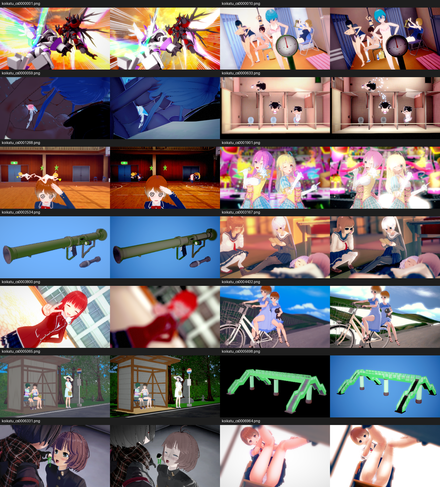

### S5 第十三輪：自動保存圖文驗收（2026-10-20）

- **每輪圖片獨立**：Compare 支援 `-OKStudioCompareOutput=<目錄>`；runner 傳入新建的 `Verify-<tag>/images`，不再讓後續場景驗收覆蓋前輪圖片。不帶參數的手動比較保留原輸出行為。
- **自動產生可攜報告**：`Tools/verify_ok_studio.lua --tag <新名稱> --editor --compare` 會逐項更新 `ACCEPTANCE.md`／`results.json`，直接嵌入本輪圖片並記錄雜湊、尺寸及記憶體；中文／日文及特殊字元檔名的圖片連結會正確編碼。`--editor` 納入 EditorSelfTest。
- **證據不完整即失敗**：除 14／14 與 final-release 外，逐張驗證 log 中的唯一檔名、本輪 PNG 可解碼、1280×360 與無卡片附加資料；缺圖、重複、損壞、目錄外舊圖不會當作成功。原作縮圖與 Unreal 結果的視覺差異仍須目視判讀，不由出圖計數宣稱完全吻合。
- **工具檢查**：`Tools/test_ok_studio_evidence.lua` 13 項 PASS；三個 Lua 檔靜態檢查 0 problems；Editor 與一般遊戲 Development 建置成功。操作與輸出契約見 [OK Studio 驗收工具](OK_STUDIO_VERIFICATION.md)。
- **完整重跑**：`Verify-HandoffEAutoEvidence` 四項自測與 14／14 場景出圖全部 PASS；14 張圖由最終收集器重新核對，並獨立確認全部圖片連結、解碼與 SHA-256。擷取峰值 20.6 GB，最後卸載 12.2 GB，沒有宣稱回到啟動基準或畫面完全一致。完整自動嵌圖報告在本機該目錄的 `ACCEPTANCE.md`；下圖是本輪實際保存的 0010，與報告原圖位元組一致。

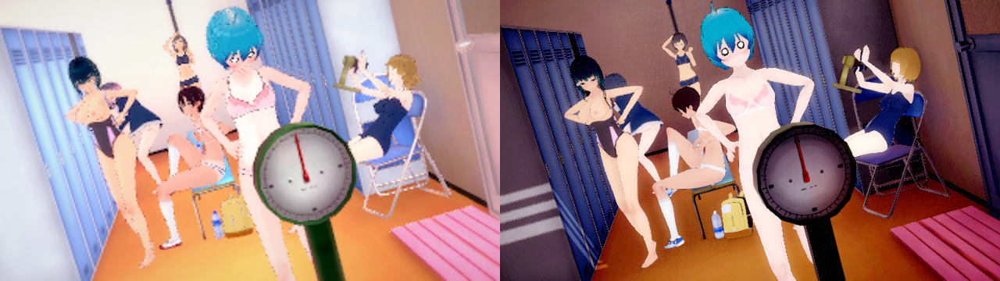
- **最終整合檢查**：整合主線 `fdf43e943` 後，Editor／一般遊戲 Development 再次建置成功，`Verify-HandoffEAutoEvidenceMerged` 三項遊戲自測全 PASS；新增街區規則的 `shop::tests` 6 PASS，規則 DLL 已重建。這次主線更新沒有變更 Studio 擷取／材質程式，完整 14 圖證據仍對應前述本輪執行。


### S5 第十四輪：來源 HDR 泛光（2026-10-20）

- **來源契約**：核對 Main Camera HDR 與安裝版三個 image-effect DXBC，改以每通道 bright-pass、半／四分之一降採樣、九點兩輪分離模糊及景深前加法混合，取代套用 LDR 強度倍率的 UE 近似。門檻依 PreExposure 換算，模糊按實際畫面高度與長寬比，沒有場景專用係數。
- **共用資源**：八個後製父材質保存於 `/Game/OKStudio/Post/SourceBloom1` 並納入 AlwaysCook；Runtime 直接載入。版本化烘材質拒絕覆寫，不新增角色材質配方。參數組合採不可變 MID 與弱參照快取，避免跨相機覆寫。
- **色彩與 GPU 檢查**：Studio 明確關閉 UE BlueCorrection。新增線性 HDR GPU 測試，確認通道門檻、常數場、相機參數隔離、關閉回復與大於 1 的值；藍色輸出 1.5117／預期 1.5152，PASS。預設驗收納入 BloomTest，`--only BloomTest` 可單獨重跑。
- **驗收**：兩種 Development 建置成功；五項自測 PASS，14／14 出圖且 PNG／雜湊／連結全通過；峰值 22.2 GB，卸載 12.0 GB。精確 cook 八個目標、SM5／SM6 成功；新 Lua cook 工具逐檔檢查與記錄 SHA-256。不將單包 cook 當作完整打包遊玩驗收。
- **圖文與邊界**：[來源泛光完整紀錄](OK_STUDIO_SOURCE_BLOOM_20261020.md) 包含原作／本輪圖與 GPU 數據。1901 光暈、角色明暗及其他畫面差異仍保留，未因演算法通過而宣稱整張畫面完全還原。前述調查與測試錯誤均已寫入 ERROR_LOG。

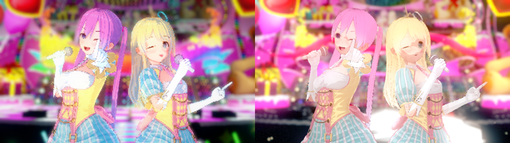


### S5 第十五輪：濾鏡混合、反射探針、暗角（2026-10-22）

使用者指出光影與 LUT 仍有差距，要求對照反編譯程式碼。方法：原作探針 `run_scene_visual_audit.lua` 新增 `--stages`（記錄主攝影機元件順序與參數 `post.tsv`、逐一關閉後製元件擷取、關地圖燈／角色燈擷取）、`--white <路徑片段>`（材質換白色反照率，含無反射與無地圖燈兩張）、`--hide`、`--lightmaps`（光照貼圖照 GPU 取樣輸出 float），並新增 `renderer_reflection`（每個 renderer 的 `GetClosestReflectionProbes`）與光照貼圖取樣設定；UE 端對應 `OK_STUDIO_COMPARE_VIGNETTE=0` 與 `OK_LIGHTMAP_DIAG`（white／whitenoenv／env／uv／dir／dirw）。

- **後製順序**（原作主攝影機）：GlobalFog → AmplifyOcclusion → BloomAndFlares → AmplifyColor（LUT）→ SunShafts → Vignette → DepthOfField → CrossFade。
- **濾鏡強度（6331 灰棕髮的根因）**：Amplify Color 的調色 LUT 是 lerp(LutTexture, LutBlendTexture, BlendAmount)；Studio 只換 LutTexture，LutBlendTexture 固定是攝影機 prefab 的 `Lut_Amount`。之前誤當成「往原圖混」，aceBlend ≠ 0 的場景色調錯誤。`M_SourceGrade32` 同時取樣兩張 LUT，強度 0 = `Lut_Amount`，`ColorFilter = -1` 才關閉。6331 飽和度 0.101 → 0.195（原作 0.214），頭髮回到紅棕色。
- **反射探針選擇**：`assign_reflection_probes` 之前用部件中心判斷是否在探針盒內，置物櫃室後牆中心比盒子邊界多 7 cm 就退回天空反射；改成包圍盒相交（importance → 重疊量 → 小盒）。地圖 26／8／20 共 477 個部件逐一和原作 `GetClosestReflectionProbes` 一致。`SESSION_CACHE_REVISION` 21。0010 右側金屬門框亮度比值 0.82 → 0.98。
- **暗角**：原作 `VignetteAndChromaticAberration`（Simple）`_Intensity = 1/(1 − 0.1) − 1`，mask = 1 − dot(c, c)·k，c = (uv − 0.5)·2，接在 LUT 之後；UE 之前用內建暗角 0.4，四角明顯過暗（UE 暗角約 −8%，原作約 −3%）。改由調色後製（新路徑 `SourceGrade3`，沒有濾鏡時只做暗角）照原作公式；文件新增 `SourceVignetteIntensity`（預設 0.1，UI「暗角強度」編輯它），舊 `VignetteIntensity` 只在後製材質未就緒時當退路。邊緣模糊（`_Blur`）未做。
- **已排除**（逐 texel 或常數核對一致）：光照貼圖與方向貼圖資料（地圖 26、15）、`unity_Lightmap_HDR` (34.49, 2.2)、lightmapScaleOffset、光照貼圖編號（地圖 15 全部 218 個、地圖 26 69／71）、方向因子、mip 取樣、box projection（ProbePosition.w = 0）、light probe（場景沒有 light probe 群組，內插值等於 ambient）。
- **結果**（sRGB 平均亮度，原作／修正前／修正後）：0010 141.6／119.7／129.3；6331 73.6／92.2／69.8；3167 132.3／126.3／124.2。
- **驗收**：Rust 422 PASS／0 FAIL；`Verify-VignetteAccepted20261022` 八項自測（Game、Pattern、EyeSet、Bloom、Grade、Transparency、Editor）PASS，14／14 出圖。GameSelfTest 的暗角檢查這輪走的是退路分支（拍照時調色材質尚未編譯完成）。
- **還沒修**：3167 的漫射在只有烘焙光時仍暗 8–26%、偏冷（藍色通道最低），光照貼圖資料、編號、探針都已確認一致，根因未定位；3800 窗戶附近反射不同；地圖 26 兩個玻璃複本實例（`#2`、`#3`）沒拿到光照貼圖；暗角邊緣模糊；0010 全開仍暗約 9%。

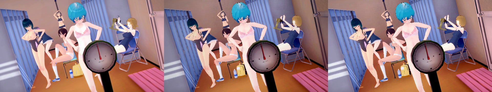

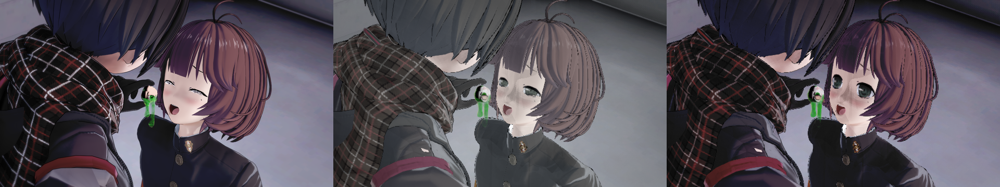

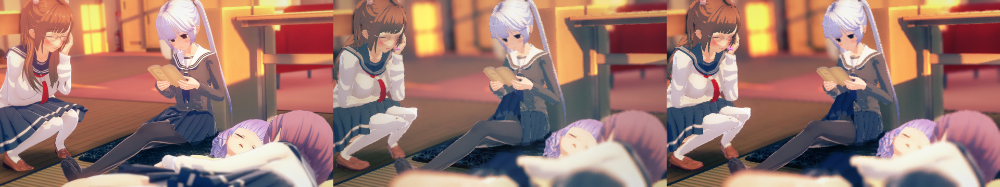

### S5 第十六輪：3167 上半部偏暗＝色影特效沒畫出（2026-10-22）

使用者要求只處理差距超過 10% 的地方。3167 上排（後牆、窗）比原作暗 11–22%。

- **排查**：原作探針新增 `white-baked`（白反照率、無反射、無地圖燈）、`white-blacklightmap`（光照貼圖換全黑，仍是 LIGHTMAP_ON）、`white-blacklightmap-nosh`（再去掉 light probe 與 ambient SH），以及 `render_fog`、即時光照貼圖欄位、Standard 材質完整參數、`--mesh-dump <路徑片段>`（網格頂點、uv、三角形）。光照貼圖全黑後地圖上半部仍有一層往下變淡的橘光，去掉 SH 也還在；`--hide marukage` 證實是 Studio 道具「色影」`p_koi_stu_marukage00_00`（`Shader Forge/main_item_studio_add`：Cull Back、ZWrite Off、One One；貼圖只有 R 通道的圓形光斑，道具色 (0.857, 0.533, 0.353)），它讓原作上半部亮 5–11%。
- **根因**：UE 有建這個加法材質（參數、位置都對），但網格 UV 是光照貼圖的 uv2（0.0039–0.99 分四象限），取到貼圖的黑邊。`unity::decode_uvs` 為舊的串流對齊問題對每個通道多試「偏移 +8」；在單一交錯串流（stride 56：uv0 在 40、uv1 在 48）裡 +8 正好讀到 uv1，而真正的 uv0 有兩個 (0,0) 角，被「(0,0) 較少」的規則判輸。
- **修正**：+8 只在讀取會跨出同一筆頂點紀錄（獨立 UV 串流）時才試（程式在 `1cb05ea89`）。Rust 原作測試 `sources_with_changed_main_uv`（舊規則以 `UV_LEGACY_PADDING` 切換）掃描 22,008 個來源：685 個主 UV 改變，原作 34 個（Studio 道具 `studio/00`、`studio/01`，31 張 Studio 地圖的樹葉草叢 `*_kusa*`／`*_ha*` 與 `*_shadow*` 網格，`bo_hair_b_00`），共用 mod 0 個。以 `OKLIB_REFRESH=meshes_for_maindata,decode_all,base_bundle` + `convert <lib> 8 @清單` 重錄這 34 個模型（24 分鐘，2,920 筆）；`SESSION_CACHE_REVISION` 22。本機第三方 mod 另有 90 個已轉來源受影響，未重錄（不進版控）。
- **結果**：3167 上排比值 0.85–0.89 → 0.92–0.94；超過 10% 的格子 13 → 11，剩右側紅椅區（0.77–0.85）與角色姿勢相位不同的格子。
- **驗收**：Rust 422 PASS／0 FAIL，`studio_marukage_quad_keeps_uv0`（對照原生 `mesh.uv`）PASS；`Verify-Marukage20261022` 八項（Game、Pattern、EyeSet、Bloom、Grade、Transparency、Editor、CompareKStudio 14／14）PASS。
- **14 場景巡檢**（原作探針 `All14b_20261022` 對 UE）：多數場景目視一致，格子差多半是構圖或動作相位。明顯超過 10% 的另有：4432 天空（原作 `m_skybox_simple_daytime` 藍色漸層，UE 黑底雲層）與稻田道具 `kusa01alfa` 變白條；5065 屋頂與植被顏色；1901 舞台背景；3800 窗邊亮區。這幾項在這輪之前就存在（10-21 的 4432 截圖相同）。0059 的原作擷取是全黑，需重拍。

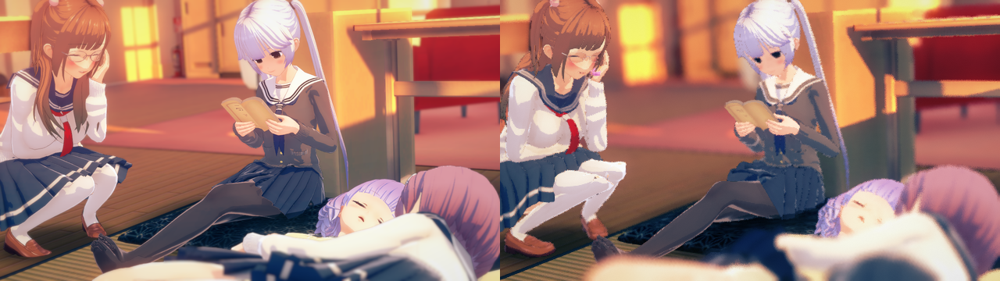

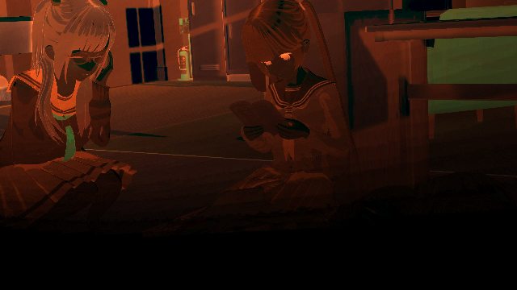


## S6 動畫（進行中）
- [x] Studio 動畫目錄：`studio_anims.rs` 讀 `studio/info` 的 Anime／HAnime（含群組、分類），依原作規則對到控制器狀態（`<控制器> / [Studio layer N] …<狀態>`，layer 0 優先）：Studio 動作 887、H 動作 4,918
- [x] 轉成 OK 動畫：`ok-extract <game> --oklib anim-convert <lib> <card> [filter] [threads]`，5,805 個全部轉換、0 失敗（8 執行緒約 4 分鐘，目錄建立約 16 分鐘），寫進 `base_v1/anims/studio/*.okanim`（224 MB）與 `base_v1/studio_anims.json`
- [x] 驗收（Rust `okanim_matches_native_animator`）：61 個動畫、29,829 個骨骼取樣（取在影格之間），和原作 Animator 平均差 0.010°、最大 2.97°；5,805 個都有自己的時長
- [x] OK Studio 角色播放基礎庫的 Studio 動畫（`StudioAnimeKind/Group/Category/No`，不用 Unity bundle）；遊戲內動畫瀏覽器；KStudio 匯入帶入角色動作、速度、時間
- [x] 覆蓋率：官方 7,594 個場景的 45,664 個角色動作，45,651 個（99.97%）在 OK 動畫庫；`studio_k/anime` 沒有任何原版清單引用（原版 Studio 也播不到），不需轉
- [x] mod 動作：`anim-convert` 先掃遊戲 `UserData/Studio/scene` 的場景動作，原版沒有的再從 zipmod 的 Sideloader 清單（`abdata/studio/info/**/Anime*.csv`，UTF-16 或 UTF-8）補；bundle 在 zip 裡就用 `mods/…zipmod!路徑` 來源；只收場景用到的、絕不取代原版（Rust `mod_motion_from_zipmod`：AgiShark Mixamo 1011/0/0 解析到 `Base Layer.Administering Cpr`）。這台機器場景缺的 6 種（2/114/8、13、15、16，3/114/8、16）在已裝的 mod 裡都沒有（場景作者另裝的 mod），轉不了；（3,111,4）原版那列控制器配錯（女性控制器放在男性 bundle），原作也播不出
- [x] 移除 PairedAnimations（R7：執行時改讀基礎庫 `base_v1/paired`）

## S7 時間軸、畫面、狀態（進行中）
- [x] 時間軸：物件的關鍵幀（變換＋燈光強度／相機視角），旋轉 slerp、其他線性；存進 .okscene；遊戲內時間滑桿、設／刪關鍵幀、播放、長度；自測驗證插值、存讀、播放
- [x] 時間軸：角色的 FK（逐骨 slerp，`ok_unity_euler_slerp`，和 FK 套用同一套四元數）、表情（眉／眼／嘴編號在關鍵幀切換，張嘴程度混合）、手型、衣服狀態（只在不同時切換）都隨關鍵幀走；自測 FK 半途 30°、張嘴 0.5、眼睛在關鍵幀切換
- [x] 時間軸曲線：每個關鍵幀有到下一幀的曲線（線性／緩入緩出／緩入／緩出／跳格，`EOKSceneEase`），位置、旋轉、數值、FK、張嘴都照曲線混合；同一時間重設關鍵幀保留曲線；時間軸列的「曲線」按鈕切換。自測：緩入緩出 0.5 s 在 x 25（共 200）、跳格保持前一幀
- [x] 相機路徑：視角跟著使用中的相機物件，相機的位置／旋轉／視角都能設關鍵幀；物件可開「平滑路徑」（`FOKSceneTrack::bSmoothPath`），位置走穿過關鍵幀的 Catmull-Rom 曲線（端點重複自己），關鍵幀上沒有折角。自測：中間關鍵幀精確通過，半途 (43.75, 56.25) 偏離直線 (50, 50)，和計算值一致
- [x] 時間軸：轉出 `.okanim`、Level Sequence（R2）
- [x] 截圖：用 SceneCapture 照目前相機（含後製）同步渲染成指定解析度的 PNG，存到 `UserData/Studio/screenshot`（自測檢查尺寸）
- [x] 影片幀輸出：時間軸逐格渲染 PNG 序列到 `UserData/Studio/movie/<時間>/frame_00000.png`（自測 3 幀）
- [x] 場景後製：泛光、景深（對焦距離、光圈）、暗角、曝光補償，存進 .okscene，套用到觀看相機
- [x] 透明背景截圖：只拍場景的角色與道具（ShowOnly，不含地圖、天空、霧），同一角度再拍一次深度當覆蓋範圍，有深度的像素不透明；遊戲內「透明背景截圖 1920×1080」，檔名 `_alpha.png`。自測 640×360：19,712 不透明、210,688 透明、沒有中間值（邊緣是硬邊）
- [ ] Movie Render Queue 影片（直接出 mp4）
- [ ] 狀態：SkinEffects、ClothingBlendShape、ClothColliders、MaterialEditor UI、汁的貼花（飾品顯示、淚、臉紅、光澤、乳首已在 R8 完成）
- 驗收：各自自測

## 剩餘工作計畫（2026-10-17）

依序做；每項做完都要建置（D: 引擎）、跑遊戲內自測並更新本文件。R7、R8 會動到其他 session 的檔案，開始前先協調。

順序（2026-10-17 更新）：R0 → R7 → R1 → R2 → R3 → R4 → R5 → R6 → R8。原則：**執行時不再讀任何 Unity bundle**；OK 共用資源（基礎庫）要能開原版 KStudio 場景卡和 OK 場景卡。

### R0 OK 場景卡（APNG）✅
- 格式：APNG，1280×720，4 格各停 3 秒、無限循環：① 場景預覽（目前視角）② 前視圖 ③ 側視圖 ④ 頂視圖（三視圖的相機依場景物件的範圍自動取景）；第一格是一般 PNG，舊看圖軟體也看得到
- 資料：自訂 ancillary chunk `okSc`（在 IEND 前，zlib 壓縮）：.okscene JSON ＋ 場景用到的 OK 角色卡本體（卡片自帶，換電腦也能開；道具、地圖、動畫都引用基礎庫）
- 寫入：`FKKAnimatedPng` 加可指定尺寸的版本（或 OKStudio 自己的場景卡函式，視「新渲染模式」意見）
- 讀取：同一個入口自動分辨 ①OK 場景卡（`okSc`）→ 直接開，角色卡解到 `UserData/Studio/scene/<名>_cards/` ②原版 KStudio 場景卡 → 走 S5 匯入 ③ .okscene JSON（舊檔）
- 遊戲內：存檔預設存成場景卡 `UserData/Studio/scene/<名>.png`；場景清單同時列 OK 場景卡與 KStudio 場景卡（標示種類）；編輯器工具列也能讀寫場景卡
- 自測：存場景卡 → 4 格、各 3 秒、1280×720、有 `okSc`；讀回後文件內容一致、角色重建；原版 KStudio 場景卡經同一入口匯入成功

- 完成（2026-10-17）：`FOKSceneCard`（Capture／CaptureViews／Write／Open／ReadPayload），`okSc` = `OKSC`＋版本＋原始大小＋zlib（場景 JSON＋角色卡本體，卡片路徑改成 `okscene-card:N`）；`FKKAnimatedPng::BuildFrames` 改成任意尺寸（每格一致）；遊戲內存檔預設存場景卡、場景清單列 OK／KStudio 場景卡與舊 .okscene（標示種類）、讀取自動分辨三種；編輯器開檔／存檔／另存同樣支援。自測：遊戲 4 格、1280×720、各 3 秒、無限循環、四格不同、讀回場景與角色一致、認得原版 KStudio 場景卡、清單存讀；編輯器 6/6 物件來回- 大小：一張 OK 角色卡約 12 MB（IEND 後的卡片資料，不是預覽圖），場景卡約等於「角色卡總和＋4 張畫面」（1 個角色 12.6 MB、2 個角色 32.6 MB）；要換電腦也能開，所以角色卡必須完整內嵌
### R7 移除 PairedAnimations：執行時不再讀 Unity bundle（3.2 GB、24 個 bundle）✅（基礎庫 base_v1/paired）
現況（盤點結果）：只有 OK Studio 動畫播放不讀 bundle；其餘都讀 `PairedAnimations/abdata`：
| 功能 | 讀的 bundle |
|---|---|
| 畫廊雙人動作選單、雙人播放（含 IK） | `h/list/*`（動作清單、MotionIK）、`h/anim/female\|male/*`（控制器、動畫片段）、`chara/oo_base`（FBBIK 設定、Avatar TOS）、`studio/base/00`（身體骨架） |
| 互動場景的待機與動作清單 | `h/list`、`h/anim` |
| 身體碰觸反應、OK Studio IK | `chara/oo_base`、`h/list`、`studio/base/00` |
| 所有 OK 卡／基礎庫角色的 `states:` 動畫、畫廊 Studio 動作、editor demos | `studio/anime/00,01`、`custom/custompose`、搖動（yure）資料 |

做法：
1. **轉換器**（`--oklib paired-convert`）把下列資料寫進基礎庫 `base_v1/paired/`：
   - 雙人動作目錄（`h/list` 的 AnimationInfo：id、分類、名稱、參與者、圖層、來源、動作）→ JSON
   - MotionIK 資料 → 解碼後的 JSON／二進位
   - FBBIK 設定（`PrefabIkConfig`）、身體骨架靜止姿勢、Avatar TOS → 基礎庫紀錄
   - 控制器圖（狀態、blend tree、圖層、時間、參數）→ JSON；每個動畫片段 → OK 動畫片段（沿用 `OKCLIP01`／okanim），blend tree 在執行時用片段混合，保留原作的參數混合（不是把狀態取樣死）
   - 搖動（yure）資料、`custompose`、`editor-demos.json` 改用基礎庫 id
2. **執行時改讀基礎庫**：`source_path`／`setup_index`／`factory_prefab`／`authored_poses`／雙人動作清單都走基礎庫；`CommonPairRoot` 改成基礎庫；找不到時報錯，不回頭讀 bundle
3. **驗收**（先比對再刪）：
   - Rust：抽樣雙人動作與 Studio／custompose 動作，基礎庫版和 bundle 版逐骨比對（目標平均 < 0.05°、最大 < 3°，同 S6）；IK 解算結果一致
   - 遊戲：畫廊雙人動作、互動場景、身體反應、OK Studio IK 的既有自測全過
   - 把 PairedAnimations 改名後重跑全部自測，確認沒有任何路徑還在讀它，最後才刪資料夾
4. 畫廊、互動場景其他 session 也在改：動到那些檔案前先通知，改動只換資料來源、不改行為
5. **技術做法（2026-10-17 查過程式碼後定案）**：動畫系統已經有「解碼後資料的磁碟快取」（`anim/disk_cache.rs`，OK 自己的 bincode＋LZ4 格式，涵蓋控制器圖 `controller`、bundle 片段清單 `bundle`、解碼片段 `clip`）。R7 把它變成基礎庫的一部分，而不是把每個狀態取樣成 okanim（那樣會失去 blend tree 的參數混合與圖層）：
   - 快取的 key 改成相對資源根的邏輯路徑（現在是絕對路徑，搬家就對不上）
   - 資源根若是基礎庫的 `paired/`（有標記檔），`source_path` 不再 canonicalize 實體檔，快取從 `paired/cache/<種類>/` 讀；找不到就報錯並記到 `missing.txt`，不讀 bundle
   - 還沒有快取的查詢補上快取：雙人動作清單／authored poses（`h/list`）、雙人 IK 設定（MotionIK＋`oo_base` 的 FBBIK）、身體骨架 prefab（`studio/base/00`）、Avatar TOS、搖動資料；檔案時間戳的驗證在基礎庫模式略過（基礎庫版本由 manifest 決定）
   - 轉換指令 `--oklib paired-convert <PairedAnimations> <base_v1/paired>`：把執行時會用到的查詢全部跑一遍（所有雙人動作與其圖層／狀態、互動場景姿勢、畫廊用的 Studio 動作與 custompose、editor demos、身體反應與 Studio IK），結果寫進 `paired/cache`
   - `CommonPairRoot` 改指 `base_v1/paired`；過渡期保留 PairedAnimations，驗收全過、改名測試也過後才刪
   - anim.rs、h_playback.rs 也有其他 session 在改（工作區有未提交的改動）：開始改之前先通知

- 完成（2026-10-17）：`ok-paired-library convert|verify`（`src/paired_library.rs`、`src/bin/ok-paired-library.rs`）把 PairedAnimations 能回答的所有查詢解碼成 OK 格式，存進 `base_v1/paired/cache/pack.bin`（單一封裝：內容依雜湊去重＋索引，1.33 GB，20,766 份內容、359,952 筆）與 `okpaired.json`（清單）。動畫的磁碟快取改成相對資源根的 key，基礎庫根（有 `okpaired.json`）只讀 pack、缺的記成 miss，不讀 bundle；補上雙人動作目錄、MotionIK＋FBBIK 設定、身體骨架、Avatar TOS、yure 的快取；片段拆成 `clipdata`（曲線，可去重）與 `cliphead`（scene、state timing）。1,072 個來源、268,938 個 key、179,321 個片段、234 個配對圖層、117 組配對、128 個互動姿勢、415 個 MotionIK
- 執行時：`CommonPairRoot` 只用 `base_v1/paired`（沒轉換就回報，不退回 bundle）；打包 `DirectoriesToAlwaysStageAsNonUFS` 改放 `base_v1/paired`；LFS 規則加 `paired/cache/pack.bin`、`okpaired.json`、`anims/**/*.okanim`
- 驗收：Rust「OK 卡＋基礎庫 replay」測試，同一配對狀態從 bundle 與從基礎庫的骨骼角度差 0°、沒有 miss；`test_shared_interaction_reader.ps1` 在基礎庫上 passed（基準也 passed），配對第一狀態準備 13.38 s → 0.01～0.03 s、18 狀態 0.2～0.3 s；把 PairedAnimations 改名後雙人動作驗收與 OK Studio 自測（含 Studio IK）都過 → 執行時不需要它
- 完整驗證（`ok-paired-library verify`，81 分鐘）：1,072 個來源的名稱全部一致；抽樣 4,014 個 key 可否準備與時長一致；234 個配對圖層、配對目錄、IK 設定一致；沒有任何 library miss
- PairedAnimations 資料夾保留在本機（gitignore）當轉換來源；之後要重新轉換：`ok-paired-library convert <PairedAnimations> <base_v1>/paired`（約 1 小時）再 `verify`
### R1 Niagara 特效物件（取代 KKS 粒子特效）✅
- 新物件種類 `Effect`：引用一個 Niagara System 資產，可調位置／旋轉／縮放、顯示、播放速度、顏色與強度（User Parameter：`User.Color`、`User.Intensity`、`User.Rate`）
- OK 特效庫：`Content/OKStudio/Effects/` 放自製的 Niagara 系統（螢火蟲、煙、火花、光點、雨、雪、愛心、蒸氣……先做 8 個），清單 `effects.json`（id、名稱、分類、資產路徑、可調參數）
- 遊戲內：「+ 特效」瀏覽器（分類、名稱）；編輯器工具列加同一份清單
- 時間軸：特效的變換與強度能設關鍵幀
- KStudio 匯入：KKS 的 29 個粒子道具對到最接近的 OK 特效（對照表放 `effects.json` 的 `kks` 欄），對不到的變空資料夾並寫進報告
- 自測：加入螢火蟲特效 → Niagara 元件存在且在跑、改顏色參數生效、存讀還原、匯入含螢火蟲的場景會變成 OK 特效

- 完成（2026-10-17）：物件種類 `Effect`（`FOKSceneEffect`：特效 id、速度＝time dilation、強度 `User.Intensity`、顏色 `User.Color`），`UNiagaraComponent` 播放；特效庫 `Content/IndependentResources/OKStudio/effects.json`（放在 IndependentResources，避免編輯器把 json 當 DataTable 匯入）14 個、4 類；資產 `/Game/OKStudio/Effects/NS_OK_*` 由編輯器指令 `OKStudio.MakeEffects` 從 Niagara 內建 emitter 範本生成（缺的才生）；遊戲內「+特效」、切換／速度／強度／顏色；編輯器「+ Effect」選單；時間軸的值是強度；KStudio 匯入把 29 個粒子道具對到 OK 特效（海、水面那幾個是材質，不對應）。自測：螢火蟲元件、資產、播放中、速度 0.5、存讀、KKS 螢火蟲對到 fireflies，14 個特效
- 顏色與強度接上（2026-10-18）：
  - `OKStudio.MakeEffects rewire [exit]`（編輯器，可重複執行）替每個特效系統加上 `User.Color`（預設白），把每個 emitter 的 InitializeParticle.Color（光束另有 Color 模組的 Color）連到它。範本的顏色模式是「不設定」的（fireball、electric 的 InitializeParticle）會切成「直接設定」。14 個全部接好。
  - `effects.json` 每個特效有自己的預設 `color`，火、水、螢火蟲、暗等同範本的特效現在顏色不同。執行時寫進 `User.Color` 的是「物件設定的顏色或特效預設色」×「強度」。
  - 遊戲內測試 `OKStudio.EffectColorTest [exit]`：真的跑 90 格再拍照（粒子要到一格結束才送給渲染，同一格裡拍不到）。fireball 紅色時亮像素 R 45,977／B 291，藍色時 R 1,253／B 44,758。
  - 已知限制：會循環生成的特效改顏色時，已經在場上的粒子保持舊顏色，等它們消失後才全部換新。
- 不再處理（使用者決定，2026-10-18）：特效的形狀、大小、速率維持範本預設；之後要更好看的特效，直接用 Unreal 內建的 Niagara 特效（加到 `effects.json`，再跑 `OKStudio.MakeEffects rewire` 接上顏色）
### R2 時間軸轉出（Level Sequence ✅）
- Level Sequence：每個有關鍵幀的物件一條軌（變換、燈光強度、相機視角，ease 對到 UE 曲線的切線模式、跳格對到 Constant），使用中的相機變成 Camera Cut；存到 `/Game/OKStudio/Sequences/<場景名>`（編輯器）
- `.okanim`：角色的時間軸姿勢（動畫＋FK／IK）逐格取樣存成 OK 動畫，可回到動畫瀏覽器使用
- 自測：轉出後的 Level Sequence 在半途取值和 OK 時間軸一致；`.okanim` 讀回後骨骼角度一致

- 完成（2026-10-17）：編輯器「Export Sequence」→ `/Game/OKStudio/Sequences/<場景名>`（`FOKStudioSequence`）：有關鍵幀的物件各一個 spawnable（相機 CineCameraActor＋視角、燈光對應的燈光 actor＋強度／顏色／範圍、特效 NiagaraActor＋系統；角色與道具是 OK session 畫的，先以 TargetPoint 標位置），變換軌照時間軸（線性／跳格＝常數／其他＝cubic，旋轉取短路徑），使用中的相機有 camera cut。編輯器自測：相機 2 個關鍵幀 → 1 個 spawnable、camera cut
- 燈光強度、相機視角的關鍵幀：spawnable 底下的元件 possessable ＋ float 屬性軌（燈光 `Intensity`；相機視角換算成 CineCamera `CurrentFocalLength`），曲線同變換軌。編輯器自測：相機 → 1 個焦距軌
- 角色時間軸轉 `.okanim`（2026-10-18）：Rust `PoseRecorder`（`ok_okanim_record_start/frame/finish/free`，和 KK 片段轉換同一套軌道：相對未變形靜止姿勢的差、腰高為單位的 hips）逐格記錄角色最後的姿勢（動畫＋FK／IK＋關鍵幀）；遊戲內「角色時間軸轉 .okanim」存到 `UserData/Studio/anim/`。自測：FK 關鍵幀 0→2 秒（10°→50°）轉出 2 秒動畫，去掉 FK 播放時 1 秒手臂 30°
- 角色在 Sequencer 裡的實際外觀（2026-10-18）：轉出的 Level Sequence 改成一個「OK Scene」spawnable，也就是 `AOKSceneActor` 本身，帶 `SceneJson`（整個 .okscene），再加一條 `SequenceTime` 屬性軌（0 到場景長度，線性）。這個 actor 從 JSON 建出整個場景（地圖、角色、道具、燈光、特效），每次時間改變就套用時間軸、同步角色動畫、FK、IK；相機仍是各自的 spawnable（camera cut、焦距軌）。Sequencer 預覽和 Movie Render Queue 看到的都是真的角色。編輯器自測：轉出 2 個 spawnable（場景＋相機）、從模板生成的場景 actor 自己建出 7 個物件，角色 A 有 34 個部件
### R3 影片輸出（mp4）✅（ffmpeg 版）
- 啟用 Movie Render Queue（`MovieRenderPipeline` 外掛），用 R2 的 Level Sequence 算圖，畫質比現在的逐格截圖好（抗鋸齒、動態模糊）
- mp4：用 `Tools/ffmpeg/ffmpeg.exe`（LGPL 9.0，BtbN 建置，SHA-256 已驗證；不進版控，缺檔時清楚提示）。H.264 編碼器依序試 `h264_nvenc`（顯示卡）→ `h264_amf` → `h264_mf` → `libopenh264`（軟體，一定能用）；這台機器 nvenc／amf／mf／openh264 都實測可用，qsv 不行
- 自測：輸出 1 秒、30 幀的影片，檔案存在且幀數正確

- 完成（2026-10-17）：遊戲內「輸出 mp4 1920×1080 30fps」＝時間軸逐格同步渲染（含後製）成 PNG，再用 `Tools/ffmpeg/ffmpeg.exe` 編成 H.264 mp4（`UserData/Studio/movie/<時間>.mp4`，成功後刪掉中間的 PNG）；編碼器依序 nvenc → amf → Media Foundation → OpenH264，奇數尺寸自動補成偶數；沒有 ffmpeg 時提示放一份（不進版控）。自測：3 幀編成 mp4（這台用 h264_nvenc）
- Movie Render Queue（2026-10-18，不再處理；影片用遊戲內的 ffmpeg 逐格輸出，需要 MRQ 的人照下面的說明自行開發）：
  - 已完成：
    - `.uproject` 啟用 MovieRenderPipeline（TargetAllowList 只限 Editor）。
    - 編輯器工具列「Render Movie」：轉出 Sequence，PIE 算圖成 PNG，每格 8 個時間取樣，再用 ffmpeg 編成 mp4，存到 `UserData/Studio/movie/`（`FOKStudioMovie`）。
    - 測試指令 `OKStudio.RenderMovieTest [exit]`：一個角色＋移動的相機，640×360、1 秒；檢查 mp4 存在、中間那格有亮像素且沒有過曝。
    - 修正一：程式加的 spawnable 要自己加生成軌（`UMovieSceneSpawnTrack` 整段 true），否則在 PIE 裡根本不會生成。之前轉出的相機也因此從沒生效過。
    - 修正二：轉出的相機套用場景後製和手動曝光。自動曝光會依黑背景把角色拉成過曝。
    - 修正三：同名 Sequence 重新轉出時，先完整載入再換掉舊的。原本只部分載入的套件存檔時會直接當機。
  - 卡住：PIE 算圖時，引擎 `SkeletalRenderGPUSkin.cpp:343` 的 `check(Index == 1)`（morph 雙緩衝）會間歇性讓編輯器當機。5 次跑只成功過 1 次，那次 30 幀、角色正常出現。
    - 原因：專案沒開 GPU skin cache，有 morph 的骨架網格走雙緩衝；在版本號推進、但 morph 還沒寫入的那格讀到目前緩衝就會觸發。
    - 試過都無效：強制每格重算 morph（`r.MorphTarget.ForceUpdate`）、新角色頭幾格 `ClearMotionVector`、預熱幀、建好那格先不擺姿勢。
    - 不改引擎：這個 check 是引擎認定的不變條件（讀之前一定寫過），拿掉只會把錯誤的 morph 資料藏起來。
  - 決定（使用者，2026-10-18）：MRQ 先擱置，影片用遊戲內「輸出 mp4」（逐格 SceneCapture＋ffmpeg）。MRQ 的程式保留；「Render Movie」和 `OKStudio.RenderMovieTest` 在專案沒開 GPU skin cache 時不會開始算圖，按鈕會說明原因，測試回報 SKIP。
  - 需要 MRQ 的人可以自己開 GPU skin cache：
    1. 在 `Config/DefaultEngine.ini` 的 `[/Script/Engine.RendererSettings]` 加上：
       ```
       r.SkinCache.CompileShaders=True
       r.SkinCache.Mode=1
       ```
       角色多的場景再把上限調高：`r.SkinCache.SceneMemoryLimitInMB=512`（預設約 128 MB，超過的網格會退回原本會當機的路徑）。
    2. 重開編輯器。所有 shader 會重編，第一次可能要數十分鐘到一兩個小時，DDC 也會變大。
    3. 跑 `OKStudio.RenderMovieTest exit`，要看到 `RESULT PASS`，中間那格有角色且不過曝。之後就能用編輯器工具列的「Render Movie」。
  - 開之前要知道：
    - 這是全專案設定，遊戲和打包版的骨架網格也會改走 skin cache（先由 compute shader 蒙皮），渲染路徑和效能都會變。
    - 群眾場景的 GPU 姿勢／骨骼緩衝配置（`r.GPUSkin.BoneTransformAllocationMode` 等）和「新渲染模式」的材質是照現在的路徑調的，要重新驗收畫面和效能。
    - 硬體：顯示卡要支援 compute shader（DX11 SM5 以上）；顯存每個角色約多 3～10 MB（每個頂點約 24～32 bytes）。
    - 如果只想在自己的機器上試，可以把這兩行放在 `Saved/Config/WindowsEditor/Engine.ini`（不進版控），只影響這台機器的編輯器。
### R4 道具細節
- 子物件接點（`child`）：okmodel 保留剛體網格的 prefab 層級（節點名稱、local 變換），掛在道具上的子物件接到指定節點
- 剛體物件的道具 FK：同一份層級，FK 轉節點後重算剛體網格（補上 15/74/979 這類）
- 花紋（柄）：Studio 道具的花紋貼圖清單轉進基礎庫，材質的花紋槽、顏色、縮放、偏移
- 燈光道具：Studio 的 Light 清單（地圖燈光 prefab）當燈光預設
- 自測：子物件跟著節點動、剛體 FK 轉動、花紋貼圖套上
- 完成（2026-10-18）：
  - **節點層級：**
    - 新的錄製查詢 `prefab_hierarchy`（`pose::PrefabHierarchy`）存 prefab 的變換樹、每個網格所在節點和 Light 元件。
    - 轉換指令 `ok-extract <game> --oklib studio-nodes <lib> [threads]` 把 Studio 道具和燈光清單的 prefab 錄進基礎庫：18 個 bundle、8,024 個節點、8 秒。
  - **子物件接點：**
    - 用 `FOKStudioCatalog::ItemChildPoint` 讀清單的「子の接続先」節點，透過 FFI `ok_okmodel_node_world` 取得接點位置並快取。
    - `UOKSceneDocument::WorldTransform` 和 `ChildFrame` 會把道具底下的子物件放在接點上；改變父物件、拖曳、Sequence 匯出都改用 `ChildFrame`。
    - 41 個有接點的道具全部能從基礎庫解析。
  - **剛體網格：**
    - 剛體網格（MeshFilter）的頂點原本是網格自己的局部座標，預覽路徑一直沒套它的 GameObject 矩陣，多段道具和地圖小物件都疊在原點。現在 `prefab_session_fk` 會照節點層級把矩陣烘進頂點；沒錄層級的模型改用錄好的 `prefab_local`。
    - 剛體 FK 走同一條路徑：轉節點後重算。`fk_bones` 會列出剛體網格上方的節點。
    - Rust 測試：15/74/979 FK 軸轉 `joint_00` 後，網格中心移動 0.85 m。
  - **燈光：** prefab 裡只有 Studio 燈光清單那 3 個有 Light 元件，道具本身沒有燈光，原有的 Light 物件就足夠，不另外做燈光道具。
  - **自測：**
    - Rust：`hierarchy_tests` 兩項（子物件接點、剛體 FK）。`map_rigid_probe` 是不納入一般測試的探查用測試。
    - 遊戲內 `OKStudio.GameSelfTest`：子物件位在接點上，移出父物件後位置不變。
  - **未做：**
    - 花紋：等「新渲染模式」的 MID 參數介面。2026-10-18 協調結果：
      - 介面：做通用的部件材質參數覆寫 `AKKPreviewActor::SetMaterialOverrides(TArray<FOKMaterialOverride>)`。每筆是：部件比對（role＋source_property 或 slot）、材質名（可省略）、參數名，以及 Scalar／Vector／貼圖其中之一。覆寫記在 actor 上，漸進式材質換成最終材質時重套。
      - 限制：材質共用（C1）預設開啟，所以只能寫各部件自己的 MID。item 類的圖如果還沒有 _PatternMask1..3、_patternuv1..3 參數，要在建圖時加上，並把「有花紋」當成材質 key 的一部分。
      - 進度：渲染 session 要等使用者同意才開工；花紋貼圖由 OK Studio 從 Studio 花紋清單轉進基礎庫，開工前再對一次參數名。
      - 2026-10-18：使用者同意後渲染端做好了 item 圖的三個花紋槽（`KKMaterialExposure`，覆寫名稱含花紋參數時才加）。OK Studio 這邊完成：花紋清單＝角色清單的 mt_pattern（430），`ok_studio_patterns`／`ok_studio_pattern_png`（57 個、128×128）；`FOKSceneItem::Patterns`（花紋編號、第二色＝colors[3..5]、uv 偏移／縮放、旋轉、clamp）；KStudio 匯入帶入；遊戲內每槽的編號、顏色、縮放；`AOKSceneActor` 在載入前把 `_PatternMaskk`／`_Patternuvk`／`_patternrotatork`／`_patternclampk`／`_Colork_2` 放進 `MaterialOverrides`
      - **原因：** `studio/00.unity3d` 的道具 renderer 材質指向依賴包（`m_FileID`=1 → `CAB-0b5c15a7…` ＝ `abdata/studio/mat/00.unity3d`），轉換器只解析同檔材質，這個 bundle 1,569 個網格只有 26 個有材質；道具零件沒有 shader、不走 item_draw 圖，顏色（`ItemColorOverrides`）也沒生效。地圖的材質在場景自己的檔案，但貼圖指向 `CAB-24a2cb56…` ＝ `abdata/studio/map/00/tex.unity3d`，所以地圖是灰色雜訊
      - **修正（2026-10-18）：**
        - `unity.rs`：每個檔案的材質解析抽成 `materials_in`；renderer 的 `m_Materials` 帶 `m_FileID`≠0 時讀依賴包的材質（`external_file`），材質的 `m_Texture` 帶 `m_FileID`≠0 時用那個檔案的貼圖名稱，貼圖名稱 → 來源檔記在 `dependency_texture_source`
        - 依賴包本身就是基礎庫模型（`mat/00` 1,791 張、`map/00/tex` 1,266 張貼圖已錄）：`decode_tex` 找不到時走 `dependency_texture_png`，每個名稱只錄一筆「在哪個模型」（`dependency_texture_model`），重播時從那個模型解碼，網格記錄只留名稱。先前直接存 PNG 會讓 1F 從 30 MB 變 90 MB，存模型 id 後是 34 MB；72 個地圖重錄共增加 77 MB
        - `session.rs`：shader 是 `main_item_studio`（含 `_alpha`）的零件帶 3 色 item_draw，shader_kind 4 的花紋槽因此接上
        - 小貼圖解碼錯誤：`read_texture_payload` 讀完 `.resS` 串流後，`repair_inline_texture_payload` 會在物件檔頭找到假的長度、把正確資料換掉（球的 ColorMask 是純紅 DXT1 8×8，變成雜訊，顏色看起來很淡）。現在從串流讀到、長度剛好等於宣告的就不修補。整個 abdata 有 85 張、37 個 bundle 受影響（含 co_top_00、bo_hair_b_00、mt_eye_white_00 等角色貼圖），基礎庫 34 個 bundle 的 `texture_payload`／`texture_gpu_named` 已重錄（111 筆），`SESSION_CACHE_REVISION` 升到 4
        - 重錄：Studio 道具 18 個 bundle（00／01 再錄一次改成參照模型）、地圖 72 個（`OKLIB_REFRESH=meshes_for_maindata convert <lib> 6 @list`）
      - **驗收：** `OKStudio.PatternTest` PASS（1,877 像素改變、955 紅、全部套上，鮮紅條紋）；`ok.AuditMaterialOverrides` 預設模式 valid（渲染 session）；Rust `studio_item_material_from_dependency_bundle`、`sphere_mask_is_red`；遊戲自測 77／77、編輯器自測 PASS
    - ~~同一個網格被多個 renderer 共用時只放出第一個~~ 已修（2026-10-18）：節點層級記錄每個網格的所有實例，多的實例複製成 `<網格>#<n>` 部件；地圖的根物件也錄進去（`studio-nodes` 現在含道具、燈光、地圖：90 個 bundle、32,518 個節點、304 個燈光）。地圖 1F 補回 145 個、2F 152 個實例；地圖沒有靜態合批的 Combined Mesh，照 GameObject 變換放是 Unity 的原本行為

### R5 編輯器 FK／IK UI（姿勢分頁 ✅）
- 編輯器細節面板加 FK 骨骼樹（部位分組、XYZ、重設）與 IK 效果器清單，和遊戲內共用同一份文件欄位
- 視窗中的旋轉／移動把手（沿用遊戲內的導引邏輯）
- 自測：編輯器自測改 FK 後角色骨骼角度一致

- 完成（2026-10-17）：編輯器「Pose (FK / IK)」分頁（`OKStudioEditorPose.cpp`）：全部 FK 骨骼（主要骨架、其他部位兩段；沒設定的顯示目前姿勢，一改就設定）、全部取目前姿勢、清除 FK；13 個 IK 目標（勾選從四肢目前位置開始）＋ XYZ；改的是同一份文件欄位，細節面板的副本同步。編輯器自測：355 根骨骼＋13 目標、編輯寫回文件
- 編輯器視窗的 3D 把手（2026-10-18）：預覽視窗用引擎內建的移動／旋轉／縮放把手（W／E／R），位置在選取的物件上；拖曳改的是場景文件的變換（換算回父物件座標，含道具接點），不是預覽 actor；一次拖曳是一個可復原的操作。編輯器自測：選取顯示把手、拖 X 軸世界座標移 25 cm、旋轉環轉 40°、取消選取隱藏
### R6 KStudio 匯入補完
- IK 的手肘／膝蓋目標：FBBIK 的彎曲目標（bend goal）接到 Rust IK
- 部位開關順序用官方場景驗證（找只開部分 IK 的場景）
- 6 種沒裝 mod 的動作：報告裡列出缺哪個 mod

- 完成（2026-10-17）：手肘／膝蓋目標＝FBBIK 四肢的彎曲目標（`IKConstraintBend::goal_position`，Studio IK 目標 9 左肘、10 右肘、11 左膝、12 右膝），匯入帶入、遊戲內 IK 面板可選。Rust 測試：手肘彎曲目標讓手肘移 11 cm、手仍到位（誤差 0）；自測匯入 4 個角色各 13 個目標，左手全到位
- 部位開關：官方場景有 1,700 多個角色只開部分 IK（例如只開 3、4 號 423 個、只開 1、2 號 230 個），1/2、3/4 各是成對的左右部位；目前照「身體、右腿、左腿、右臂、左臂」，是哪一對手、哪一對腳還要在原作裡實際比對才能確定
- 2026-10-20 接手核對安裝的原作 `OIBoneInfo.BoneGroup` 與 `OCIChar.ActiveIK/ActiveIKGroup`：body=1、right leg=2、left leg=4、right arm=8、left arm=16；`activeIK[i]` 使用 `1 << i`。現有左右部位順序正確，未改 mapping。
- mod 動作：匯入報告列出缺的動作編號（例 2/114/8），裝了 mod 後跑 anim-convert 就會補進來
### R8 角色狀態（和「新渲染模式」協調）
- 飾品顯示（每個欄位開關）、淚／汗／臉紅（臉部貼圖層的強度）、體液（貼花）
- SkinEffects、ClothingBlendShape、ClothColliders 的 Studio 對應欄位
- MaterialEditor UI：道具／角色材質的顏色、貼圖、數值覆寫，存進 .okscene
- 渲染端（KKPreviewActor 材質）由「新渲染模式」決定介面，我做文件欄位、UI、匯入與自測
完成（2026-10-18）：
- 角色狀態欄位：`FOKSceneCharacter` 的 `TearsLevel`、`Blush`、`NipStand`、`SkinGloss`、`Fluids`（5 部位 0..2）、`AccessoriesShown`。`AccessoriesShown` 有 21 格：前 20 格是原版欄位，第 21 格代表所有 MoreAccessories 擴充欄位。-1 或空值照卡片。改了會重建角色（`SameState`）。
- Rust `studio_status.rs`：`ok_session_open_status` 在開 session 時把狀態套到卡片（ChaFileStatus）與部件。淚依等級顯示 `cf_O_namida_S/M/L`。關掉的飾品欄位在 resolve 階段就不載入。session 快取鍵帶入狀態，沒狀態時鍵不變。
- UE：`FOkSession::Open(..., StatusJson)`，`AOKSceneActor::Build` 帶入角色狀態。面板有淚、臉紅、光澤、乳首、汁、飾品（全部／逐欄）控制。
- KStudio 匯入：Studio 存的乳首、汁，加上卡片 Status 的淚等級與飾品顯示。臉紅、光澤卡片本身已帶。
- 自測：Rust `studio_status` 兩項（`OK_NOCACHE=1`）；遊戲內 `OKStudio.GameSelfTest` 的 character state。
- 未做：汁的貼花渲染，等「新渲染模式」的材質介面；SkinEffects、ClothingBlendShape、MaterialEditor。
- 2026-10-21 透明材質專項：3167 的 KoikanoGlasses0–11 改為來源 alpha blending，保存未套色 MainTex 與卡片 Color4，重烘 StreetDisplay26／StudioDisplay26／StreetHG05，48 組真實 GPU 混合回歸通過。前後圖與驗收見 [透明材質修正](OK_STUDIO_TRANSPARENCY_20261020.md)。


### S5：1268 動畫父道具接點（2026-10-21）

使用者回報天使角度錯誤。來源證據確認兩個角色掛在旋轉道具 10/3/397 下，缺的是 Animator 接點相位，不是場景相機；`ff1cd4ffa` 保留道具 pattern／time／speed，轉出 32 種共用動畫接點，統一套用於子物件、gizmo parent frame、播放與 timeline。`2d3284930` 恢復比較工具擷取前的播放狀態。

實際前後圖、來源 oracle、建置／自測與支援邊界見 [動畫接點圖文驗收](OK_STUDIO_ANIMATED_ATTACHMENTS_20261021.md)。417 Rust PASS；兩個具名來源測試 PASS；已提交版本六項 Studio 自測 PASS；普通庫與純追蹤資源 clone 的接點 Automation PASS。乾淨／完整庫原卡各五張 MATCH，完整庫 OK 卡五張 MATCH；乾淨庫 OK 卡四張 MATCH，March_7th 保留 gaps=1 DIFFERENT（雜湊一致、game_reads=0），不寫成全通過。

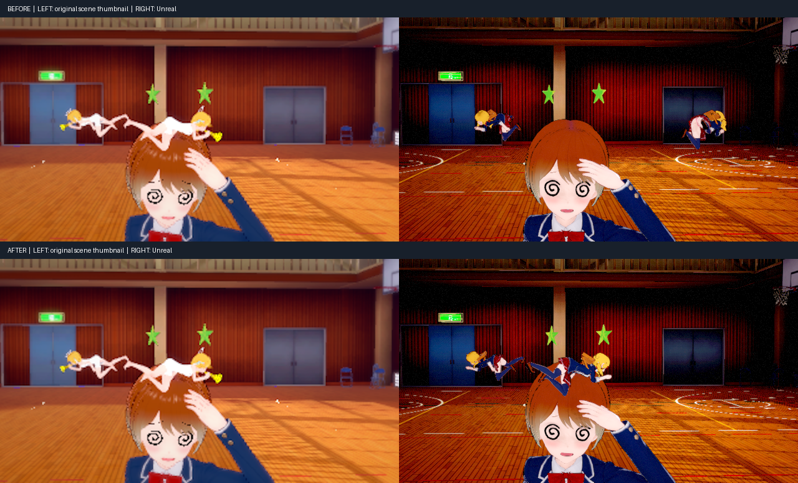

### S5：6331 手腕方向與固定頭部（2026-10-21）

來源手部 IK 的旋轉與 FIX 頸部資料原本沒有傳入。現在依來源手／腳目標保存旋轉，保留頸、頭局部四元數；固定模式可切回動畫再選回，身形重建也保留 FIX。沒有場景專用 offset，沒有修改相機或角色 root。

最新 Editor／Game 建置成功，418 Rust PASS，7 項 Automation Success；真實角色旋轉／位置／身形重建 oracle PASS。核心版本六項 Studio 自測 PASS，1268／6331 連續擷取 2/2，最後版本 6331 重拍 1/1。來源、版本與完整驗收見 [6331 圖文驗收](OK_STUDIO_SAVED_POSE_6331_20261021.md)。舊 .okscene 需重新匯入原作 PNG 取得新資料。

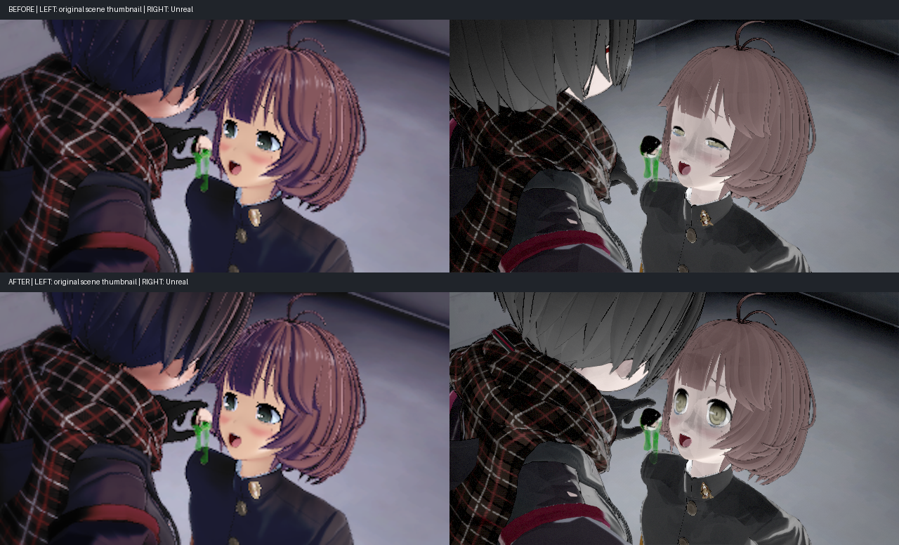

### S5：1268 天使服裝（2026-10-21）

`d1996aa6e`：Studio 的轉卡保留來源 Coordinate／Status／plugin 編號，依場景指定的服裝記錄資源，避免一般展示規則把白色浴巾與校服交換。非第0套也記錄依賴，錄製期間略過最終Session快取，正常載入快取保留。

實際來源／暖快取／非0套／closed reopen 與乾淨共用庫回歸見 [1268 服裝圖文驗收](OK_STUDIO_CLOTHES_1268_20261021.md)。舊場景及角色卡需重新匯入原作場景PNG。

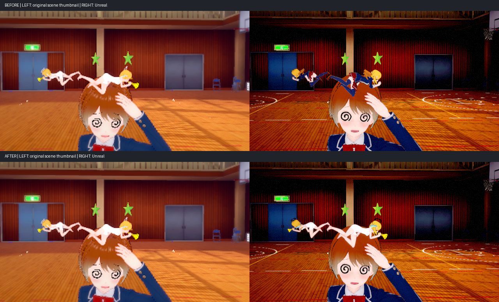

### S5：3800 鏡頭核對與頸部 FK（2026-10-21）

使用者回報鏡頭參數；來源及實際camera trace確認位置、含roll旋轉、vertical→horizontal FOV換算均正確。`304d10724` 修正保存FIX無條件覆蓋頸／頭FK：依原作Neck FK強制FIX停止追視的語義，逐骨保留明確FK，未接管骨頭仍套FIX，清除FK後自然接回。一般／live身形重建共用此規則。

來源與完整驗收見 [3800 圖文紀錄](OK_STUDIO_CAMERA_3800_20261021.md)。419 Rust PASS；3800真實骨架三條路徑與6331固定頸部／手腕回歸PASS；相機數值修正前後完全一致，3800／6331重拍2/2。

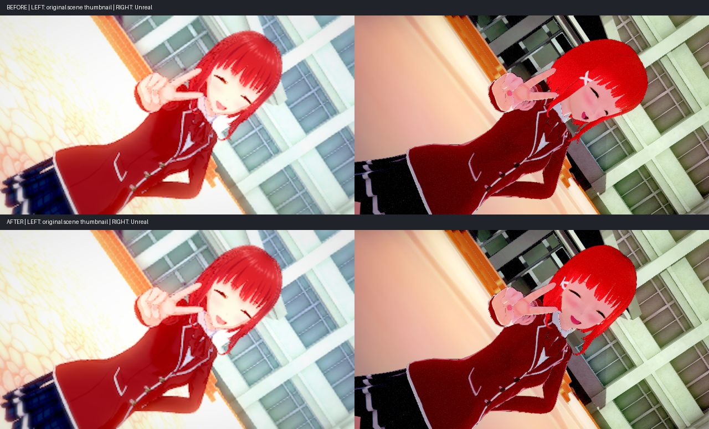


### S5：1901 舞台過亮與逐實例可見性（2026-10-21）

修正共用網格複製到停用接點時遺漏 GameObject.activeSelf／祖先 activeInHierarchy，以及地圖 Animator.m_IsActive 曲線。逐實例保存來源狀態，SunLightInfo 時段根另依既有時段政策切換；90個共用模型更新，session cache revision 18。沒有調暗曝光、停用 Bloom 或依場景／shader 名稱全隱藏。

來源1375個接點完整／純追蹤庫向量 MATCH；原卡與OK卡兩庫回歸 MATCH。實際圖與完整驗收見 [1901 燈光紀錄](OK_STUDIO_LIGHTING_1901_20261021.md)。

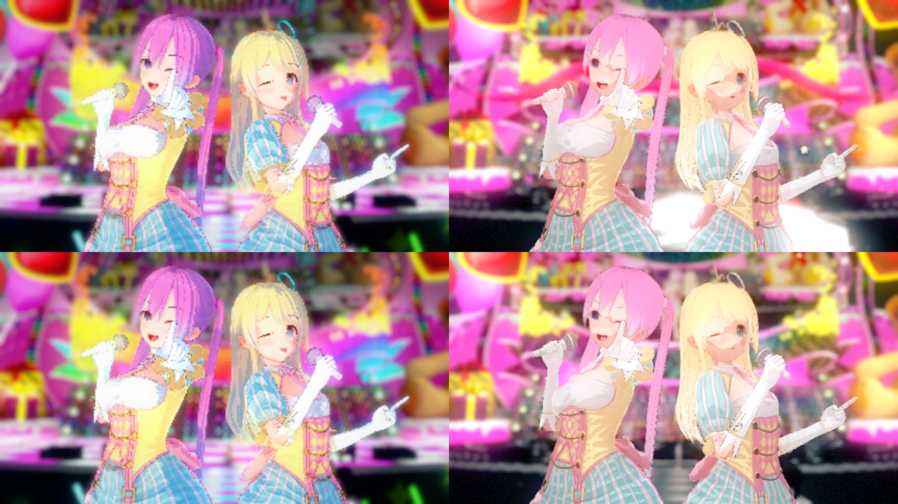


### S5：4432 裙擺與 Studio 動態時鐘（2026-10-21）

Studio 原先更新動畫時固定傳入零秒，固定相位擷取時更略過角色更新，使裙子動態無法隨 FK 腿部姿勢解算。現在每幀統一更新角色姿態與衣物動態，播放相位可獨立暫停，零速度與無播放器的靜態 FK 同樣適用；追視先準備目標，避免重複步進。

實際前後圖、來源語義及驗收見 [4432 裙擺圖文紀錄](OK_STUDIO_CLOTH_4432_20261021.md)。

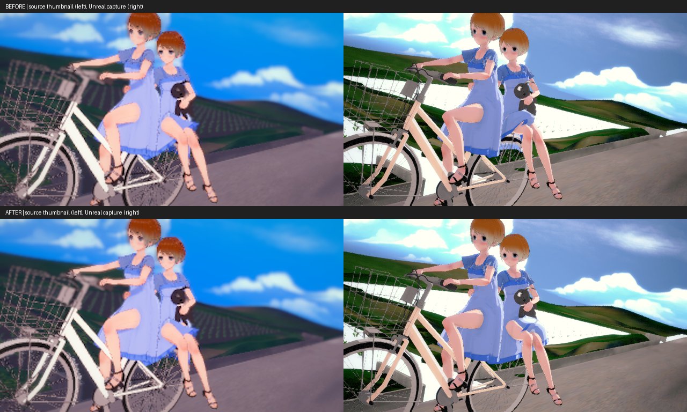


### S5：6964 虹膜與過黑陰影（2026-10-21）

虹膜的 Linear 來源旗標原本因先翻列、再比對 PNG bytes 而遺失，造成重複 sRGB 解碼；現在和眼白共用 bytes／列方向／color_space 的單次來源解析。原作 create_eye GPU RT 比對左右虹膜誤差由40.416/255降至0.084778/255，透明覆蓋差異0。另修正AO Tint錯誤再解碼（約0.53→0.24），以及場景shaderType遺漏；session cache revision19。

原作資料、前後實拍與驗收見 [6964 虹膜／陰影紀錄](OK_STUDIO_SHADING_6964_20261021.md)。沒有調曝光、關AO或針對場景染色。

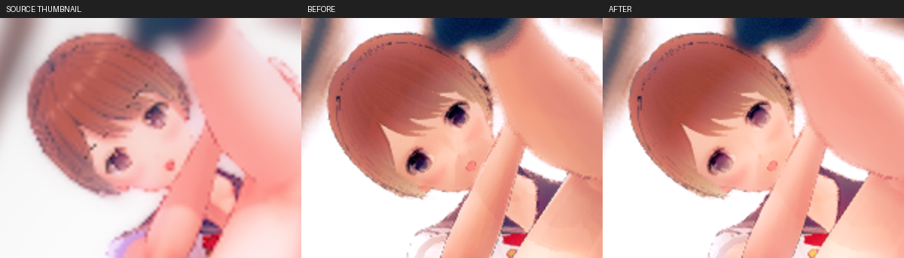
