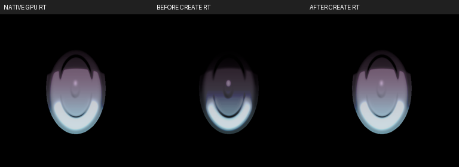

# 6964 虹膜與陰影修正（2026-10-21）

> 同日後續全場景盤點更正：下方第3點把Rust預設shader_type=0誤認為場景保存值。版本早於1.1.0.0其實沒有該欄位，原作沿用系統設定。後續改為保留缺省，詳見 [全場景盤點](OK_STUDIO_VISUAL_AUDIT_20261021.md)。本文件圖片與62項結果為該次版本的歷史證據；虹膜與AO的原作比對仍有效，不能據此宣稱所有shader差異已修復。

`koikatu_cs0006964` 的虹膜與環境遮蔽暗部已修正。這次修正來源資料與色彩轉換，保留來源的 AO、陰影色、相機、曝光與後製。

## 根因與通用修正

1. **虹膜 Linear 標記遺失。** 虹膜先改成 runtime 列方向，再以 PNG bytes 重新比對原始貼圖，兩者因翻列而不相等；原本 Linear 的 `cw_t_hitomi_010` 因此被當成 sRGB 再解碼，整個虹膜變暗。現在虹膜與眼白共用一次來源解析，將 bytes、列方向、color_space 一起傳遞，保留標記後才翻列及合成。未知來源的鬆散 PNG 仍保留既有 sRGB 預設，不借用同名 bundle 的標記；Session cache revision 提高至 19。
2. **AO Tint 多做一次 sRGB 解碼。** 原作 `AmplifyOcclusionBase` 將 Tint 送入 `_AO_Levels`；同版 `UnityEngine.Shader.SetGlobalColor` 直接呼叫 `SetGlobalVectorImpl`，不轉換數值。舊實作卻把約 0.53 轉成約 0.24，讓眼窩與接觸陰影過黑。現在直接傳入保存的 Tint，保留 AO 半徑及開關。
3. **場景 shaderType 遺漏。** 6964 保存 Koikatsu 模式 0，但遊戲 `system.xml` 是 Koikano 模式 1。新增可保存的場景 `ShaderType`，依原作 `ChaShader.ChangeShaderType` 映射 `_KanoVerShift`；未記錄的舊場景用 -1 保留卡片設定，不憑空猜測模式。

沒有場景編號、角色名稱或固定亮度補丁，沒有重染虹膜、調高曝光或關掉 AO。單獨補模式的中間圖仍偏暗；停用 AO 的圖只作隔離診斷，均不是最終交付。

## 原作虹膜驗收

原作探針載入場景內同一張角色卡，取得 `Koikano/create_eye` 的純合成 RT 及實際 renderer MainTex，兩者相同；直接讀取 mip0 與 PNG 也相同。修正前後 CLI 合成 PNG 的 CRC32 分別是 `2c987e6f`／`6f2425b5`，和正式 Unreal 載入 log 的對應輸入一致。

| 比較 | 修正前 RGB 平均誤差（0–255） | 修正後 | 透明覆蓋差異 |
|---|---:|---:|---:|
| 左虹膜有效區 | 40.416 | 0.084778 | 0 像素 |
| 右虹膜有效區 | 40.416 | 0.084778 | 0 像素 |

具名 `selected_iris_create_rt_matches_native` 已實際執行 1 PASS，要求兩個虹膜、RGB MAE < 2、透明覆蓋差異 < 32；本次實測遠低於門檻。這是合成貼圖比對，不等於整個場景逐像素相同。

## 共用庫與封裝

原卡 `kks-verify` 在完整庫及純追蹤庫皆 MATCH。以純追蹤庫轉出的 OK 卡，在兩庫的 `okcard-check ... live` 皆 1 MATCH／0 DIFFERENT，recorded／closed／live digest 同為 `4b4d95316822447d3922a3c66508fe5a`，`gaps=0`、`game_reads=0`。

第一輪用含私有模型的完整本機庫轉卡時，乾淨庫缺少 `cf_mnk_05_t` 查詢；依既有共用資源政策改用純追蹤庫轉換，讓卡內 pack 記錄該私有來源。沒有把私有模型提交進共用庫。最後 pack 51,111 bytes，CLI 容量規則 25.2% 通過；首輪容量拒絕及 DIFFERENT log 均保留。

## 驗收與範圍

420 項 Rust 測試 PASS／469 ignored；新增的具名原作虹膜 oracle 另跑 1 PASS。AO GPU 檢查確認原始 Tint binding、灰色 Tint 保留接觸陰影、白色 Tint 是中性乘色。

- 最後 Editor／Game Development 建置成功。
- 六項 Studio 自測全部 PASS（GameSelfTest、PatternTest、EyeSetTest、BloomTest、TransparencyTest、EditorSelfTest）；透明度測試含101張GPU證據圖。
- 最後 PostTest 六項檢查全部 PASS，含三項新增AO檢查。舊霧測試改驗實際受影響幾何像素，1736個像素紅升／綠降至少5；沒有修改霧正式公式。
- 七項 Studio／材質／陰影 Automation 全部 Success。
- 14／14 實際場景擷取、PNG尺寸／完整性及雜湊檢查通過，已檢視完整比較圖；1901舞台底部白光區域仍為0%。3800在完整序列中仍有先前既知的景深模糊，14／14不等於所有細節逐像素相同。
- 純追蹤庫665個LFS payload，共8,636,436,776 bytes逐一符合雜湊；617個模型均為追蹤檔，git status clean。
- 單獨重拍的修正前後camera trace完全一致。公開臉部after圖採完整14景最後一景的實拍；只有裁切、等比例放大與文字標示。
- 最終62項檢查全部PASS。

實拍來源、圖檔 SHA-256 與 PNG IEND 檢查見 [manifest](images/OKStudio/Shading6964_20261021/manifest.json)。錯誤與中間失敗見 `Docs/ERROR_LOG.md`。

舊 `.okscene` 未保存 shaderType 時，需重新匯入原作場景 PNG 才能取得原設定。來源縮圖與 Unreal 的解析度、景深、輪廓及部分髮色仍有差異；本次未宣稱所有渲染細節完全相同。

本機證據：`Saved/OKStudio/Verify-Shadow6964Before/`、`Verify-Shadow6964Iris/`、`Verify-Shadow6964FinalCompare/`、`Verify-Shadow6964FinalSelfTests/`、`Verify-Shadow6964PostFinal/`、`Verify-Shadow6964FinalAutomation/`、`6964-final-rust-suite.log`、`6964-iris-native-oracle-latest.log`、`6964-clean-cardcheck-final.log`、`6964-full-cardcheck-final.log`、`6964-clean-tracked-verification.json`、`6964-final-validation.json`，以及 `Saved/Tests/Shadow6964Native/` 的原作讀回。中間模式／AO單獨修正、容量拒絕、乾淨庫DIFFERENT與舊霧斷言失敗均保留，未列作最終成功結果。
