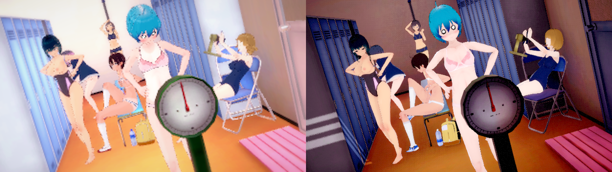
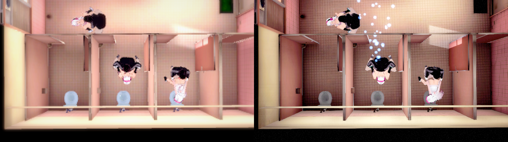
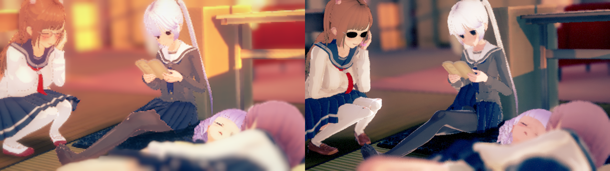

# Studio HDR 泛光來源移植（2026-10-20）

本輪修正共用的 HDR 泛光路徑，不使用場景名稱、物件名稱或單張圖片的亮度係數。原作縮圖與 Unreal 結果仍有角色、光照、景深與光暈差異；本報告只將已驗證的泛光運算與色彩設定列為完成。

## 來源與實作

核對安裝版 `CharaStudio_Data/level2`：Main Camera 的 HDR 為 true；BloomAndFlares 為 HDR Auto、Add、2 次模糊、useSrcAlphaAsMask=0、lensflares=false。再核對 `sharedassets2.assets` 的 Hidden/BrightPassFilterForBloom、Hidden/Blend、Hidden/SeparableBlurPlus DXBC：

| 步驟 | 實際來源契約 |
|---|---|
| 降採樣 | 每次四點、±0.5 input texel，先半解析度，再四分之一 |
| Bright-pass | 線性 HDR 的每個 RGB 通道分別 `max(c-threshold,0)`；沒有亮度加權門檻或 `1/(1-threshold)` 倍率 |
| 第一次模糊 | 垂直、水平各一次，spread=s |
| 第二次模糊 | 垂直、水平各一次，spread=1.5s |
| 九點核心 | 中心 0.225；±1 各 0.15，±2 各 0.11，±3 各 0.075，±6.5 各 0.0525；總和 1 |
| 偏移單位 | 依原作 `s/512` 的畫面高度比例；水平方向按實際長寬比換算 |
| 混合 | 原畫面＋Intensity×模糊結果，在後續景深前完成；不將 HDR 限幅到 1 |

[OKStudioBloom.cpp](../Plugins/OKStudio/Source/OKStudio/Private/OKStudioBloom.cpp) 用 UE UserSceneTexture 串接八個步驟，門檻按 PreExposure 換入相同空間。每組相機參數使用不可變的 MID 組合，快取只持弱參照；關閉效果會移除先前的八個步驟。原有負門檻「全部像素」擴充仍保留。

同時明確將 Studio 的 BlueCorrection 設為 0：UE 在 ToneCurveAmount=0 時仍會執行該色彩矩陣。這項設定不表示所有顯示色差已解決。

## 共用材質與 cook

八個父材質在 `/Game/OKStudio/Post/SourceBloom1/M_SourceBloom0`～`7`，已納入 AlwaysCook。一般遊戲直接載入保存的父材質，無須現場建立 Editor 材質圖；Editor 開發時仍可建立尚未烘出的圖。這是獨立的後製材質，不是新增 EKKRuntimeMaterialRecipe，因此沒有變更 StreetDisplay／HG 的配方清單。

`OKStudio.BakeBloom exit` 烘出版本化父材質，拒絕覆寫既有資產；改動圖時應使用新的 root 版本並同步 cook 設定。`ok.Studio.SourceBloom 0` 可切到保留的舊 UE 高斯近似作診斷，不能把該模式當作來源運算驗收。

可重跑的精確 cook：

```powershell
.\Tools\lua\lua.exe Tools/verify_ok_studio_bloom_cook.lua --tag <新名稱>
```

工具只指定八個 package，跳過無關的啟動套件，使用新的獨立輸出目錄；除 exit code 與錯誤訊息外，還會核對八個實際 cooked 檔案與 SHA-256。本輪 `Verify-CookBloom-SourceBloomFinal` 八個目標全數通過；`Verify-SourceBloomCookExact` 的 SM5／SM6 編譯亦成功，0 errors、0 warnings。單包 cook 驗證不等同完整應用打包驗收。

## GPU 檢查

[OKStudioBloomTest.cpp](../Plugins/OKStudio/Source/OKStudio/Private/OKStudioBloomTest.cpp) 使用已知 RGB 的無光照測試片、線性 HDR 浮點讀回，檢查逐通道門檻、常數場模糊、相機參數隔離與關閉回復。測試會先核對基準色，避免空場景／黑對黑被算成通過。

```powershell
.\Tools\lua\lua.exe Tools/verify_ok_studio.lua --tag <新名稱> --only BloomTest
```

最終 `Verify-SourceBloomHDRFinal` 通過。中心像素的線性讀回如下；預期值以實測基準色代入來源逐通道公式，容差 0.015：

| 情況 | 實測 RGB | 預期 RGB |
|---|---|---|
| 關閉 | 0.1010, 0.4004, 0.7051 | 基準 |
| 強度 0.25 | 0.1010, 0.4285, 0.8062 | 0.1010, 0.4255, 0.8063 |
| 強度 2 | 0.1010, 0.6060, **1.5117** | 0.1010, 0.6012, **1.5152** |
| 再次關閉 | 0.1010, 0.4004, 0.7051 | 回到基準，八個步驟已移除 |

兩個相機設定先後建立後，較弱設定仍保持 0.25 的結果。PNG 是 sRGB 顯示預覽；超過 1 的證據來自 HDR 浮點讀回，而非 PNG 的亮度。

| 關閉 | 強度 0.25 | 強度 2（顯示值已限幅） |
|---|---|---|
|  |  |  |

## 整體驗收

- Editor／一般遊戲 Development 均建置成功。
- `Verify-SourceBloomRelease`：GameSelfTest、PatternTest、EyeSetTest、BloomTest、EditorSelfTest 全 PASS；14／14 場景出圖及圖片驗證 PASS。
- 全部 14 張 PNG 的 SHA-256、尺寸、完整解碼與 Markdown 嵌圖連結另行核對通過。本輪擷取峰值 22.2 GB，最後卸載 12.0 GB，未宣稱回到啟動基準。
- 最後只加強 GPU 測試的 HDR 強度案例、修正說明註解，未改動已完成 14 張擷取所用的渲染程式；兩種目標重新建置成功，HDR 加強案例另行 PASS。
- 八個實際 cooked 目標與雜湊檢查 PASS。未執行完整應用打包／一般遊戲執行檔的現場遊玩驗收。
- 完整自動嵌圖報告、14 張圖、逐項 log 與記憶體數據保留本機 `Saved/OKStudio/Verify-SourceBloomRelease/`；HDR 加強數據在 `Verify-SourceBloomHDRFinal`，可重跑 cook 證據在 `Verify-CookBloom-SourceBloomFinal`。

## 實際畫面

每張對照圖左側為原作場景卡內的預覽縮圖，右側為本輪 Unreal 擷取，沒有另外調色或修圖。

### 1901：光暈仍有差異

舊泛光近似：


本輪來源泛光：


右下的光暈與角色明暗仍有差異；沒有因新泛光通過 GPU 檢查就把整張場景列為完全還原。

### 0010



### 0633



### 3167


