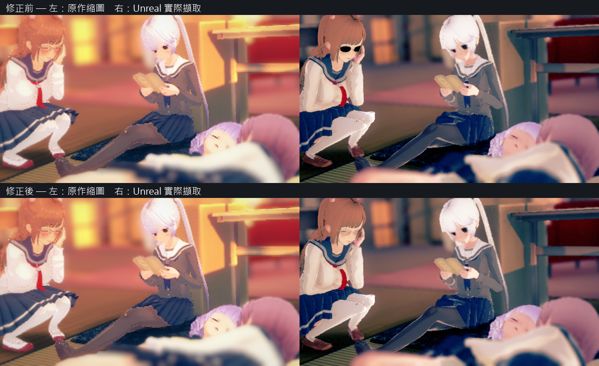

# 3167 眼鏡透明材質修正

驗收範圍：`koikatu_cs0003167` 的黑色實心鏡片、共用鏡片家族的透明混合，以及眼睛父材質的混合回歸。這份紀錄不宣稱場景色調與原作逐像素一致。

## 原因與修正

`KoikanoGlasses0`–`11` 未列入半透明配方。共用父材質產生器因此選擇遮罩並把原生 shader 的 alpha 改成 1，鏡片變成實心。依來源 Forward 的 `SrcAlpha / OneMinusSrcAlpha` 修正整個家族，從實心陰影代理分類移除，並以新版本產生 `StreetDisplay26`、`StudioDisplay26`、`StreetHG05`。

原生材質還曾讀到已預先套色的舊預覽 PNG，造成顏色／alpha 重複相乘。現在在套用預覽烘焙前保存未套色的原生 `_MainTex`；原生 draw 與舊預覽分開傳送及保存，並明確寫回卡片解析後的 `_Color4`。序列化快取版本提升到 17。空的原生 `_MainTex` 使用來源宣告的白色預設；MaterialEditor 貼圖覆寫仍保留。

GPU 驗收使用正式綁定器、已知不透明與常數 alpha 控制，以及和正式 Capture 相同的擷取預設。每個材質在前一影格提交，再於下一個 ticker 擷取，避免同一影格連續更換材質造成繪製資料尚未更新。

3167 的實際載入日誌確認 `_MainTex` 為白色 RGBA 255，而 `_Color4__A=0.197` 保留為獨立材質參數。修正後可以透過鏡片看到眼睛。

## 實際畫面

每一列左側為原作縮圖，右側為 Unreal 擷取。上列修正前，下列修正後。

原始擷取：[修正前](images/OKStudio/Transparency20261020/before.png)、[修正後](images/OKStudio/Transparency20261020/after.png)。圖片只有 PNG 像素，不含角色或場景資料。

## 驗收

新增 `OKStudio.TransparencyTest` 使用實際烘焙父材質，在兩個不同背景上量測透射率；原生 shader RGB 會相消，能直接檢查 GPU 是否保留 alpha 混合。12 個鏡片變體加上四個現行眼睛父材質，跨三個出貨根，共 48 組。單層預期透射率 .5；來源允許背面顯示的六個鏡片變體在薄盒 fixture 上有兩層，預期 .25，容差均為 .04。

| 項目 | 結果與本機紀錄 |
|---|---|
| GPU 真正混合 | `Saved/OKStudio/Verify-AlphaTrackedAcceptance/`：48 / 48 PASS；不透明控制約 .101，常數 alpha 控制透射率約 .494；101 張 PNG 保留在該輪 images/TransparencyTest |
| Rust 一般回歸 | `Saved/OKStudio/handoff_e/alpha-tracked-rust-suite.log`：417 PASS、461 ignored |
| 嚴格原作鏡片＋快取保存 | `alpha-rust-oracle-corrected.log`：2 PASS，`OK_NOCACHE=1`；原生白色 MainTex 與卡片 alpha 0.1254902 各自核對 |
| 材質／陰影 Automation | `Saved/OKStudio/Verify-AlphaAutomation/console.log`：GlassesBlend、StudioMdkCoverage、ShadowSubmit Coverage／FaceChannels／Mesh，五項 Success |
| 三個共用根 | `Saved/Crowd/RuntimeSharedMaterial-{StreetDisplay26,StudioDisplay26,StreetHG05}.json`：來源網格 shader permutations 通過；一般／HG 另完成眼睛 foreground 與淚材質 |
| 原卡：乾淨與完整基礎庫 | `alpha-{clean,full}-kks.log`：兩邊各五張 MATCH |
| OK 卡封閉／live 重開 | `alpha-{clean,full}-okcards.log`：兩邊各五張 MATCH，gaps=0、game_reads=0 |
| 完整本輪自測 | `Saved/OKStudio/Verify-AlphaTrackedAcceptance/`：GameSelfTest、PatternTest、EyeSetTest、BloomTest、TransparencyTest、EditorSelfTest，六項 PASS；自動 ACCEPTANCE.md 內嵌 13 張代表圖，JSON 記錄 101 張圖片的尺寸與 SHA-256 |
| 已提交版本的 Unity 建置 | `alpha-tracked-editor-build.log`、`alpha-tracked-game-build.log`：Editor／Development 遊戲均 Succeeded，包含 Module.OKStudio.cpp 分組編譯 |
| 最終 3167 擷取 | `Saved/OKStudio/Verify-Alpha3167Accepted/`：1 / 1 出圖，本文 after／comparison 使用該次結果 |
| 圖片驗收工具 | `Tools/test_ok_studio_evidence.lua`：16 PASS；三個 Lua 檔靜態檢查無問題 |

最終複驗日期：2026-10-21。實作提交 `df6fd755c`，附圖驗收工具提交 `84f9952b3`。獨立檢查再次完整解碼所有 101 張 PNG，核對 hash、IEND 結尾及 13 張 Markdown 嵌圖；六個測試程序皆退出 0。

推送前另合併遠端街頭規則提交 `eb42d766f`（合併 `d123057c1`）。`alpha-merged-editor-build.log`、`alpha-merged-game-build.log` 皆 Succeeded；`Saved/OKStudio/Verify-AlphaMergedFinal/` 再次通過 48 組 GPU 混合、101 張圖檔驗證與 13 張嵌圖。Studio 修正程式未因該次合併改動。

這些結果限於本輪透明材質修正，不代表全部原作場景完全還原。場景整體色調、明暗與景深仍有既有差異。
