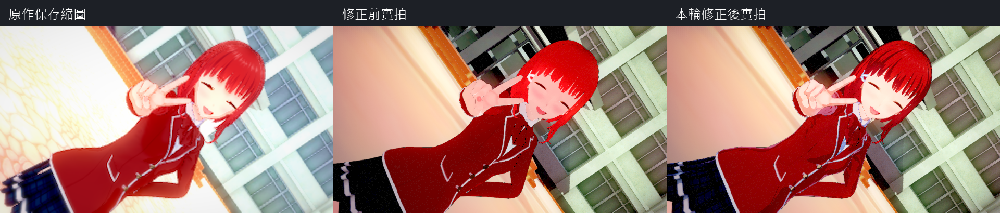
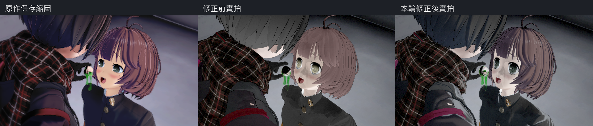
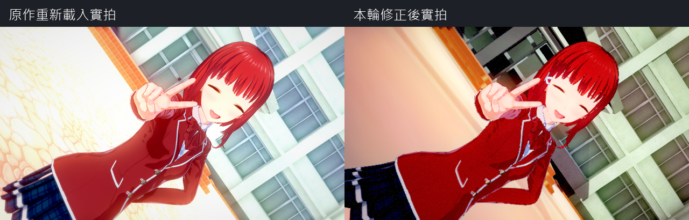

# Studio 全樣本畫面問題盤點（2026-10-21）

本輪先盤點再修正。範圍是目前共用庫 `studio/samples` 的全部 **14** 張樣本，並非原遊戲所有外部場景。基準為 `e93f97819766c5208ae04b5a1f940faf75c63d43`，實拍使用 `Saved/OKStudio/Verify-Shadow6964FinalCompare/images/`；該輪程式標記為前次修正尚未提交時的 `45cbc186d+worktree`。原作側是場景內預覽縮圖，最終 shader 根因仍須原作 runtime／反編譯程式核對。

## 原遊戲全目錄結構盤點

已另對 `D:/KoikatuSunshine/UserData/Studio/scene` 遞迴執行 `scene-stats`。7,694張PNG中，38張是先前匯出的角色卡／背景等衍生圖片；真正場景7,656張，7,652張解析成功且讀到主相機。合計45,747個角色、4,224,064個道具、1,485盞燈、944,078個資料夾、1,195條路線、3,072個相機物件。885個道具引用不在共用道具清單，需個別核對mod，不等於已確認缺件。

| 原作場景 | 結構問題 | 狀態 |
|---|---|---|
| 0001370 | 第3個物件讀取截斷，offset 1,712,593 | 保留失敗，未列為可載入 |
| 0001378 | 第2個物件讀取截斷，offset 901,697 | 保留失敗，未列為可載入 |
| 0002050 | 第0個物件讀取截斷，offset 399,015 | 保留失敗，未列為可載入 |
| 0005566 | 物件樹超過1,024層保護限制 | 需核對來源，未直接放寬限制 |

完整本機紀錄：`Saved/OKStudio/VisualAudit20261021/all-source-scene-stats.log`。這是全目錄結構檢查，**不是7,652張畫面的逐圖視覺驗收**。以下14張是目前完整目視比較的共用樣本。

載入成功、測試通過與畫面吻合分開紀錄。之前的 14/14 只證明出圖成功，不能排除以下問題。以下均為已檢視圖片的觀察，不先認定單一根因。

| 場景 | 尚存畫面差異 | 處理方向／優先度 |
|---|---|---|
| 0000001 | 天空與光束亮部過度偏黃／偏白；機體明暗及光暈不同 | 後製與材質照明，P1 |
| 0000010 | 室內牆面、窗簾明顯較暗，人物與背景的明暗關係不同；頭髮缺來源高光層次 | 共用光照／髮材質，P1 |
| 0000059 | 整體藍紫色、頭髮亮度與輪廓不同；既有狀態貼層需求另列，不視為已完成 | 共用材質／狀態支援邊界，P2 |
| 0000633 | 隔間與牆面較暗、材質對比不同；粒子可見數與位置不同 | 地圖照明／動畫相位，P1 |
| 0001268 | 天使角度及白色服裝已修；體育館背景較暗、地板高反差及高光不同 | 地圖材質／後製，P1 |
| 0001901 | 過亮白塊已修；人物偏淡、頭髮高光與服裝層次不同，背景模糊與光暈仍不同 | 人物材質／後製，P1 |
| 0002534 | 道具來源偏平面色塊，現況呈連續立體明暗；背景有漸層差異 | 道具 shader／背景，P2 |
| 0003167 | 透明鏡片已修；原作偏暖且較亮，現況偏冷暗，頭髮及衣物明暗不同 | 共用光照與色調，P1 |
| 0003800 | 使用者確認原作較亮且紅髮有光澤；全序列實拍另有嚴重景深模糊，無法可靠比較髮絲 | 優先分離景深／shader／照明，P0 |
| 0004432 | 裙擺動態已修；天空、雲、草地與道路色調明顯不同，人物髮色及高光仍不同 | 天空／地圖／人物 shader，P1 |
| 0005065 | 原作有霧化、低對比，現況樹葉與房屋更硬、更飽和，人物也較亮 | 霧／地圖照明及材質，P1 |
| 0005698 | 原作黑色背景變成藍色；樓梯明暗及輪廓不同 | 清屏色／背景還原、道具 shader，P1 |
| 0006331 | 使用者確認 shader 不同；男性頭髮由藍黑變灰黑、女性粉紫髮偏灰棕，髮絲高光不足；眼睛與表情外觀仍不同，衣服照明偏硬 | 優先核對來源 shader、實際參數、貼圖及場景全域值，P0 |
| 0006964 | 虹膜與 AO 過黑已修；仍有髮絲光澤、局部明暗、輪廓及景深差異 | 共用髮材質／後製，P1 |

## 根因調查與執行順序

1. 3800／6331 使用同一套角色渲染流程，先擷取實際材質配方、卡片解算後顏色／光澤、shader globals、光源與貼圖取樣旗標；和 `D:/KoikatuSunshine/kks_decomp/Managed/CharaStudio_Data` 核對。
2. 同時比較 3800 單獨載入與連續切場景，查明景深是否有狀態洩漏或來源參數映射錯誤。不得以永久關景深或改相機掩蓋。
3. 依已證實的共用根因修正，再重拍 14 景。每項保留修正前後圖、數值依據及未解差異。
4. 角色輪廓、表情、地圖、天空與背景若屬不同根因，各自列項；不能因共用 shader 測試通過就自動結案。

## 已證實並修正的共用根因

- **切場景狀態殘留**：匯入只清Objects，未重設Post等文件狀態。3800的depth_aperture=0略過啟用分支，仍沿用前景的景深。單獨載入清晰，連續載入模糊。已在來源解析成功後重設後製、地圖變換、時間軸與時鐘；加入全新／污染文件等價測試。
- **舊場景假造shader模式0**：原作SceneInfo只在版本≥1.1.0.0讀取shaderType，其餘沿用GraphicData設定。Rust原先用Default的0輸出，UE強制覆寫成0。3800原作直接載入後_KanoVerShift=1，且與原作預覽髮絲光澤相符。解析改為Option，缺省不輸出；明確保存0仍有效。這更正前輪6964對來源模式的判斷。
- 已新增可重用的原作整場景讀回探針（`OK_PROBE_STUDIO_SCENE`），記錄實際shader／keyword／卡片顏色／光澤／取樣ST／全域值／相機與DOF，並直接從原作camera擷取畫面。原作程式參考為使用者提供的CharaStudio反編譯目錄。
- **Gallery展示設定污染Studio材質**：`CharacterDisplay.EnableShadows=False`使Studio角色來源陰影色被改白。新增host專用照明覆寫；實際13個髮材質的陰影色與來源轉換結果最大誤差0，GameSelfTest PASS。保留Gallery原設定。
- **髮絲UV通道**：修正骨架／程序顯示路徑的UV1對應，共用parent與舊預覽均取得需要的座標。該修正對3800主畫面影響很小，不視為已完整解決光澤。原作光澤PNG對正式Session輸入RGB MAE=0.008689/255，最大6/255，排除貼圖選擇與任意提高亮度的修補。
- **角色燈的階層與固定旋轉遺漏**：`CameraLightCtrl.LightCalc.Reflect`旋轉場景根`Light Chara`，其`Directional Chara`子物件保留原生Euler(40,180,0)。舊匯入器把它掛在相機下且漏掉子旋轉。改為來源root*child與world-root。3800原作GPU光向(-0.30333951,0.19080923,-0.93358290)與新runtime相同；實際光源RGB=1.0445286，強度HDR轉換相符。相機旋轉不再帶動這盞來源燈。
- **每張地圖的環境光遺漏**：新增`studio-environments`轉換全部72筆原生地圖的RenderSettings.m_AmbientProbe，保留27係數。地圖20／33對原作27係數各最大誤差8.21e-10／1.01e-9；runtime依地圖提供SHAr/g/b，顯式天空仍走既有天空流程。同步修正共用Vector更新漏送float4的__A scalar。資料已列NonUFS，無角色或私有mod模型。
- 3800高光恢復，但3800／6331最新重拍仍未達到原作的完整材質外觀，**髮絲層次與整體亮度還原保持未完成**。仍需查高階SH、頂點varying及其他shader運算。原作6331直接載入的camera擷取也和保存縮圖不同，不將那張圖當作構圖金標；其實際shader全域／材質值仍可用於查證。

## 本輪實拍與驗收

3800 的髮絲高光已恢復，序列景深殘留已修正；建物亮度／陰影與原作保存縮圖仍有差異。6331 的來源光向、環境光、髮色／陰影參數已接回，實拍仍有灰棕髮色、臉部明暗、表情及服裝材質差異，保留為未完成。上表記錄修正前問題，不能把其中每一列自動改為已修復。







三張圖均為真實輸出，只裁切、等比例縮放、排列及加標籤；沒有生成或重繪畫面。來源與輸出SHA-256、尺寸、PNG IEND無附加資料檢查見[manifest](images/OKStudio/VisualAudit20261021/manifest.json)。原作保存縮圖與重新載入的實際畫面可能不同，6331尤為明顯；不能拿縮圖顏色直接寫入場景專用補償。

- Editor／Game Development 整合建置成功。
- Rust完整單執行緒測試420 PASS／0 FAIL／472 ignored；預設並行的兩項失敗與獨立重跑結果另保留，見ERROR_LOG。
- 原作地圖20／33各27係數oracle PASS；原作髮光澤輸入oracle PASS；14樣本shader模式欄位存在性oracle PASS。
- 最終3800／6331同程序出圖2／2；13個實際髮材質陰影色與來源轉換誤差0；GameSelfTest含匯入狀態重設、原生光向、相機獨立性、地圖SH與float4同步檢查PASS。

最終採`1415af233`程式版本（已合併遠端街頭更新），重新驗收結果：

- 六項Studio自測全部PASS，透明度包含101張GPU證據圖；新檢查證實道具採4×4共用中性depth，角色保留原生材質陰影。
- 七項Studio／材質／陰影Automation全部Success。
- 全14景重新擷取、PNG完整解碼／尺寸／SHA-256檢查PASS；已檢視14景比較圖。峰值20.6GB，最後場景釋放後12.7GB，不宣稱回到啟動基準。
- 中間4432的每道具角色陰影RT配置已修正，同景從50.0GB降到10.9GB；失敗的中間輪不計入最終通過。
- 3800最終實際材質的七組向量對原作GPU常數核對PASS：燈色、SHAr/g/b、底色及陰影色誤差0，光向最大誤差2.38e-7，獨立alpha scalar全部同步。
- 原卡在完整庫／純追蹤庫的`kks-verify`均MATCH；OK卡在兩庫的closed／live均1 MATCH／0 DIFFERENT，`gaps=0`、`game_reads=0`。乾淨clone同步程式版本，665個LFS payload共8,636,436,776 bytes逐一SHA核對，617個模型皆tracked，新增環境光JSON及來源blob核對，最後git status clean。

最終本機圖文驗收：`Saved/OKStudio/Verify-VisualAuditAcceptedAll/ACCEPTANCE.md`（完整14圖）、`Verify-VisualAuditAcceptedSelfTests/ACCEPTANCE.md`、`Verify-VisualAuditAcceptedAutomation/Automation.log`。其他原作探針／數值／建置／Rust與乾淨庫證據位於`Saved/OKStudio/VisualAudit20261021/`及`Saved/Tests/VisualAuditNativeFinal/`。這些是本輪實跑結果，不沿用前輪62項數字；本輪完成盤點與上述共用修正，**並未把所有畫面差異列為已修復**。

## 可重現工具與保存契約

```text
Tools/ok-extract/target/release/ok-extract.exe D:/KoikatuSunshine --oklib studio-environments Content/IndependentResources/base_v1
Tools/lua/lua.exe Tools/GamePoseProbe/build.lua
cargo build --release --manifest-path Tools/shader_probe/Cargo.toml
Tools/lua/lua.exe Tools/GamePoseProbe/run_scene_visual_audit.lua --tag NativeAuditFresh --scenes <原作場景.png> --gpu-probe Tools/shader_probe/target/release/ok_shader_probe.dll --mesh cf_hair_b_17_00
Tools/lua/lua.exe Tools/verify_ok_studio.lua --engine E:/PhysX/UE5.8 --tag AuditFresh --compare --editor
```

原作探針擷取後移除，只結束自己啟動的程序；遇既有Studio或既有probe則拒絕操作。GPU探針用途與欄位解讀見`Tools/shader_probe/README.md`。共用地圖環境光JSON已加入NonUFS依賴，原始角色卡、含角色場景與私人mod模型均不提交。

舊`.okscene`保存的是先前的相機子燈階層與shader模式覆寫，需重新匯入原作PNG取得本輪正確資料；不對使用者自製場景猜測遷移，也不要求刪除全域快取。尚待還原的高階SH／頂點varying、反射、地圖shader、後製及表情列入後續問題，不能以本輪輸入值吻合當成完整shader逐像素吻合。

後續可重現的小差異：原作`ChaFileHair.PartsInfo.GlossInitColor`為`Color32(217,217,217,255)`，Rust缺省仍為`0.8490566`；3800實際`_GlossColor`線性值分別為`0.693871915`與`0.690340936`。這項來源缺省差異尚未修改，也不能用它解釋整個6331的灰棕髮色。前述GPU吻合特指已列出的燈色／光向／SHAr/g/b／底色／陰影色，不代表所有uniform都一致。


## 後續實作：原生高階環境光、反射與來源顏色

詳見 [本輪圖文驗收](OK_STUDIO_NATIVE_AMBIENT_20261021.md)：27係數／原作vertex插值、Standard間接光、HDR map sun、無損default及局部probe、髮gloss與臉部overlay通道均有來源oracle。最新421 Rust、6 Studio、8 Automation與14景實拍通過；6331色調／表情等差異仍未結案，原逐景表保留為後續清單。


## 後續實作：無地圖背景與零環境

[最新圖文驗收](OK_STUDIO_EMPTY_ENVIRONMENT_20261021.md)修正5698固定藍色背景，改從原作Est設定讀色並保存；無map／sky時使用原生零SH，包含道具。6Studio／9Automation及14景實拍通過。2534當前原作重載也為黑色，歷史縮圖藍色來自未存於SceneInfo的安裝設定，不加單景補償。原逐景表的其他材質、後製與表情差異仍保留。
