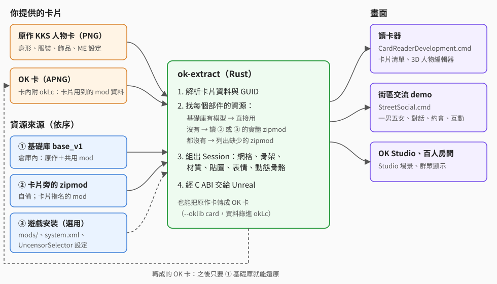
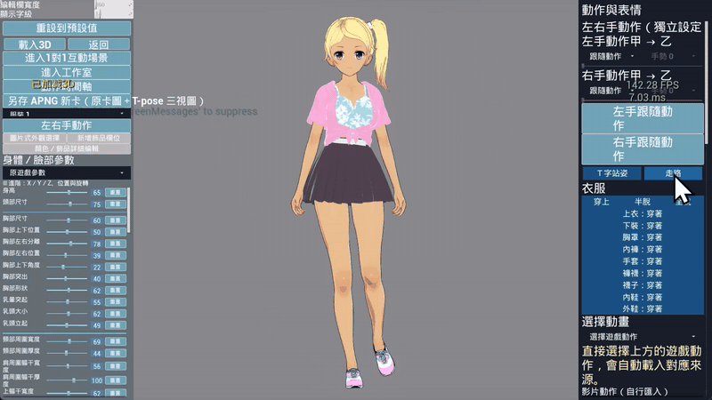
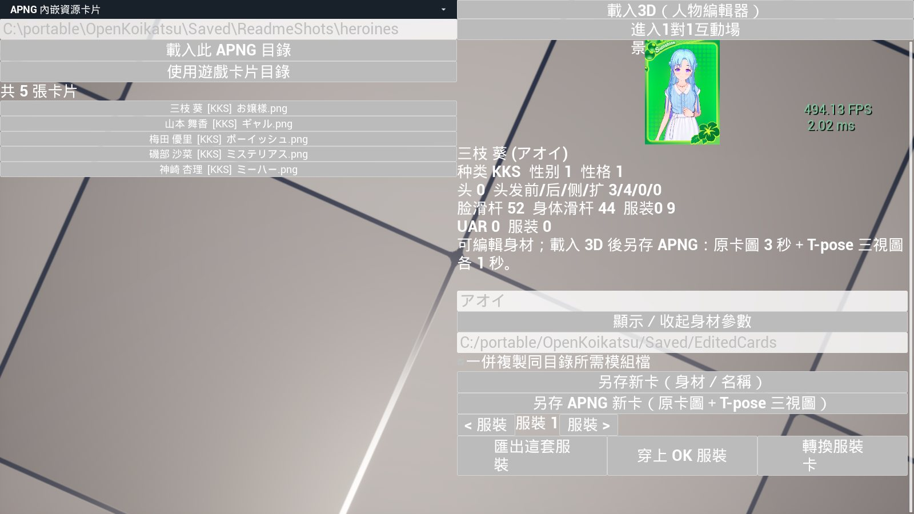
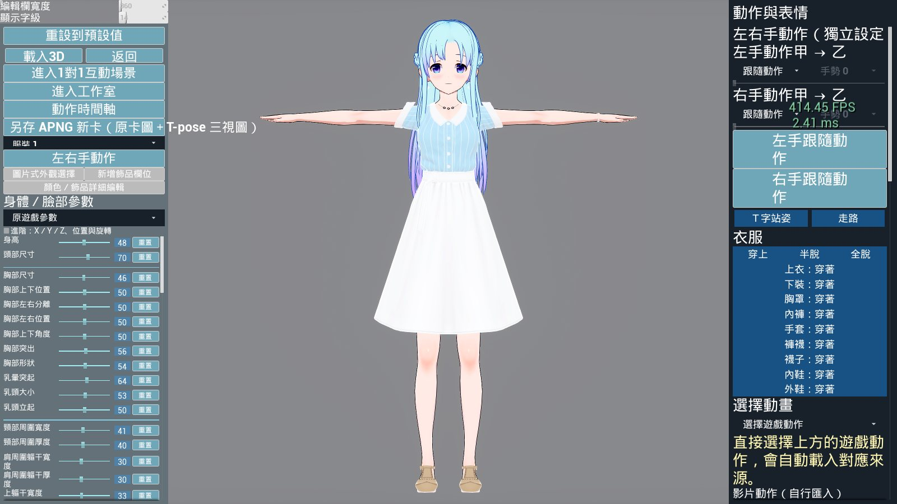
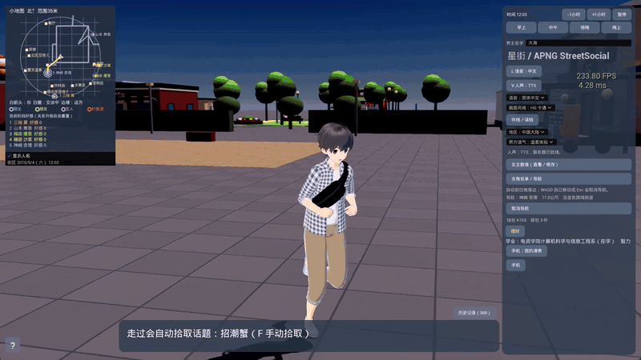
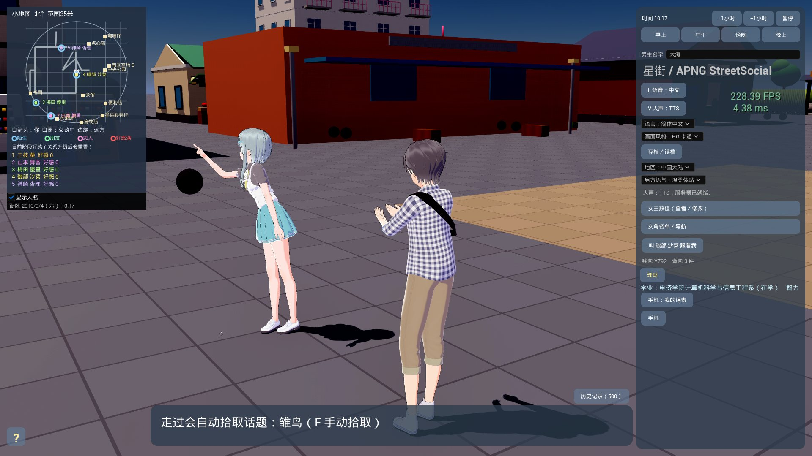
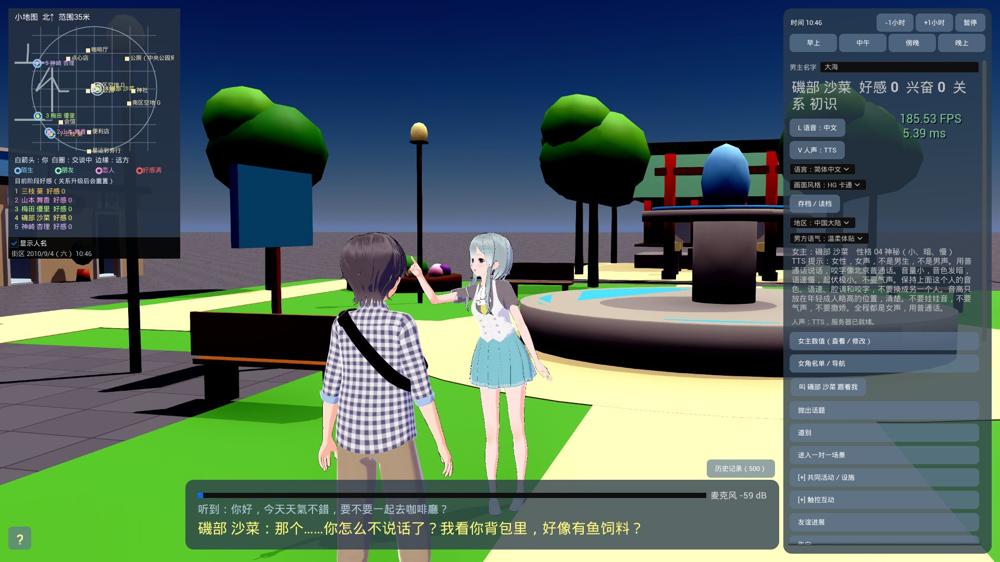
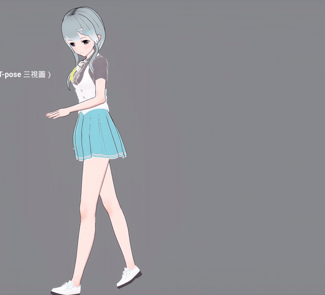

# OpenKoikatsu

歡迎加入 QQ 群 **1127259437** 討論。

用 **Unreal Engine 5.8、C++ 與 Rust** 做的非官方 Koikatsu Sunshine 人物卡 3D 工具：讀取 KKS 人物卡，依卡片組出 3D 角色，還原身形、服裝、材質、表情、動畫與動態骨骼。

## 能做到的事

- **讀卡並顯示 3D 角色**：身體、頭部、頭髮、衣服、飾品、ABMX、UncensorSelector、Material Editor 等卡片資料。
- **OK 卡**：把原作卡轉成自帶資源的 APNG 卡，之後不需要遊戲與 zipmod 也能還原人物。
- **卡片牆與人物預覽**：選卡、換服裝、播動畫，96 個身形／臉部滑桿，眨眼、視線、嘴型。
- **動畫**：遊戲動畫目錄、Animator 取樣、多層動畫與 CrossFade。
- **影片動作（動補）**：把真人影片轉成角色動作。
- **OK Studio**：匯入 Studio 場景卡，含道具、地圖、天空與燈光。
- **示範場景**：街區交流 demo（`StreetSocial.cmd`）、百人房間（`CrowdRoom100.cmd`）、白色油漆水槍。
- **人物編輯 MCP**：讓外部 AI 查詢與調整角色參數並拍三視圖。

尚未完成：完整捏人存檔、完整 Studio 場景編輯、所有卡片與 mod 的完整相容。

## 倉庫裡有什麼

**本專案不含任何角色卡**：沒有原作卡、OK 卡，也沒有 Studio 場景裡的角色。要顯示角色，請用你自己的卡片。

倉庫只有程式碼與**共用資源**：原作轉出的模型、UncensorSelector 身體、全域 mod（修正、陰影 ramp、Material Editor shader 等，清單在 [`Tools/base_library_shared_mods.txt`](Tools/base_library_shared_mods.txt)）。其他第三方 mod 也不在倉庫內，卡片需要時請自備 zipmod。大型檔案用 Git LFS。

## 怎麼讀角色卡



1. 讀取人物卡（原作 PNG 或 OK 卡 APNG）裡的身形、服裝、飾品、Material Editor 等資料，以及卡片指名的 mod GUID。
2. 每個部件依序找資源：倉庫內的基礎庫有就直接用；沒有就讀卡片旁的 zipmod 或遊戲 `mods/` 裡的實體檔；都找不到就列出缺少哪些 zipmod。
3. Rust（`Tools/ok-extract`）組出網格、骨架、材質、貼圖、表情與動態骨骼，經 C ABI 交給 Unreal 顯示。
4. 原作卡可以轉成 OK 卡：卡片用到的 mod 資料錄進卡內，之後只要基礎庫就能還原。

## CardReaderDevelopment.cmd：讀卡器

在 Unreal 裡開啟讀卡器（`UnrealEditor -game`）。左側是卡片清單，選卡後顯示卡片資料；按「載入 3D（人物編輯器）」組出 3D 角色，可調身體與臉部滑桿、換服裝與穿脫、播放遊戲動作、另存新卡或 APNG 卡。



完整短片：[card-reader-demo.mp4](Docs/videos/card-reader-demo.mp4)（19 秒，無聲）





```powershell
.\CardReaderDevelopment.cmd -CardDirectory <OK 卡資料夾>
```

`-CardDirectory ""` 改用 `Config/DefaultGame.ini` 設定的遊戲卡片目錄。第一次啟動若引擎與專案建置不符，會先重新建置 `OpenKoikatsuEditor`。

## StreetSocial.cmd：街區交流 demo

獨立製作的一男五女街區：在街上走動、靠近女角按 E 用文字或語音自由對話（AI 依角色性格回應，TTS 配音），還有好感度、約定、手機、一起吃飯購物、觸碰互動與一對一場景。



完整短片：[street-social-demo.mp4](Docs/videos/street-social-demo.mp4)（33 秒，無聲；對話以字幕顯示）





```powershell
.\StreetSocial.cmd -SelectionFile <女角清單.json>
```

`<女角清單.json>` 列出五張 OK 卡：`{"cards": ["D:/cards/a.png", "D:/cards/b.png", ...]}`；`-MaleCard <png>` 指定男主角。啟動的是 `Saved/StreetSocial/Build/` 裡最新打包的版本，打包方式見 [AGENTS.md](AGENTS.md)。

## 影片動作（動補）

把一段真人影片轉成角色動作（`.okanim`），在讀卡器的「影片動作（自行匯入）」選單播放。轉換由 `Tools/ok-video`（Rust、CUDA）完成，會自動修復並逐幀驗證，詳見 [影片動作](Docs/VIDEO_MOTION.md)。



完整短片：[video-motion-tennis.mp4](Docs/videos/video-motion-tennis.mp4)（13 秒，無聲）

倉庫只附一個示範動作「網球示範」（`Content/IndependentResources/VideoMotionDemos/`，讀卡器啟動時自動複製到 `Saved/VideoMotions/`）；原始影片與其他自行轉出的動作（含雙人影片的動作）不在倉庫內。

```powershell
.\Tools\ok-video\target\release\ok-video.exe import <影片.mp4> --name <動作名稱> -s
```

以上截圖與短片使用 Koikatsu Sunshine 原作內建的預設角色（`DefaultData/chara/female` 的お嬢様、ギャル、ボーイッシュ、ミステリアス、ミーハー）在本機轉成的 OK 卡；這些卡片不在倉庫內。

## 匯入角色

| 你有的東西 | 怎麼用 |
|---|---|
| 遊戲安裝 | 在 `Config/DefaultGame.ini` 的 `[/Script/KKSideloader.KKGameRoot]` 設 `Root=<遊戲目錄>`，卡片需要的 mod 從遊戲 `mods/` 讀 |
| 原作卡＋zipmod | 把卡片需要的 zipmod 放在卡片旁邊；缺的 zipmod 會列出來 |
| 只有原作卡 | 卡片只用原作與共用資源時可完整還原 |
| OK 卡 | 直接開，不需要遊戲與 zipmod |

轉成 OK 卡：`Tools\ok-extract\target\release\ok-extract.exe <遊戲目錄> --oklib card Content\IndependentResources\base_v1 <原作卡.png> <輸出.png>`（沒有遊戲時，遊戲目錄給一個不存在的路徑，zipmod 放在卡片旁邊）。

## 建置

### 需求

| 項目 | 說明 |
|---|---|
| 作業系統 | Windows x64 |
| Unreal Engine | 5.8.4 原始碼版，[`UE5.8-physX-5.11-ok`](https://github.com/damody2026/UnrealEngineOK/tree/UE5.8-physX-5.11-ok) 分支（GameWorks Flex／PhysX 5.11），並套用 [`Tools/EnginePatches/README.md`](Tools/EnginePatches/README.md) 列出的補丁；`OpenKoikatsu.Build.cs` 會檢查補丁是否存在 |
| Visual Studio 2022 | 「使用 C++ 的遊戲開發」與 Windows SDK |
| Rust | stable，MSVC 工具鏈（`cargo` 在 PATH 或 `%USERPROFILE%\.cargo\bin`） |
| Git LFS | 共用資源是 LFS 檔案 |
| CUDA 12.8 以上（選用） | 影片動作轉換（`Tools/ok-video`）與語音（`Tools/ok-tts`、`Tools/ok-asr`）需要 |

### 步驟

1. 取得專案：

   ```powershell
   git lfs install
   git clone https://github.com/damody2026/OpenKoikatsu.git
   cd OpenKoikatsu
   ```

2. 取得並建置引擎 [damody2026/UnrealEngineOK](https://github.com/damody2026/UnrealEngineOK/tree/UE5.8-physX-5.11-ok) 的 `UE5.8-physX-5.11-ok` 分支：

   ```powershell
   git clone -b UE5.8-physX-5.11-ok --single-branch https://github.com/damody2026/UnrealEngineOK.git D:\PhysX\UE5.8
   ```

   > **看不到這個網址（顯示 404）？** Unreal Engine 原始碼只開放給已綁定 Epic Games 帳號的 GitHub 使用者。請先到 [Epic Games 帳號的「應用程式與帳號」](https://www.epicgames.com/account/connections) 連結你的 GitHub 帳號，再到 GitHub 接受 [EpicGames](https://github.com/EpicGames) 組織的邀請，之後就能看到。詳見 [Unreal Engine on GitHub](https://www.unrealengine.com/ue-on-github)。

   之後照 UE 的說明執行 `Setup.bat`、`GenerateProjectFiles.bat` 並建置 `UnrealEditor`。

3. 指定引擎位置：建立 `Tools\engine.local.json`（不進版控），或設環境變數 `OK_ENGINE_ROOT`。

   ```json
   {"engine": "D:/PhysX/UE5.8"}
   ```

4. `OpenKoikatsu.uproject` 啟用了本機的商用 Editor 外掛 `BpGeneratorUltimate`（不在倉庫內）。沒有這個外掛時，把 `.uproject` 裡它的 `"Enabled"` 改成 `false`。

5. 建置 Editor（Rust 函式庫 `Tools/ok-extract` 會由建置前步驟自動編譯）：

   ```powershell
   & '<UE5.8>\Engine\Build\BatchFiles\Build.bat' OpenKoikatsuEditor Win64 Development "-project=$PWD\OpenKoikatsu.uproject" -waitmutex
   ```

6. 執行讀卡器：`.\CardReaderDevelopment.cmd -CardDirectory <OK 卡資料夾>`。要讀原作卡時，在 `Config/DefaultGame.ini` 設定遊戲目錄：

   ```ini
   [/Script/KKSideloader.KKGameRoot]
   Root=D:/KoikatuSunshine
   ```

7. 街區交流 demo（選用）：
   - 遊戲規則 `Tools/ok-rules` 由 `StreetSocial.cmd` 啟動時自動 `cargo build --release`；女角的 AI 對話邏輯另外編譯：`cargo build --release --manifest-path .\Tools\ok-mind\Cargo.toml`。
   - 打包成可執行的版本：`.\Tools\lua\lua.exe Tools\rebuild_street_social_runtime.lua --tag <名稱>`（流程見 [AGENTS.md](AGENTS.md)）。
   - 設定 DeepSeek API key（見下一節）。
   - 語音（選用）：`Tools/ok-tts`（Qwen3-TTS，模型路徑 `OK_TTS_MODEL`）與 `Tools/ok-asr`（Qwen3-ASR，模型路徑 `OK_ASR_MODEL`）各自 `cargo build --release`，放到 `Build/ok-tts/`、`Build/ok-asr/`，見 [語音](Docs/STREET_SOCIAL_TTS_VOICE.md)。沒有語音伺服器時改用內建語音、沒有語音輸入。

8. 影片動作轉換（選用）：`.\Tools\ok-video\cargo-cuda.cmd build --release`。需要 GVHMR 的模型檔（只能非商業使用，不隨專案散布），放置位置見 [影片動作](Docs/VIDEO_MOTION.md)。

## DeepSeek API key（街區 demo 的 AI 對話）

街區 demo 的女角用 DeepSeek 產生對話，需要你自己的 API key（在 [DeepSeek 開放平台](https://platform.deepseek.com/) 申請）。沒有 key 時，遊戲會在對話時提示「尚未設定 DeepSeek 金鑰」。

設定方式擇一：

- **環境變數**（優先）：

  ```powershell
  setx DEEPSEEK_API_KEY "<你的 key>"
  ```

- **設定檔** `Saved/StreetSocial/deepseek.json`：

  ```json
  {
    "api_key": "<你的 key>",
    "endpoint": "https://api.deepseek.com/chat/completions",
    "model": "deepseek-v4-flash"
  }
  ```

  `endpoint`、`model` 可省略，預設就是上面的值。遊戲會把這份設定備份到 `%LOCALAPPDATA%\OpenKoikatsu\deepseek.json`，清空 `Saved/` 後也能沿用；要用別的位置時設環境變數 `OK_FREE_TALK_SETTINGS=<檔案路徑>`。

讀取順序：環境變數 `DEEPSEEK_API_KEY` → `OK_FREE_TALK_SETTINGS` 指定的檔案 → `Saved/StreetSocial/deepseek.json` → `%LOCALAPPDATA%\OpenKoikatsu\deepseek.json`。`deepseek.json` 已列入 `.gitignore`，**不要把 key 提交到倉庫**。

## 授權

程式碼採 [MIT License](LICENSE)。原作與第三方 mod 的資源不在授權範圍內，請只使用自己合法取得的遊戲與 mod。

開發與架構說明（給開發者與 AI agent）：[AGENTS.md](AGENTS.md)；各項專題文件在 `Docs/`。
